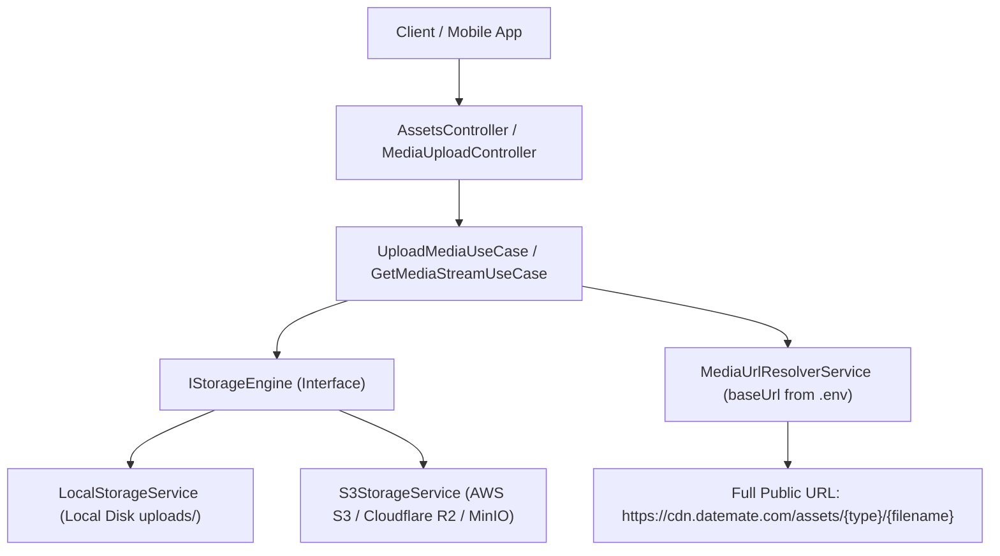

# DateMate Backend Architecture

## 1. Architectural Paradigm: Modular Monolith + Clean Architecture + DDD

DateMate is architected as a **Modular Monolith** applying **Domain-Driven Design (DDD)** and **Clean Architecture** principles. The system enforces strict boundaries between business logic and infrastructure to enable effortless maintenance, high test coverage, and a frictionless path to independent microservices when required.

### Layer Separation
1. **Domain Layer**: Pure business entities, enums, value objects, and repository/storage interfaces (`IStorageEngine`, `IUserRepository`). Zero external dependencies.
2. **Application Layer**: Use cases, DTOs, domain validators, and orchestrators (`UploadMediaUseCase`, `GetProfileUseCase`, `MediaUrlResolverService`).
3. **Infrastructure Layer**: Concrete persistence and driver implementations (`LocalStorageService`, `S3StorageService`, `PrismaUserRepository`, `RedisService`, `NodemailerService`).
4. **Presentation Layer**: NestJS controllers handling HTTP transport, OpenAPI/Swagger specifications, and input transformation (`AssetsController`, `MediaUploadController`, `UsersController`, `AuthController`).

---

## 2. Media Upload & Scalable Asset System (`src/modules/media`)

### 2.1 Core Design Goals
- **Scalable Route Architecture**: Provides clean, dedicated routes for asset categories:
  - `/assets/icons/{filename}`
  - `/assets/images/{filename}`
  - `/assets/avatars/{filename}`
  - `/assets/{type}/{filename}` (extensible to future types without code modification)
- **Decoupled Storage & Public URL Independence**:
  - The storage layer stores files organized by asset type (`uploads/<assetType>/<filename>` or `s3://<bucket>/<assetType>/<filename>`).
  - Stored database references hold relative keys (e.g. `icons/icon_123.svg`, `avatars/avatar_456.webp`).
  - The public URL is resolved dynamically using the configured `baseUrl`.
- **Zero-Migration Domain Changes**:
  - `baseUrl` is read from environment configuration (`ASSET_BASE_URL` -> `MEDIA_BASE_URL` -> `APP_BASE_URL` -> `http://localhost:<PORT>`).
  - Migrating to a CDN (e.g. `https://cdn.datemate.com`) requires only modifying `.env`; no database records require alteration.
- **Unique, Safe Filename Generation**:
  - Filenames follow the pattern: `<assetType>_<uuidHex>_<timestamp>.<safeExt>` (e.g. `icons_8f3e2b9c_1727599000000.svg`).
  - Strict protection against directory traversal (`..`, `/`, `\`, null bytes).
  - Cross-platform sanitized path handling.
- **Binary Inspection & Validation**:
  - Validates magic bytes for authentic JPEG, PNG, WebP, GIF, and PDF formats.
  - Cleans and sanitizes SVGs against embedded `<script>` or event handler XSS attacks.
  - Enforces size boundaries per asset type rule.

### 2.2 Storage Engine Abstraction (SOLID DIP & OCP)


### 2.3 Asset Type Registry
An extensible registry (`AssetTypeRegistry`) defines validation rules, MIME types, and size limits per asset type. Adding a new asset type (e.g., `banners`, `audio`, `documents`) only requires registering a configuration rule:
```typescript
registry.register({
  assetType: 'banners',
  allowedMimeTypes: ['image/jpeg', 'image/png', 'image/webp'],
  allowedExtensions: ['.jpg', '.jpeg', '.png', '.webp'],
  maxSizeBytes: 10 * 1024 * 1024,
  magicBytesValidation: true,
  description: 'Event and promotional banners',
});
```

---

## 3. Configuration Reference

| Environment Variable | Default | Purpose |
| :--- | :--- | :--- |
| `ASSET_BASE_URL` | `http://localhost:3000` | Authoritative public base domain for asset URLs |
| `MEDIA_BASE_URL` | *(optional fallback)* | Secondary asset base domain fallback |
| `APP_BASE_URL` | *(optional fallback)* | Application base URL fallback |
| `STORAGE_DRIVER` | `local` | Storage driver engine: `local` or `s3` |
| `UPLOADS_DIR` | `uploads` | Local disk storage root directory |
| `S3_BUCKET` | `datemate-media` | S3 bucket name when `STORAGE_DRIVER=s3` |
| `S3_REGION` | `us-east-1` | S3 bucket region |
| `S3_ENDPOINT` | *(optional)* | S3 endpoint override for MinIO / Cloudflare R2 |

---

## 4. API Specification

### Media Upload Endpoints
- `POST /v1/media/upload/:type` (and `/assets/upload/:type`): Multipart upload for any registered asset type.
- `POST /v1/media/upload/icons`: Dedicated icon upload.
- `POST /v1/media/upload/images`: Dedicated image upload.
- `POST /v1/media/upload/avatars`: Dedicated avatar upload.
- `GET /v1/media/types`: Returns supported asset types, allowed formats, and size constraints.

### Public Asset Endpoints
- `GET /assets/icons/:filename`: High-performance icon streaming with `ETag` and `304 Not Modified` support.
- `GET /assets/images/:filename`: High-performance image streaming.
- `GET /assets/avatars/:filename`: High-performance avatar streaming.
- `GET /assets/:type/:filename`: Scalable endpoint dynamically serving any registered asset category.

---

## 5. Interests Module (`src/modules/interests`)

The Interests module provides category-based discovery of user hobbies and activities matching the mobile UI.

### 5.1 Architecture & Domain Invariants
- **Domain Entities**: `InterestCategoryEntity` and `InterestEntity` representing categories and their child interests.
- **Client Response Format**: Matches Android client schema:
  ```json
  [
    {
      "id": 1,
      "en": "Food",
      "fa": "غذا",
      "icon": {
        "type": "IMAGE",
        "url": "http://localhost:3000/assets/icons/Beach%20With%20Umbrella.svg",
        "alt": ""
      },
      "Interest": [
        {
          "id": 1,
          "en": "Gaming",
          "fa": "بازی"
        }
      ]
    }
  ]
  ```
- **Endpoints**:
  - `GET /interests` (and `GET /interest`): Retrieves list of categories with child interests. Supports optional `language` (en, fa) and `id` filter.
  - `GET /interests/:id`: Retrieves a single category with child interests.
  - `POST /interests` (and `POST /interest`): Admin-only category creation with child interests.
- **User Profile Integration**:
  - `GET /users/me`: Returns selected interests in `Profile.LikedActivities` as `{ [categoryId]: interestId | interestId[] }` (omitting duplicate `interest` / `interests`).
  - `PUT /users/me`: Updates selected user interests via `LikedActivities` key-value map, flat IDs, or category objects.
- **Seeding**:
  - Seed script: `npm run seed:interests` (`npx ts-node prisma/seed-interests.ts`).
  - Reads SVG icons from `seed-icons/intersets` or `seed-icons/interests` in project root and copies them to `uploads/icons/`.

