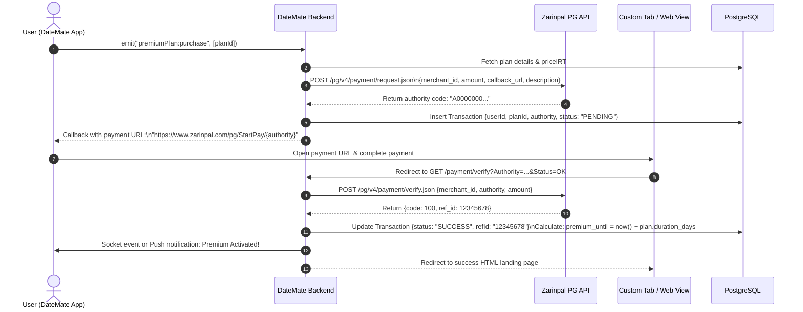

# DateMate Backend: Architecture, System Design & Technical Specification

> **Version**: 1.0.0  
> **Status**: Ready for Backend Implementation  
> **Target Clients**: 
> - **DateMate User Application** (`com.dmate.datemate` - Android / Jetpack Compose)
> - **DateMate Admin & Support Panel** (`com.rzcode.datematepanel` - Android / Jetpack Compose)

---

## Table of Contents

1. [Executive Summary & System Overview](#1-executive-summary--system-overview)
2. [High-Level System Architecture](#2-high-level-system-architecture)
3. [Client Applications & Interaction Model](#3-client-applications--interaction-model)
4. [Recommended Technology Stack](#4-recommended-technology-stack)
5. [Database Architecture & Entity-Relationship Model (ERD)](#5-database-architecture--entity-relationship-model-erd)
6. [HTTP REST API Specification](#6-http-rest-api-specification)
7. [Socket.IO Real-Time Protocol Specification](#7-socketio-real-time-protocol-specification)
   - 7.1 [Client App Namespace (`/`)](#71-client-app-namespace-)
   - 7.2 [Admin Panel Namespace (`/admin`)](#72-admin-panel-namespace-admin)
   - 7.3 [Projection & Query Filter Pattern](#73-projection--query-filter-pattern)
8. [WebRTC Audio/Video Calling & Signaling Flow](#8-webrtc-audiovideo-calling--signaling-flow)
9. [Notification Subsystem & FCM Push Architecture](#9-notification-subsystem--fcm-push-architecture)
10. [Payment Processing Pipeline (Zarinpal)](#10-payment-processing-pipeline-zarinpal)
11. [Security, Integrity & Business Restrictions](#11-security-integrity--business-restrictions)
12. [Target Backend Directory Structure](#12-target-backend-directory-structure)

---

## 1. Executive Summary & System Overview

**DateMate** is a social dating and community platform comprising:
1. **User Client Application (`datemate`)**: A mobile Android app built with Kotlin and Jetpack Compose. It allows users to register, build comprehensive profiles, discover people nearby or through preferences, match/swipe, engage in 1-on-1 direct messaging, join interest-based group chat rooms, participate in local events, initiate peer-to-peer WebRTC voice/video calls, purchase premium memberships, and contact customer support.
2. **Admin & Support Panel (`android-panel`)**: A dedicated Android management app built for platform administrators and support agents. It enables real-time user management, ban/unban moderation, selfie identity verification, report resolution, group chat room & event moderation, direct support ticket chatting, AdMob advertising parameter management, and restriction rule configuration.

### Core Communication Paradigm
The DateMate ecosystem utilizes a hybrid network model:
- **HTTP REST**: Used for initial stateless operations including registration, login, token refresh, password resets, Google OAuth, Google Play Integrity verification, lookup catalogs (countries, states, cities, interests, onboarding questions), health checks, and multipart media profile creation.
- **Socket.IO (WebSockets with Fallback)**: The primary real-time backbone for all post-authentication activities. It uses two separate namespaces:
  - `/` for standard users (`datemate`).
  - `/admin` for support operators and administrators (`android-panel`).
  - Employs request-response acknowledgement callbacks (`Ack`) yielding typed `CallbackData<T>` envelopes, alongside pub/sub event broadcasting.
  - Supports raw binary buffers (`ByteArray` / `Buffer`) transmitted alongside JSON objects for attachments, event media, dialog images, and voice recordings.
- **WebRTC**: Used for real-time peer-to-peer audio and video communication with Socket.IO acting as the signaling plane (SDP offers, answers, ICE candidates) and FCM push notifications triggering incoming calls when the app is backgrounded.

---

## 2. High-Level System Architecture

```mermaid
flowchart TB
    subgraph Clients["Client Layer"]
        UserApp["DateMate Android App\n(Users)\n[Kotlin / Compose]"]
        AdminApp["DateMate Panel App\n(Admins & Support)\n[Kotlin / Compose]"]
    end

    subgraph Gateway["Edge / Ingress Layer"]
        Nginx["Reverse Proxy / SSL Termination\n(Nginx / Cloudflare)"]
    end

    subgraph Backend["DateMate Core Backend (Node.js / NestJS / TypeScript)"]
        HTTPRouter["Express / Fastify REST API\n- /auth/*\n- /users/profile\n- /interests, /questions\n- /countries, /states, /cities\n- /admob, /time, /payment/callback"]
        
        subgraph SocketServer["Socket.IO Server"]
            RootNamespace["Namespace: '/'\n(User App Authentication & Gateways)"]
            AdminNamespace["Namespace: '/admin'\n(Admin Role Authorization & Gateways)"]
        end

        subgraph ServiceModules["Core Domain Services"]
            AuthService["Auth & Security Service\n(JWT, Play Integrity, Password)"]
            UserService["User & Profile Service\n(Profiles, Gallery, Swipes, Friends, Blocks)"]
            ChatService["Chat & Messaging Service\n(Direct, Group, Event, Attachments)"]
            EventService["Event & Community Service\n(Events, Comments, Participants)"]
            CallService["WebRTC Signaling Service\n(Offer, Answer, ICE, Bye)"]
            SupportService["Support Ticket Service\n(User <-> Admin Messaging)"]
            NotificationService["Notification & FCM Service\n(Push Dispatcher)"]
            PaymentService["Payment Service\n(Zarinpal Gateway & Subscription)"]
            AdminService["Admin Operations Service\n(Selfie Review, Reports, Restrictions)"]
        end
    end

    subgraph DataLayer["Storage & Cache Layer"]
        Postgres[(PostgreSQL\nRelational Database\nvia Prisma ORM)]
        Redis[(Redis\nSocket.IO Adapter,\nCache, Presence & Pub/Sub)]
        MediaStorage["Local Storage / MinIO / S3\n(/uploads/avatars, /selfies, /media)"]
    end

    subgraph ExternalServices["Third-Party Integrations"]
        FCM["Firebase Cloud Messaging (FCM)\nPush Notification Service"]
        ZarinpalGateway["Zarinpal Payment Gateway\n(Payment Request & Verify)"]
        GooglePlayAuth["Google Play Services\n(OAuth & Integrity Verification)"]
        STUN_TURN["Coturn Server\n(STUN / TURN for WebRTC NAT Traversal)"]
    end

    %% Client connections
    UserApp -->|HTTPS REST| Nginx
    UserApp -->|WSS Socket.IO (Namespace: '/')| Nginx
    UserApp <-->|WebRTC Media Stream| STUN_TURN
    UserApp <-->|P2P WebRTC Media| UserApp

    AdminApp -->|HTTPS REST| Nginx
    AdminApp -->|WSS Socket.IO (Namespace: '/admin')| Nginx

    Nginx --> HTTPRouter
    Nginx --> RootNamespace
    Nginx --> AdminNamespace

    %% Gateway to Services
    HTTPRouter --> AuthService
    HTTPRouter --> UserService
    HTTPRouter --> PaymentService
    RootNamespace --> ServiceModules
    AdminNamespace --> ServiceModules

    %% Services to Data
    ServiceModules --> Postgres
    ServiceModules --> Redis
    ServiceModules --> MediaStorage
    SocketServer <--> Redis

    %% External
    NotificationService --> FCM
    PaymentService --> ZarinpalGateway
    AuthService --> GooglePlayAuth
    FCM -.->|Push Notifications| UserApp
```

---

## 3. Client Applications & Interaction Model

### 3.1 DateMate (`com.dmate.datemate`)
- **Authentication**: Email/password registration with 6-digit email verification code; Google Sign-In; Play Integrity token checking.
- **Profile Setup**: Step-by-step profile creation uploading avatar (required), verification selfie (optional for verified badge), demographic data, relationship preferences, lifestyle options, interest tags, and answered questions.
- **Home / Discovery**:
  - Top 3 popular chatrooms and top 3 featured events.
  - Profile recommendations card stack (swiping like / dismiss).
  - First-launch promotional / announcement dialogs.
- **Search & Filtering**: Multi-faceted filter by age range, height range, marital status, relation type, online status, geolocation / distance (latitude/longitude), country, state, city.
- **Social Graph**: Friend requests (send, cancel, accept, reject, unfriend), user blocking / unblocking, user visits (who visited me, who I visited).
- **Group Chat Rooms**: Browse public rooms, create topic-based group rooms (with minimum/maximum age, gender, city, and interest category rules), invite friends, join/leave, live group messaging with text, voice notes, and images.
- **Events**: Discover community events (all, weekly, joined, owned, liked), create/edit events with cover images, RSVP/join, invite friends, comment threads, and dedicated event group chats.
- **Direct Messaging (1-on-1)**: Real-time chat with text, voice messages (with duration), image attachments, read receipts, and soft-deletion.
- **WebRTC Calling**: In-app 1-on-1 audio and video calls over WebRTC with Socket.IO signaling.
- **Monetization (Premium)**: Subscription tiers (1 month, 3 months, etc.) with Zarinpal payment gateway integration for Iranian Toman (IRT).
- **Customer Support**: In-app ticketing system to submit questions, upload screenshots, and chat in real-time with human support staff.

### 3.2 DateMate Panel (`com.rzcode.datematepanel`)
- **Authentication**: Admin credentials login to obtain JWT access and refresh tokens. Handshake on `/admin` Socket.IO namespace.
- **User Moderation**: Paginated user search, profile inspection, ban user from platform, unban user, review user blocklists (`user has blocked`, `user blocked by`).
- **Selfie Identity Verification**: Gallery of submitted verification selfies compared side-by-side with profile avatars; approve or reject verification badge.
- **Report Management**: Review user, chatroom, and event reports submitted with descriptions and screenshots; mark reports as reviewed or ban offending users.
- **Chatroom & Event Moderation**: View all rooms and events; toggle `active` status; toggle `popular` / featured status; forcefully remove disruptive users.
- **Support Inbox**: Centralized dashboard of open user tickets; live 1-on-1 support chat with individual users; upload image attachments in support responses.
- **App Configuration & AdMob**: Configure AdMob ad units (Banner, App Open, Rewarded, Interstitial, Native, Rewarded Interstitial), display intervals, active toggles, and terms/policy links.
- **Restriction Rules**: Adjust platform limits (free message limits for non-friends, restrictions requiring premium/selfie/questions to create chatrooms or events, gift premium days on signup).
- **Payment Settings**: Update Zarinpal Merchant ID, create and modify premium subscription packages.
- **Broadcast Dialogs**: Create and push popup modal announcements (title, English text, Persian text, hyperlink, banner image).

---

## 4. Recommended Technology Stack

| Layer | Recommended Technology | Justification |
|---|---|---|
| **Runtime & Language** | **Node.js (v20+ LTS) + TypeScript** | Native support for Socket.IO binary transfers, non-blocking I/O for real-time messaging, shared types with clients. |
| **Backend Framework** | **NestJS** (or Express + TypeScript) | NestJS provides modular architecture, native `@WebSocketGateway()` with Socket.IO, dependency injection, and clean separation of concerns. |
| **Real-Time Engine** | **Socket.IO (v4.x)** | Fully matches both mobile clients (`io.socket:socket.io-client`), supports namespacing (`/` and `/admin`), binary payloads (`Buffer`), and acknowledgement callbacks (`Ack`). |
| **Database** | **PostgreSQL (v15+)** | Robust ACID relational storage with native JSONB support, spatial extensions (PostGIS for location-based search), and strong indexing. |
| **ORM** | **Prisma ORM** | **Critical match**: The mobile client's `*Filter` classes (e.g. `UserFilter`, `MessageFilter`) map directly to Prisma's dynamic `select` and `include` object structures. |
| **Cache & Real-Time Sync** | **Redis (v7+)** | Manages `@socket.io/redis-adapter` for horizontal clustering, user online presence, rate limiting, and session blacklists. |
| **File / Media Storage** | **Local Disk / MinIO / AWS S3** | Serves static assets (`/uploads/avatars`, `/uploads/selfies`, `/uploads/attachments`, `/uploads/events`, `/uploads/dialogs`). |
| **Push Notifications** | **Firebase Admin SDK** | Dispatches data and display notifications to FCM tokens registered by `MyFirebaseMessagingService`. |
| **Payment Gateway** | **Zarinpal REST API (v4)** | Direct integration for payment request initiation (`/pg/v4/payment/request.json`) and verification (`/pg/v4/payment/verify.json`). |
| **App Integrity** | **Google Play Integrity API** | Verifies Google Play integrity tokens sent during signup/signin. |

---

## 5. Database Architecture & Entity-Relationship Model (ERD)

### 5.1 Mermaid ERD Diagram

```mermaid
erDiagram
    User ||--o| Profile : "has"
    User ||--o| Demographic : "has"
    User ||--o| Preferences : "has"
    User ||--o| Personality : "has"
    User ||--o{ Session : "owns"
    User ||--o{ Notification : "receives"
    User ||--o{ UserGallery : "uploads"
    User ||--o{ UserReport : "files"
    User ||--o{ UserReport : "reported_in"
    User ||--o{ Message : "sends"
    User ||--o{ Message : "receives"
    User ||--o{ Chatroom : "owns"
    User ||--o{ Event : "owns"
    User ||--o{ EventComment : "writes"
    User ||--o{ Friendship : "has"
    User ||--o{ FriendRequest : "initiates"
    User ||--o{ UserBlock : "blocks"
    User ||--o{ UserLike : "likes"
    User ||--o{ ProfileVisit : "visits"
    User ||--o{ Transaction : "pays"

    Profile ||--o{ UserInterest : "likes/dislikes"
    InterestCategory ||--o{ Interest : "categorizes"
    Interest ||--o{ UserInterest : "referenced_in"

    Question ||--o{ QuestionAnswer : "has_options"
    User ||--o{ UserQuestionAnswer : "selects"
    QuestionAnswer ||--o{ UserQuestionAnswer : "answered"

    Country ||--o{ State : "contains"
    State ||--o{ City : "contains"
    Demographic }o--|| City : "located_in"
    GroupChatroomData }o--|| City : "located_in"
    Event }o--|| City : "held_in"

    Chatroom ||--o| GroupChatroomData : "details"
    Chatroom ||--o{ ChatroomMember : "members"
    Chatroom ||--o{ ChatroomJoinRequest : "requests"
    Chatroom ||--o{ ChatroomBannedUser : "bans"
    Chatroom ||--o{ Message : "contains"

    Event ||--o{ EventParticipant : "attends"
    Event ||--o{ EventInvite : "invites"
    Event ||--o{ EventLike : "liked_by"
    Event ||--o{ EventComment : "comments"
    Event ||--o{ Message : "discussion"

    Message ||--o{ MessageAttachment : "attaches"
    Message ||--o{ MessageReaction : "reacts"

    User {
        int id PK
        string email UK
        string password_hash
        boolean profile_validated
        enum role "USER, ADMIN"
        enum language "EN, FA"
        timestamp premium_until
        int total_premium_days
        float wallet
        float score
        boolean online
        timestamp last_seen_at
        timestamp banned_until
        boolean notifications_on
        boolean message_notifications_on
        boolean view_notifications_on
        boolean request_notifications_on
        float latitude
        float longitude
        timestamp created_at
        timestamp updated_at
    }

    Profile {
        int id PK
        int user_id FK,UK
        string first_name
        string username UK
        string phone_number
        json languages
        string bio
        string avatar
        string selfie
        boolean is_private
        timestamp updated_at
    }

    Demographic {
        int id PK
        int user_id FK,UK
        date birth_date
        enum gender "MALE, FEMALE"
        int height
        int weight
        enum degree "HIGH_SCHOOL, BACHELOR, etc."
        string profession
        enum religion "CHRISTIANITY, ISLAM, etc."
        enum relation_status "SINGLE, MARRIED, etc."
        int city_id FK
    }

    Preferences {
        int id PK
        int user_id FK,UK
        enum relation "FUN, OPEN, LONG"
        enum drinking "SOCIALLY, NEVER, etc."
        enum smoking "YES, NO, SOMETIMES, etc."
        enum kids "LOVE_KIDS, NO_KIDS, etc."
        enum pets "CATS, DOGS, NO_PETS, etc."
    }

    Personality {
        int id PK
        int user_id FK,UK
        enum mood "INTROVERT, EXTROVERT, etc."
        enum star_sign "ARIES, TAURUS, etc."
    }

    Chatroom {
        int id PK
        int owner_id FK
        boolean active
        timestamp created_at
        timestamp updated_at
    }

    GroupChatroomData {
        int id PK
        int chatroom_id FK,UK
        string title
        string bio
        string avatar
        boolean is_private
        enum gender "MALE, FEMALE"
        int min_age
        int max_age
        int subject_id FK
        int city_id FK
    }

    Event {
        int id PK
        int owner_id FK
        int room_id FK "optional linked chatroom"
        string name
        string description
        string media
        enum status "STARTED, CANCELLED, FINISHED"
        boolean is_private
        enum gender "MALE, FEMALE"
        timestamp date
        int city_id FK
        int subject_id FK
        timestamp created_at
        timestamp updated_at
    }

    Message {
        int id PK
        string temp_id
        int sender_id FK
        int receiver_id FK "nullable (for 1-on-1 direct)"
        int room_id FK "nullable (for group chat)"
        int event_id FK "nullable (for event chat)"
        int support_receiver_id FK "nullable (for support chat)"
        string content
        boolean is_seen
        timestamp created_at
        timestamp updated_at
        timestamp deleted_at
    }

    MessageAttachment {
        int id PK
        int message_id FK
        enum type "IMAGE, AUDIO, VIDEO, FILE"
        string uri
        int voice_duration
    }

    Notification {
        int id PK
        int user_id FK
        enum type "NEW_MESSAGE, INCOMING_CALL, etc."
        enum status "IDLE, READ, ACCEPTED, REJECTED"
        json metadata
        timestamp created_at
    }

    UserReport {
        int id PK
        int reporter_id FK
        int reported_user_id FK "nullable"
        int chatroom_id FK "nullable"
        int event_id FK "nullable"
        string description
        string screenshot
        boolean reviewed
        boolean is_direct_chat
        timestamp created_at
    }

    PremiumPlan {
        int id PK
        string billing_id UK
        string fa_name
        string en_name
        string description
        int duration_days
        float price_irt
        float final_price_irt
    }

    Transaction {
        int id PK
        int user_id FK
        int plan_id FK
        string authority UK
        string ref_id
        float amount_irt
        enum status "PENDING, SUCCESS, FAILED"
        timestamp created_at
        timestamp verified_at
    }

    AdSettings {
        int id PK
        string banner_ad_unit
        string app_open_ad_unit
        string rewarded_ad_unit
        string interstitial_ad_unit
        string native_ad_unit
        string rewarded_interstitial_ad_unit
        string full_screen_native_ad_unit
        int app_open_interval
        int interstitial_interval
        int rewarded_interval
        int rewarded_interstitial_interval
        boolean banner_active
        boolean app_open_active
        boolean rewarded_active
        boolean interstitial_active
        boolean native_active
        boolean rewarded_interstitial_active
        boolean full_screen_native_active
        string policy
        string image_policy
    }

    RestrictionSettings {
        int id PK
        boolean chatroom_rule_premium
        boolean chatroom_rule_selfie
        boolean chatroom_rule_questions
        boolean event_rule_premium
        boolean event_rule_selfie
        boolean event_rule_questions
        int gift_premium_days
        int message_count_not_friends
        int message_count_other_users
    }

    FirstDialog {
        int id PK
        string title
        string title_fa
        string body
        string media
        timestamp created_at
    }
```



---

## 6. HTTP REST API Specification

All HTTP API endpoints follow the unified JSON response wrapper matching `ResponseResult<T>`:

```typescript
interface ResponseResult<T> {
  status: "success" | "error";
  message: string;
  data: T | null;
  error?: {
    type: string;
    message: string;
  };
}
```

### 6.1 Authentication Endpoints (`/auth`)

#### 1. `POST /auth/signup`
- **Purpose**: Initiates user registration by validating email and creating a pending verification record.
- **Request Body**:
  ```json
  {
    "email": "user@example.com",
    "password": "SecurePassword123!",
    "integrityToken": "base64GooglePlayIntegrityToken",
    "packageName": "com.dmate.datemate"
  }
  ```
- **Response**: `ResponseResult<null>` with status 200 on success. Dispatches 6-digit OTP code to user's email.

#### 2. `POST /auth/verify`
- **Purpose**: Verifies email OTP code, creates user record, assigns initial gift premium days (from `RestrictionSettings`), and returns JWT tokens.
- **Request Body**:
  ```json
  {
    "code": "123456",
    "device": "Samsung Galaxy S23",
    "userAgent": "DateMate/2.6 (Android 14; Mobile)",
    "fcmToken": "eXamPLe-fCm-ToKen..."
  }
  ```
- **Response**:
  ```json
  {
    "status": "success",
    "message": "User verified successfully",
    "data": {
      "access": "eyJhbGciOiJIUzI1NiIsInR5cCI6IkpXVCJ9...",
      "refresh": "eyJhbGciOiJIUzI1NiIsInR5cCI6IkpXVCJ9...",
      "userId": 104
    }
  }
  ```

#### 3. `POST /auth/signin`
- **Purpose**: Authenticates user or admin with email & password.
- **Request Body**:
  ```json
  {
    "email": "user@example.com",
    "password": "SecurePassword123!",
    "device": "Samsung Galaxy S23",
    "userAgent": "DateMate/2.6 (Android 14)",
    "fcmToken": "optional_fcm_token_string",
    "integrityToken": "optional_integrity_token_string",
    "packageName": "com.dmate.datemate"
  }
  ```
- **Response**:
  ```json
  {
    "status": "success",
    "message": "Login successful",
    "data": {
      "access": "<JWT_ACCESS_TOKEN>",
      "refresh": "<JWT_REFRESH_TOKEN>",
      "userId": 104
    }
  }
  ```

#### 4. `POST /auth/refresh`
- **Purpose**: Refreshes expired access token using a valid refresh token.
- **Request Body**: `{"token": "<JWT_REFRESH_TOKEN>"}`
- **Response**: Returns new `{ access, refresh, userId }` pair.

#### 5. `POST /auth/forgot-password`
- **Request Body**: `{"email": "user@example.com"}`
- **Response**: Generates and sends a 6-digit password reset code to user's email.

#### 6. `POST /auth/reset-password`
- **Request Body**:
  ```json
  {
    "email": "user@example.com",
    "code": "654321",
    "password": "NewSecurePassword456!"
  }
  ```
- **Response**: Updates password hash and revokes all active refresh sessions.

#### 7. `POST /auth/nonce`
- **Purpose**: Returns a cryptographically secure random nonce string for Google Play Integrity verification.
- **Response**: `{"status": "success", "data": "7f8b9c0d1e2f3a4b..."}`

#### 8. `POST /auth/google`
- **Purpose**: Authenticates or registers users via Google OAuth ID Token.
- **Headers**: `Authorization: <Google_Id_Token>`
- **Request Body**:
  ```json
  {
    "device": "Pixel 8",
    "userAgent": "DateMate/2.6",
    "integrityToken": "play_integrity_token",
    "packageName": "com.dmate.datemate"
  }
  ```
- **Response**: Returns `{ access, refresh, userId }`.

---

### 6.2 Profile & Onboarding Endpoints (`/users`)

#### 1. `GET /users/profile`
- **Purpose**: Checks if the authenticated user has completed their profile setup.
- **Headers**: `Authorization: Bearer <JWT_ACCESS_TOKEN>`
- **Response**:
  ```json
  {
    "status": "success",
    "message": "Profile status retrieved",
    "data": true
  }
  ```

#### 2. `POST /users/profile` (Multipart Form-Data)
- **Purpose**: Creates or updates user profile including multi-part images.
- **Headers**: `Authorization: Bearer <JWT_ACCESS_TOKEN>`
- **Form-Data Parts**:
  - `data` (text/json):
    ```json
    {
      "firstName": "Parsa",
      "username": "parsa_dev",
      "phoneNumber": "+989123456789",
      "languages": ["English", "Persian"],
      "bio": "Software engineer loving tech and nature.",
      "private": false,
      "language": "EN",
      "LikedActivities": [
        {
          "id": 1,
          "Interest": [{ "id": 12 }, { "id": 15 }]
        }
      ],
      "Demographic": {
        "birthDate": "1998-05-20T00:00:00.000Z",
        "gender": "MALE",
        "height": 182,
        "weight": 76,
        "degree": "BACHELOR_DEGREE",
        "profession": "Software Engineer",
        "religion": "SPIRITUALITY",
        "relationStatus": "SINGLE",
        "City": { "id": 105 }
      },
      "Preferences": {
        "relation": "LONG",
        "drinking": "SOCIALLY",
        "smoking": "NO",
        "kids": "MAYBE_SOME_DAY_WANT_KIDS",
        "pets": "CATS"
      },
      "Personality": {
        "personality": "INTROVERT",
        "starSign": "TAURUS"
      },
      "Answers": [3, 8, 14]
    }
    ```
  - `avatar` (file, image/jpeg, max 5MB): Profile avatar picture.
  - `selfie` (optional file, image/jpeg, max 5MB): Real-time camera selfie for verification.
- **Response**: `ResponseResult<null>` (HTTP 200). Stores images in `/uploads/avatars` and `/uploads/selfies`. Sets `profileValidated = false` pending admin approval.

---

### 6.3 Catalog & Metadata Endpoints

- `GET /interests`: Returns all interest categories with nested interest items.
- `GET /countries`: Returns list of countries with flags, code, native names.
- `GET /states/:countryId`: Returns states belonging to a country.
- `GET /cities/:stateId`: Returns cities belonging to a state.
- `GET /questions`: Returns onboarding lifestyle questions with selectable answers.

---

### 6.4 System & Configuration Endpoints

#### 1. `GET /`
- **Purpose**: Basic healthcheck for client network connectivity verification.
- **Response**: `{"status": "ok"}`

#### 2. `GET /admob`
- **Purpose**: Delivers dynamic Google AdMob configuration to client apps.
- **Response**:
  ```json
  {
    "status": "success",
    "message": "Ad settings",
    "data": {
      "bannerAdUnit": "ca-app-pub-3940256099942544/6300978111",
      "appOpenAdUnit": "ca-app-pub-3940256099942544/9257399496",
      "rewardedAdUnit": "ca-app-pub-3940256099942544/5224354917",
      "interstitialAdUnit": "ca-app-pub-3940256099942544/1033173712",
      "nativeAdUnit": "ca-app-pub-3940256099942544/2247696110",
      "rewardedInterstitialAdUnit": "ca-app-pub-3940256099942544/5354046379",
      "fullScreenNativeAdUnit": "ca-app-pub-3940256099942544/2247696110",
      "appOpenInterval": 4,
      "interstitialInterval": 5,
      "rewardedInterval": 3,
      "rewardedInterstitialInterval": 3,
      "bannerActive": true,
      "appOpenActive": true,
      "rewardedActive": true,
      "interstitialActive": true,
      "nativeActive": true,
      "rewardedInterstitialActive": true,
      "fullScreenNativeActive": true,
      "policy": "https://appdatemate.com/terms",
      "imagePolicy": "https://appdatemate.com/image-policy"
    }
  }
  ```

#### 3. `GET /time`
- **Purpose**: Returns authoritative server epoch time in milliseconds for client clock synchronization.
- **Response**: `{"status": "success", "message": "Server time", "data": 1726234567890}`

---

## 7. Socket.IO Real-Time Protocol Specification

### Protocol Standards
Every Socket.IO emit from client uses an acknowledgement callback with the standard signature:
```typescript
interface SocketCallback<T> {
  (response: {
    success: boolean;
    data?: T;
    error?: {
      type: string;     // E.g. "NOT_PREMIUM", "MESSAGE_COUNT_RESTRICTED", etc.
      message: string;
    } | string;
  }): void;
}
```

---

### 7.1 Client App Namespace (`/`)

#### Handshake Authentication
Client passes the JWT access token in the handshake auth object:
```javascript
const socket = io("https://appdatemate.com", {
  auth: { token: "<JWT_ACCESS_TOKEN>" }
});
```
On connection, the server validates the token, attaches `socket.data.userId`, marks user `online = true`, joins the user to personal room `user:<id>`, and notifies their friends. On disconnect, updates `last_seen_at = now()` and `online = false`.

#### Client Socket Events Reference Table

| Event Name | Client Arguments | Server Action & Callback (`CallbackData<T>`) | Broadcast / Push Trigger |
|---|---|---|---|
| `user:read` | `[userId: Int?, filters: Object, notify: Boolean]` | Returns requested user profile projected by `filters`. If `userId` is null, returns current user. If `notify === true` and reading another user's profile, triggers a `PROFILE_VIEW` notification. | Emits `notification:received` or FCM to target user if `notify === true`. |
| `user:update` | `[userUpdateJson: Object, null]` | Updates privacy, notifications toggles, coordinates, or language. Returns updated `SafeUser`. | Updates local database record. |
| `user:delete` | `[]` | Soft-deletes or anonymizes current user account and terminates sessions. | Returns `success: true`. |
| `user:logout` | `[]` | Revokes current session token and marks socket offline. | Returns `success: true`. |
| `user:block` | `[targetUserId: Int]` | Adds block record between users. Removes friendships and mutual room memberships. | Prevents future messages and visibility. |
| `user:unblock` | `[targetUserId: Int]` | Removes block record. | Returns `success: true`. |
| `user:send_request` | `[targetUserId: Int]` | Sends a friend request to `targetUserId`. | Creates `FRIEND_REQUEST` notification + FCM push. |
| `user:cancel_request` | `[targetUserId: Int]` | Cancels previously sent friend request. | Removes pending notification. |
| `user:friend` | `[targetUserId: Int]` | Accepts pending friend request and establishes reciprocal friendship. | Emits `FRIEND_REQUEST_ACCEPTED` notification. |
| `user:reject_request` | `[targetUserId: Int]` | Rejects pending friend request. | Updates notification status to `REJECTED`. |
| `user:unfriend` | `[targetUserId: Int]` | Removes friendship. Automatically removes user from owned chatrooms and events. | Returns `success: true`. |
| `user:report` | `[targetUserId: Int, description: String, media: Buffer?, isDirectChat: Boolean]` | Creates a user report with optional screenshot. | Stored in `UserReport` for admin review. |
| `user:search` | `[searchFilters: Object, selectFilters: Object, page: Int]` | Performs multi-parameter user discovery query. Returns `List<SafeUser>`. | Dynamic query execution. |
| `user:recommended:like` | `[targetUserId: Int]` | Registers a swipe "like". If mutual, creates a match and notifies both users. | `LIKE_USER` notification + FCM. |
| `user:recommended:dismiss` | `[targetUserId: Int]` | Records a dismissal so user is not recommended again. | Returns `success: true`. |
| `user:direct:list` | `[page: Int, searchInput: String, unread: Boolean]` | Returns user's recent direct conversations with last message and unread count. | Returns `List<Message>`. |
| `user:direct:read` | `[otherUserId: Int, messageFilter: Object]` | Returns historical messages between current user and `otherUserId`, paginated by cursor. | Marks unread messages as `isSeen = true`. |
| `user:direct:delete` | `[otherUserId: Int]` | Deletes direct chat history for the user. | Returns `success: true`. |
| `user:message:create` | `[otherUserId: Int, jsonMessage: Object, mediaBuffer: Buffer?]` | Checks restrictions (quota, blocks). Saves message and media attachment. Returns saved message. | Emits `user:message:created` to recipient's room + FCM push if offline. |
| `chatroom:list` | `[filter: Object, searchInput: String]` | Returns public chatrooms with member counts and preview. | Returns `List<Chatroom>`. |
| `chatroom:list:top` | `[filter: Object]` | Returns top 3 featured/popular chatrooms. | Returns `List<Chatroom>`. |
| `chatroom:search` | `[searchFilters: Object, selectFilters: Object, page: Int]` | Searches rooms by title, category, city, age, gender. | Returns `List<Chatroom>`. |
| `chatroom:read` | `[roomId: Int, filter: Object]` | Returns room metadata, members, and message history. | Returns `Chatroom`. |
| `chatroom:create` | `[groupDataJson: Object]` | Verifies creation rules (premium/selfie/questions). Creates room with owner. | Returns new `Chatroom`. |
| `chatroom:update` | `[groupDataJson: Object]` | Updates room title, bio, rules, avatar. | Emits room update to members. |
| `chatroom:delete` | `[roomId: Int]` | Owner deletes room. | Broadcasts room removal. |
| `chatroom:join` | `[roomId: Int]` | Joins public room or accepts invite. | Adds user to room; emits join notification. |
| `chatroom:leave` | `[roomId: Int]` | User leaves room. | Removes user from room members. |
| `chatroom:invite` | `[roomId: Int, targetUserId: Int]` | Invites a friend to join a room. | Sends `CHATROOM_INVITE_REQUEST` notification. |
| `chatroom:user:remove` | `[roomId: Int, targetUserId: Int]` | Room owner removes a member. | Drops user from room socket channel. |
| `chatroom:user:block` | `[roomId: Int, targetUserId: Int]` | Room owner bans user from room. | Adds to `ChatroomBannedUser`. |
| `chatroom:user:unblock` | `[roomId: Int, targetUserId: Int]` | Unbans user from room. | Removes from banned list. |
| `chatroom:message:create` | `[jsonMessage: Object, mediaBuffer: Buffer?]` | Saves message in room. Returns saved message. | Broadcasts `chatroom:message:created` to room. |
| `chatroom:report` | `[roomId: Int, description: String, media: Buffer?]` | Reports a chatroom for inappropriate behavior. | Stored in `UserReport`. |
| `event:list` | `[filter: Object]` | Returns active community events. | Returns `List<Event>`. |
| `event:list:top` | `[filter: Object]` | Returns top 3 featured events. | Returns `List<Event>`. |
| `event:search` | `[searchFilters: Object, selectFilters: Object, page: Int]` | Searches events by name, date, category, city. | Returns `List<Event>`. |
| `event:read` | `[eventId: Int, filter: Object]` | Returns event details, participants, comments, creator info. | Returns `Event`. |
| `event:create` | `[eventJson: Object, mediaBuffer: Buffer?]` | Verifies event creation rules. Uploads cover image. | Returns new `Event`. |
| `event:update` | `[eventJson: Object, mediaBuffer: Buffer?]` | Updates event details. | Returns updated `Event`. |
| `event:delete` | `[eventId: Int]` | Creator deletes event. | Returns `success: true`. |
| `event:cancel` | `[eventId: Int]` | Marks event status as `CANCELLED`. | Notifies participants. |
| `event:join` | `[eventId: Int]` | User joins event participant list. | Sends `EVENT_JOIN` notification to owner. |
| `event:invite` | `[eventId: Int, targetUserId: Int]` | Invites a friend to event. | Sends `EVENT_INVITE_REQUEST` notification. |
| `event:invite:accept` | `[eventId: Int]` | Accepts invitation to event. | Adds participant; notifies owner. |
| `event:user:remove` | `[eventId: Int, targetUserId: Int]` | Creator removes a participant. | Updates event participant list. |
| `event:message:list` | `[eventId: Int, messageFilter: Object]` | Returns message history of the event's discussion room. | Returns `List<Message>`. |
| `event:message:create` | `[eventId: Int, jsonMessage: Object, mediaBuffer: Buffer?]` | Posts discussion message to event. | Broadcasts `event:message:created` to event room. |
| `event:report` | `[eventId: Int, description: String, media: Buffer?]` | Reports an event for content violation. | Stored in `UserReport`. |
| `notification:list` | `[page: Int]` | Returns paginated list of user notifications. | Returns `List<Notification>`. |
| `notification:list:top` | `[]` | Returns the 3 newest notifications. | Returns `List<Notification>`. |
| `notification:unreadCount` | `[]` | Returns integer count of notifications with status `IDLE`. | Returns `Int`. |
| `notification:accept` | `[notificationId: Int]` | Marks notification as `ACCEPTED`. | Updates status. |
| `notification:reject` | `[notificationId: Int]` | Marks notification as `REJECTED`. | Updates status. |
| `support:question:list` | `[]` | Returns common FAQ questions for customer support. | Returns `List<SupportQuestion>`. |
| `support:message:list` | `[messageFilter: Object]` | Returns user's chat history with support team. | Returns `List<Message>`. |
| `support:message:create` | `[messageText: String?, mediaBuffer: Buffer?]` | User sends support query with optional screenshot. | Emits to `/admin` namespace (`support:message:created`). |
| `fcmToken:update` | `[token: String]` | Binds or refreshes the active FCM device token for current user. | Stored in `Session`. |
| `premiumPlan:list` | `[]` | Returns available premium subscription plans. | Returns `List<PremiumPlan>`. |
| `premiumPlan:purchase` | `[planId: Int]` | Generates Zarinpal payment gateway URL. | Returns `String` (Payment redirect URL). |
| `social:list` | `[]` | Returns official social media URLs (Instagram, Telegram, YouTube). | Returns `{ instagram, telegram, youtube }`. |
| `dialog:list` | `[]` | Returns active announcements/dialogs for first launch. | Returns `List<FirstDialog>`. |
| `restrictionSettings:read`| `[]` | Returns platform restriction settings. | Returns `RestrictionSettings`. |
| `webrtc:offer` | `[toUserId: Int, sdpString: String]` | Forwards WebRTC SDP offer to target user. | Emits `webrtc:offer(fromUserId, sdpString)` to callee. |
| `webrtc:answer` | `[toUserId: Int, sdpString: String]` | Forwards WebRTC SDP answer to caller. | Emits `webrtc:answer(calleeId, sdpString)` to caller. |
| `webrtc:ice-candidate` | `[toUserId: Int, iceCandidate: String]` | Forwards ICE candidate to peer. | Emits `webrtc:ice-candidate(fromUserId, iceCandidate)`. |
| `webrtc:bye` | `[toUserId: Int]` | Terminates active call session. | Emits `webrtc:bye(fromUserId)` to peer. |

---

### 7.2 Admin Panel Namespace (`/admin`)

#### Handshake Authorization
Admin panel connects to `/admin` namespace with `auth = { token: token }`. The server validates that `user.role === 'ADMIN'`.

#### Admin Socket Events Reference Table

| Event Name | Arguments | Server Action & Callback (`CallbackData<T>`) |
|---|---|---|
| `user:list` | `[searchInput: String, page: Int]` | Returns paginated list of all users with search filter. |
| `user:ban` | `[userId: Int, duration: Any?]` | Sets `banned_until` timestamp on user. Disconnects user sockets. |
| `user:unban` | `[userId: Int]` | Clears user ban (`banned_until = null`). |
| `user:list:banned` | `[searchInput: String, page: Int]` | Lists all currently banned users. |
| `user:read:blocks` | `[userId: Int, searchInput: String, page: Int]` | Lists users that the specified user has blocked. |
| `user:read:blockedby` | `[userId: Int, searchInput: String, page: Int]` | Lists users that have blocked the specified user. |
| `user:list:unvalidated` | `[searchInput: String, page: Int]` | Lists users who uploaded a selfie waiting for verification (`profileValidated == false` and `selfie != null`). |
| `user:update:profileValidated` | `[userId: Int, isAccepted: Boolean]` | Sets `profileValidated = true` or rejects selfie. Sends `SELFIE_ACCEPTED` or `SELFIE_REJECTED` notification. |
| `user:list:reported` | `[searchInput: String, isCheckedReports: Boolean, page: Int]` | Lists reported entities (users, chats, events) filtered by reviewed status. |
| `report:update:reviewed` | `[reportId: Int]` | Marks report as reviewed (`reviewed = true`). |
| `chatroom:list` | `[searchInput: String, page: Int]` | Lists all platform chatrooms. |
| `chatroom:update:popular` | `[chatRoomId: Int, isTop: Boolean]` | Marks chatroom as featured on home screen. |
| `chatroom:update:active` | `[chatRoomId: Int, isActive: Boolean]` | Enables or disables chatroom. |
| `user:read:chatrooms` | `[userId: Int, searchInput: String, page: Int]` | Lists chatrooms owned or joined by a specific user. |
| `user:chatroom:remove` | `[userId: Int, chatRoomId: Int]` | Admin forcefully evicts a user from a chatroom. |
| `event:list` | `[searchInput: String, page: Int]` | Lists all platform events. |
| `event:update:popular` | `[eventId: Int, isTop: Boolean]` | Marks event as featured on home screen. |
| `event:update:active` | `[eventId: Int, isActive: Boolean]` | Enables or disables event. |
| `user:read:events` | `[userId: Int, searchInput: String, page: Int]` | Lists events created or joined by a specific user. |
| `user:event:remove` | `[userId: Int, eventId: Int]` | Admin forcefully removes a participant from an event. |
| `support:message:list` | `[page: Int, searchInput: String]` | Lists all users who sent support inquiries with their latest message. |
| `support:message:read` | `[userId: Int, page: Int]` | Retrieves full conversation history between user and support. |
| `support:message:create` | `[userId: Int, messageText: String, imageBuffer: Buffer?]` | Admin sends reply to user. Broadcasts `support:message:created` to user. |
| `admobSettings:read` | `[]` | Retrieves current AdMob configuration. |
| `admobSettings:update` | `[adSettingsJson: Object]` | Updates ad unit IDs, intervals, and active toggles. |
| `restrictionSettings:read`| `[]` | Retrieves platform restriction rules. |
| `restrictionSettings:update`| `[restrictionJson: Object]` | Updates platform restriction rules. |
| `premiumPlan:list` | `[]` | Returns all subscription plans. |
| `premiumPlan:update` | `[planId: Int, planJson: Object]` | Updates pricing and duration of a subscription plan. |
| `merchantId:read` | `[]` | Retrieves active Zarinpal merchant ID. |
| `merchantId:update` | `[merchantId: String]` | Updates Zarinpal merchant ID in system configuration. |
| `dialog:list` | `[]` | Lists active broadcast announcement dialogs. |
| `dialog:create` | `[textEn: String, textFa: String, link: String?, imageBuffer: Buffer?]` | Creates new announcement dialog and saves banner image. |

---

### 7.3 Projection & Query Filter Pattern

Both Android applications send JSON selection objects (e.g. `UserFilter`, `MessageFilter`, `ChatroomFilter`) specifying which fields and relations should be returned. For example:

```json
{
  "id": true,
  "Profile": {
    "avatar": true,
    "firstName": true,
    "Demographic": {
      "birthDate": true
    }
  }
}
```

In the backend implementation with Prisma ORM, this object maps **1:1** to Prisma's `select` projection:
```typescript
// Backend query helper converts incoming client filter directly into Prisma select
const user = await prisma.user.findUnique({
  where: { id: targetUserId },
  select: buildPrismaSelect(clientFilter)
});
```
This guarantees that clients receive exactly the payload format expected without over-fetching or serialization mismatches.

---

## 8. WebRTC Audio/Video Calling & Signaling Flow

```mermaid
sequenceDiagram
    autonumber
    actor Caller as Caller (DateMate App)
    participant Signaling as Backend (Signaling Server)
    participant DB as PostgreSQL / Redis
    participant Push as Firebase Cloud Messaging (FCM)
    actor Callee as Callee (DateMate App)

    Note over Caller, Callee: Initiation Phase
    Caller->>Signaling: emit("webrtc:offer", [calleeId, sdpOffer])
    Signaling->>DB: Check if Callee is online in Redis
    alt Callee is Connected to Socket
        Signaling->>Callee: emit("webrtc:offer", calleeId, sdpOffer)
    else Callee is Offline / Backgrounded
        Signaling->>Push: Send High-Priority Data FCM {type: "INCOMING_CALL", callerId, offer}
        Push->>Callee: Wake up MyFirebaseMessagingService
        Callee->>Signaling: Connect socket and receive offer
    end

    Note over Caller, Callee: Negotiation Phase
    Callee->>Signaling: emit("webrtc:answer", [callerId, sdpAnswer])
    Signaling->>Caller: emit("webrtc:answer", calleeId, sdpAnswer)

    Note over Caller, Callee: ICE Candidate Exchange
    Caller->>Signaling: emit("webrtc:ice-candidate", [calleeId, candidate])
    Signaling->>Callee: emit("webrtc:ice-candidate", callerId, candidate)
    Callee->>Signaling: emit("webrtc:ice-candidate", [callerId, candidate])
    Signaling->>Caller: emit("webrtc:ice-candidate", calleeId, candidate)

    Note over Caller, Callee: Peer-to-Peer Media Established (STUN/TURN)
    Caller<-- WebRTC Audio/Video Stream -->Callee

    Note over Caller, Callee: Termination Phase
    Caller->>Signaling: emit("webrtc:bye", [calleeId])
    Signaling->>Callee: emit("webrtc:bye", callerId)
```

---

## 9. Notification Subsystem & FCM Push Architecture

### Notification Dispatch Logic
When an event occurs (e.g., direct message, friend request, call, selfie approved), the backend executes:
1. **Persist Notification**: Insert into `notifications` table with status `IDLE` and metadata JSON.
2. **Socket Dispatch**: If target user has an active socket session, emit real-time event directly.
3. **FCM Push Dispatch**: If user has a registered `fcmToken` in `sessions` and their preference toggle allows that category:
   - Format FCM message with standard data attributes:
     - `type`: One of `NotificationType2` values (`NEW_MESSAGE`, `FRIEND_REQUEST`, `INCOMING_CALL`, etc.)
     - `userId`, `eventId`, `chatroomId`, `id`, `supportId`, `callerId`, `offer`, `galleryId`.
   - Set Android notification channel to `my_channel_id`.
   - Send with high priority.

---

## 10. Payment Processing Pipeline (Zarinpal)



---

## 11. Security, Integrity & Business Restrictions

### 11.1 Authentication & Tokens
- **Access Tokens**: Short-lived (15–60 minutes) signed with HMAC SHA-256 (`JWT_SECRET`).
- **Refresh Tokens**: Long-lived (30 days) stored hashed in `sessions` table. Rotated on every refresh call.
- **Session Revocation**: `user:logout` or password reset invalidates the refresh session.

### 11.2 Google Play Integrity
During signup, signin, and Google authentication, the client sends a `playIntegrityToken`. The backend validates this token against the Google Play Integrity API to ensure:
- The app binary matches the official release fingerprint.
- The request originated from a genuine Android device.
- Prevents automated botting, reverse-engineered scrapers, and modified APKs.

### 11.3 Platform Restrictions Enforcement
The backend strictly enforces the rules configured in `RestrictionSettings`:
- **Unverified Users**: Users without an approved selfie (`profile_validated === false`) cannot create chatrooms or events if the corresponding rule is enabled.
- **Incomplete Profiles**: Users must answer onboarding questions to unlock event/chatroom creation if required by rules.
- **Non-Premium Quotas**: Non-premium users are restricted by `message_count_not_friends` daily messages to non-friends, and `message_count_other_users` interactions.
- **Content Moderation**: Binary attachments checked for file type integrity (JPEG, PNG, AAC, MP4) and scanned for prohibited content.

---

## 12. Target Backend Directory Structure

When implementation begins, the `/home/parsa/Documents/projects/datemate/backend` directory should be organized following this modular structure:

```
backend/
├── ARCHITECTURE.md                  # This complete design & architecture document
├── package.json                     # Dependencies & scripts
├── tsconfig.json                    # TypeScript compiler options
├── .env.example                     # Environment variables template
├── docker-compose.yml               # Local development setup (Postgres, Redis, MinIO)
├── prisma/
│   ├── schema.prisma                # Full database schema and relations
│   ├── migrations/                  # Database migration files
│   └── seed.ts                      # Initial seed (countries, cities, interests, questions, default admin)
├── src/
│   ├── main.ts                      # Application bootstrap & port binding
│   ├── app.module.ts                # Root NestJS module
│   ├── common/                      # Shared filters, guards, decorators, interceptors
│   │   ├── decorators/              # @CurrentUser(), @Roles()
│   │   ├── filters/                 # HttpExceptionsFilter, SocketExceptionsFilter
│   │   ├── guards/                  # JwtAuthGuard, RolesGuard
│   │   ├── interceptors/            # TransformResponseInterceptor (ResponseResult envelope)
│   │   └── utils/                   # Prisma filter mapper, crypto helpers
│   ├── config/                      # Configuration loader & validation
│   ├── database/                    # Prisma service & database connection module
│   ├── redis/                       # Redis client & pub/sub service
│   ├── storage/                     # File upload handler (avatars, selfies, media)
│   ├── notifications/               # Firebase Cloud Messaging service
│   ├── webrtc/                      # WebRTC signaling handlers & room state
│   ├── modules/
│   │   ├── auth/                    # Registration, Login, Google OAuth, Tokens, Play Integrity
│   │   ├── users/                   # Profiles, Demographics, Settings, Gallery, Swipes, Visits
│   │   ├── friends/                 # Friend requests & Blocklists
│   │   ├── chat/                    # Direct messages, Chatrooms, Media attachments
│   │   ├── events/                  # Events, RSVPs, Event comments, Event discussions
│   │   ├── support/                 # Support tickets & In-app help chat
│   │   ├── admin/                   # Admin panel endpoints & Moderation handlers
│   │   ├── settings/                # AdMob, Restrictions, First Dialogs, Time sync
│   │   └── payments/                # Zarinpal gateway integration & Subscriptions
│   └── websockets/
│       ├── root.gateway.ts          # Main Socket.IO Gateway for Client App ('/')
│       └── admin.gateway.ts         # Admin Socket.IO Gateway for Panel ('/admin')
└── uploads/                         # Stored media directory (mounted via volume)
    ├── avatars/
    ├── selfies/
    ├── attachments/
    ├── events/
    └── dialogs/
```

---

## Conclusion
This document represents the complete technical blueprint for the DateMate backend. All models, REST endpoints, Socket.IO events, binary upload methods, WebRTC signaling steps, database relationships, and admin panel requirements directly map to the existing client codebases (`datemate` and `android-panel`).
