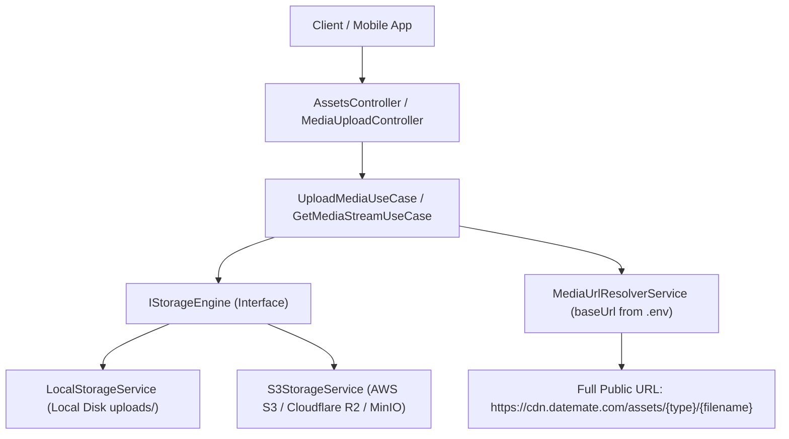

# DateMate Backend Architecture

## 1. Architectural Paradigm: Modular Monolith + Clean Architecture + DDD

DateMate is architected as a **Modular Monolith** applying **Domain-Driven Design (DDD)** and **Clean Architecture** principles. The system enforces strict boundaries between business logic and infrastructure to enable effortless maintenance, high test coverage, and a frictionless path to independent microservices when required.

### Layer Separation
1. **Domain Layer**: Pure business entities, enums, value objects, and repository/storage interfaces (`IStorageEngine`, `IUserRepository`). Zero external dependencies.
2. **Application Layer**: Use cases, DTOs, domain validators, and orchestrators (`UploadMediaUseCase`, `GetProfileUseCase`, `MediaUrlResolverService`).
3. **Infrastructure Layer**: Concrete persistence and driver implementations (`LocalStorageService`, `S3StorageService`, `PrismaUserRepository`, `RedisService`, `NodemailerService`).
4. **Presentation Layer**: NestJS controllers handling HTTP transport, OpenAPI/Swagger specifications, and input transformation (`AssetsController`, `MediaUploadController`, `UsersController`, `AuthController`).

---

## 2. Media Upload & Scalable Asset System (`src/modules/media`)

### 2.1 Core Design Goals
- **Scalable Route Architecture**: Provides clean, dedicated routes for asset categories:
  - `/assets/icons/{filename}`
  - `/assets/images/{filename}`
  - `/assets/avatars/{filename}`
  - `/assets/selfies/{filename}`
  - `/assets/{type}/{filename}` (extensible to future types without code modification)
- **Decoupled Storage & Public URL Independence**:
  - The storage layer stores files organized by asset type (`uploads/<assetType>/<filename>` or `s3://<bucket>/<assetType>/<filename>`).
  - Stored database references hold relative keys (e.g. `icons/icon_123.svg`, `avatars/avatar_456.webp`).
  - The public URL is resolved dynamically using the configured `baseUrl`.
- **Zero-Migration Domain Changes**:
  - `baseUrl` is read from environment configuration (`ASSET_BASE_URL` -> `MEDIA_BASE_URL` -> `APP_BASE_URL` -> `http://localhost:<PORT>`).
  - Migrating to a CDN (e.g. `https://cdn.datemate.com`) requires only modifying `.env`; no database records require alteration.
- **Unique, Safe Filename Generation**:
  - Filenames follow the pattern: `<assetType>_<uuidHex>_<timestamp>.<safeExt>` (e.g. `icons_8f3e2b9c_1727599000000.svg`).
  - Strict protection against directory traversal (`..`, `/`, `\`, null bytes).
  - Cross-platform sanitized path handling.
- **Binary Inspection & Validation**:
  - Validates magic bytes for authentic JPEG, PNG, WebP, GIF, and PDF formats.
  - Cleans and sanitizes SVGs against embedded `<script>` or event handler XSS attacks.
  - Enforces size boundaries per asset type rule.

### 2.2 Storage Engine Abstraction (SOLID DIP & OCP)


### 2.3 Asset Type Registry
An extensible registry (`AssetTypeRegistry`) defines validation rules, MIME types, and size limits per asset type. Adding a new asset type (e.g., `banners`, `audio`, `documents`) only requires registering a configuration rule:
```typescript
registry.register({
  assetType: 'banners',
  allowedMimeTypes: ['image/jpeg', 'image/png', 'image/webp'],
  allowedExtensions: ['.jpg', '.jpeg', '.png', '.webp'],
  maxSizeBytes: 10 * 1024 * 1024,
  magicBytesValidation: true,
  description: 'Event and promotional banners',
});
```

---

## 3. Configuration Reference

| Environment Variable | Default | Purpose |
| :--- | :--- | :--- |
| `ASSET_BASE_URL` | `http://localhost:3000` | Authoritative public base domain for asset URLs |
| `MEDIA_BASE_URL` | *(optional fallback)* | Secondary asset base domain fallback |
| `APP_BASE_URL` | *(optional fallback)* | Application base URL fallback |
| `STORAGE_DRIVER` | `local` | Storage driver engine: `local` or `s3` |
| `UPLOADS_DIR` | `uploads` | Local disk storage root directory |
| `S3_BUCKET` | `datemate-media` | S3 bucket name when `STORAGE_DRIVER=s3` |
| `S3_REGION` | `us-east-1` | S3 bucket region |
| `S3_ENDPOINT` | *(optional)* | S3 endpoint override for MinIO / Cloudflare R2 |

---

## 4. API Specification

### Media Upload Endpoints
- `POST /v1/media/upload/:type` (and `/assets/upload/:type`): Multipart upload for any registered asset type.
- `POST /v1/media/upload/icons`: Dedicated icon upload.
- `POST /v1/media/upload/images`: Dedicated image upload.
- `POST /v1/media/upload/avatars`: Dedicated avatar upload.
- `GET /v1/media/types`: Returns supported asset types, allowed formats, and size constraints.

### Public Asset Endpoints
- `GET /assets/icons/:filename`: High-performance icon streaming with `ETag` and `304 Not Modified` support.
- `GET /assets/images/:filename`: High-performance image streaming.
- `GET /assets/avatars/:filename`: High-performance avatar streaming.
- `GET /assets/selfies/:filename`: High-performance selfie verification photo streaming.
- `GET /assets/:type/:filename`: Scalable endpoint dynamically serving any registered asset category.

---

## 5. Interests Module (`src/modules/interests`)

The Interests module provides category-based discovery of user hobbies and activities matching the mobile UI.

### 5.1 Architecture & Domain Invariants
- **Domain Entities**: `InterestCategoryEntity` and `InterestEntity` representing categories and their child interests.
- **Client Response Format**: Matches Android client schema:
  ```json
  [
    {
      "id": 1,
      "en": "Food",
      "fa": "غذا",
      "icon": {
        "type": "IMAGE",
        "url": "http://localhost:3000/assets/icons/Beach%20With%20Umbrella.svg",
        "alt": ""
      },
      "Interest": [
        {
          "id": 1,
          "en": "Gaming",
          "fa": "بازی"
        }
      ]
    }
  ]
  ```
- **Endpoints**:
  - `GET /interests` (and `GET /interest`): Retrieves list of categories with child interests. Supports optional `language` (en, fa) and `id` filter.
  - `GET /interests/:id`: Retrieves a single category with child interests.
  - `POST /interests` (and `POST /interest`): Admin-only category creation with child interests.
- **User Profile Integration**:
  - `GET /users/me`: Returns selected interests in `Profile.LikedActivities` as `{ [categoryId]: interestId | interestId[] }` (omitting duplicate `interest` / `interests`).
  - `PUT /users/me`: Updates selected user interests via `LikedActivities` key-value map, flat IDs, or category objects.
- **Seeding**:
  - Seed script: `npm run seed:interests` (`npx ts-node prisma/seed-interests.ts`).
  - Reads SVG icons from `seed-icons/intersets` or `seed-icons/interests` in project root and copies them to `uploads/icons/`.

---

## 6. Admin Panel Module (`src/modules/admin`)

The Admin Module provides administration, monitoring, user directory search, account moderation, and identity verification capabilities for platform operators.

### 6.1 Architecture & Domain Invariants
- **Bounded Context**: Dedicated `admin` domain isolated from consumer authentication and mobile profile endpoints.
- **Role-Based Security**: Secured with `AdminAuthGuard` requiring valid JWT with `role === 'ADMIN'`.
- **Session Termination on Ban**: Banning a user automatically purges all their active sessions (`user_sessions`) in real-time.
- **Identity Verification Notification**: Approving or rejecting a verification triggers `NotificationType.PROFILE_VERIFIED` to inform the user.

### 6.2 Administrative Endpoints
- `GET /v1/admin/dashboard/stats` (also `/v1/admin/dashboard/overview`): Returns KPI metrics (`totalUsers`, `onlineUsers`, `pendingSelfies`, `unansweredTickets`), weekly activity, gender stats, recent tickets, and `recentSelfies` (strictly returning the last 4 unvalidated users who have an existing `selfieUrl`).
- `GET /v1/admin/users/count`: Returns the total registered user count, supporting optional status filtering (`ALL`, `PENDING_VERIFICATION`, `BLOCKED`, `ONLINE`).
- `GET /v1/admin/users/pending-selfies/count`: Returns the count of unvalidated users who have a non-empty selfie URL and `profileValidated = false`.
- `GET /v1/admin/users`: Lightweight paginated user directory with multi-field search (`search`), status filters (`ALL`, `BLOCKED`, `PENDING_VERIFICATION`, `COMPLETED`), gender filters (`MALE`, `FEMALE`, `ALL`), age range filters (`minAge`, `maxAge`), and sorting (`createdAt`, `lastSeenAt`, `wallet`). Excludes heavy payloads (gallery, bio, transactions, chatRooms) for fast listing. Returns `id`, `email`, `fullName`, `avatarUrl`, `age`, `gender`, `isPremium`, `hasPendingSelfie`, `profileValidated`, `isOnline`, `bannedUntil`, and `createdAt`.
- `GET /v1/admin/users/:id`: Full user details endpoint providing complete inspection data for the admin details modal/tabs: demographics, full photo gallery, transactions, chatRooms, and interests.
- `DELETE /v1/admin/users/:id`: Permanently deletes a single user by ID and cascades through all associated records (sessions, profile, demographics, gallery, swipes, matches, messages). Strictly deletes only one user per request (multi-user delete is not supported).
- `DELETE /v1/admin/users/:userId/gallery/:galleryId`: Deletes a specific gallery photo for a user. If the deleted photo was the active profile picture, the backend automatically falls back to another gallery photo or clears `profilePictureUrl`. Returns `{ success: true, message: "Gallery image deleted successfully", data: { userId, galleryId, deleted: true } }`.
- `PATCH / PUT /v1/admin/users/:id`: Updates user moderation fields (bio, fullName, premium, wallet, and confirms selfie verification).
- `POST /v1/admin/users/:id/ban`: Bans/blocks user account with duration in hours or permanent ban (`null`).
- `POST /v1/admin/users/:id/unban`: Unbans user account and restores full access.
- `GET /v1/admin/verifications/count` (also `/v1/admin/verifications/pending/count`): Returns count of unvalidated users whose selfie is not validated, who have an existing selfie URL, and `profileValidated = false`.
- `GET /v1/admin/verifications`: Paginated queue of identity selfie reviews displaying user details (`id`, `userId`, `fullName`, `email`, `avatarUrl`, `selfieUrl`, `age`, `gender`, `requestedAt` ISO string, `status`). Strictly filters for users with an existing selfie photo (`selfieUrl` is not null/empty), and for `PENDING` status only returns unvalidated users (`profileValidated = false`). Supports `status` filter (`PENDING`, `APPROVED`, `REJECTED`, `ALL`), `page`, and `limit`.
- `POST /v1/admin/verifications/:id/approve`: Validates user profile (`profileValidated = true`) by verification request ID or userId, creates `PROFILE_VERIFIED` notification, and returns `{ success: true, message: "Verification approved successfully", ... }`.
- `POST /v1/admin/verifications/:id/reject`: Rejects verification by verification request ID or userId, clears `selfieUrl`, sets `profileValidated = false`, and fires notification explaining rejection reason. Accepts `{ reason?: string }` body and returns `{ success: true, message: "Verification rejected successfully", ... }`.

---

## 7. User Gallery & Swipe Profile Picture System (`src/modules/auth`)

The User Gallery system enables users to upload, manage, and curate their photo gallery for profile discovery and matching.

### 7.1 Architecture & Domain Invariants
- **Profile Picture vs. Avatar**:
  - `avatar`: Dedicated identity verification photo (stored in `Profile.avatarUrl`, served via `/assets/avatars/...`).
  - `profilePicture`: The primary public swipe picture used in the matching/discovery deck (stored in `Profile.profilePictureUrl`, served via `/assets/images/...`).
  - `Profile.profilePictureUrl` is persisted in nullable `profiles.profile_picture_url` (added by the `20261004130000_add_profile_picture_url_to_profiles` migration).
  - `Profile.profilePictureId`: Gallery ID of the currently active profile picture, returned in profile response.
  - `UserGallery.isProfilePicture`: Boolean flag designating which gallery item is currently active for swiping.
- **Multipart Upload Fields**:
  - Only three distinct file fields are accepted on profile update endpoints (`PUT /v1/users/profile` and `POST /v1/users/profile`):
    - `avatar?: Express.Multer.File[]` (max 1)
    - `selfie?: Express.Multer.File[]` (max 1)
    - `gallery?: Express.Multer.File[]` (max 1 - multiple gallery photo uploads in a single request are rejected)
- **Gallery Object & Profile Picture Updating**:
  - `gallery` in request body is a single object: `{ isProfilePicture?: boolean, image?: string, description?: string, id?: number }`.
  - `isProfilePicture` is optional: if omitted, the backend sets the user's first gallery image as `isProfilePicture: true` by default.
  - **In-place Gallery Update by ID**: When both a gallery image file and `gallery.id` are sent in the request, the backend replaces the existing gallery item's photo and description in-place without creating a duplicate record or counting towards the 10-image limit.
  - `profilePictureId`: integer gallery ID passed in request to select an existing or uploaded gallery photo as active profile picture.
  - **Single Canonical Contract**: `gallery` and `profilePictureId` are strictly sent outside the `Profile` object at the root level (no duplicated fields across root and nested objects). There is **no need** for `profilePicture` string URL in the request.

### 7.2 Validation Boundaries & Upload Rules
- **Resolution**: Resolution restriction removed for gallery uploads (no minimum 1200×800 or maximum dimension restriction; image dimensions are extracted for metadata and converted to WebP).
- **File Size Limits**: Minimum **50KB** and maximum **10MB** per photo.
- **Maximum Photos Per Upload**: 1 photo per request (multi-photo gallery requests are rejected with 400 Bad Request).
- **Maximum Total Upload Size**: 10MB per request.
- **Accepted Formats**: WebP (recommended) and JPG/JPEG/PNG. All images are normalized, EXIF-rotated, stripped of metadata, and converted to WebP via Sharp.
- **Gallery Total Capacity**: Maximum 10 photos stored per user (`projected = current - deleteCount + newUploads <= 10`).

### 7.3 Profile Response
Both `GET /v1/users/me` and `PUT /v1/users/profile` return:
```json
{
  "Profile": {
    "avatar": "http://localhost:3000/assets/avatars/avatar_1.webp",
    "profilePicture": "http://localhost:3000/assets/images/gallery_1_123.webp",
    "profilePictureId": 12
  },
  "gallery": [
    {
      "id": 12,
      "url": "http://localhost:3000/assets/images/gallery_1_123.webp",
      "description": "Weekend trip",
      "isProfilePicture": true,
      "createdAt": "2026-10-04T12:00:00.000Z"
    }
  ]
}
```

### 7.4 Gallery Image Deletion (`DELETE /v1/users/gallery/:galleryId`)
- **Self-Service Gallery Photo Delete**: Authenticated users can delete a specific photo from their gallery by `galleryId`.
- **Active Profile Picture Fallback**: If the deleted photo was the active profile picture, the backend automatically falls back to another existing gallery photo or sets `profilePictureUrl: null`.
- **Physical File Cleanup**: Attempts physical file deletion from disk (`uploads/` directory).
- **Response Contract**: Returns `{ status: "success", success: true, message: "Gallery image deleted successfully", data: { userId, galleryId, deleted: true } }`.
- **Bulk Deletion**: Bulk removals can also be executed in `PUT /v1/users/profile` via `deleteGalleryIds: [id1, id2]`.

### 7.5 User Account Deletion (`DELETE /v1/users/me` & `/v1/users/account`)
- **Self-Service Account Purge**: Authenticated users can permanently delete their own account.
- **Cascading Purge**: Removes user sessions, profiles, demographics, preferences, personalities, galleries, swipes, matches, and messages. Cleans up associated media files from local storage.
- **Response Contract**: Returns `{ status: "success", message: "Account deleted successfully", data: { userId, deleted: true } }`.

---


## 8. Authentication & Admin Sign-In (`src/modules/auth`)

The Authentication module supports consumer mobile applications and web administration portals with unified credentials.

### 8.1 Dual Identifier Sign-In (`POST /v1/auth/signin` & `/auth/signin`)
- **Flexible Identifier**: Accepts either `username` or `email` (or `usernameOrEmail` alias).
  - Searches `Profile.username` and `User.email` case-insensitively.
- **Web & Mobile Compatibility**:
  - Android client attestation fields (`integrityToken`, `packageName`, `device`, `userAgent`, `fcmToken`) are optional.
  - Web applications (such as Admin Panels) can authenticate by providing only:
    ```json
    {
      "username": "admin",
      "password": "Password123!"
    }
    ```
    or
    ```json
    {
      "email": "admin@datemate.com",
      "password": "Password123!"
    }
    ```
- **Device Information Default**: If client device metadata is omitted, `deviceInfo` defaults gracefully to `'Web Browser'`.
- **Role Propagation**:
  - JWT access tokens encode `role` in the payload (`role: 'ADMIN' | 'USER'`).
  - Auth response returns the authenticated user's role:
    ```json
    {
      "userId": 18,
      "access": "<jwt_access_token>",
      "refresh": "<refresh_token>",
      "role": "ADMIN"
    }
    ```
- **Admin Seeding**: Seeded admin user can be provisioned via `npm run seed:users` (`admin` / `admin@datemate.com`).

---

## 9. Matching & Swipes Module (`src/modules/matching`)

The Matching module provides candidate discovery (feed deck), high-throughput atomic swiping, and likes-received inspection designed for high scale and low latency.

### 9.1 Core Domain Philosophy & Business Rules
- **No Mutual Match Gate**: Unlike traditional dating apps that require a mutual right-swipe before revealing interest, DateMate allows users to directly inspect everyone who liked them (`GET /v1/likes`).
- **Sub-50ms Fast Swiping (`POST /v1/swipes`)**:
  - The client submits `{ targetUserId: number, direction: 'RIGHT' | 'LEFT' }`.
  - The backend executes an in-memory Redis update and persists to PostgreSQL.
  - Returns a minimal HTTP 200 OK (`{ status: "success", message: "Swipe recorded successfully" }`) **without hydrating matched user details**, ensuring maximum write throughput and sub-50ms response times.
- **Strict 6 Feed Selection Invariants (`GET /v1/feed`)**:
  The candidate feed deck (default 20 cards) is strictly filtered by:
  1. **Exclude Self**: `candidate.id != currentUserId`.
  2. **Exclude Already Swiped**: Excludes users previously swiped (Right or Left) via Redis in-memory set and PostgreSQL [`Swipe`](file:///home/parsa/Documents/projects/datemate/backend/prisma/schema.prisma#L399) records.
  3. **Account Status**: `bannedUntil IS NULL` (user is not banned or suspended).
  4. **Has Photo**: Candidate must possess an active profile picture (`profile.avatarUrl`, `profile.profilePictureUrl`, or `gallery` item with `isProfilePicture: true`).
  5. **Profile Validated**: Candidate has `profileValidated == true`.
  6. **Gender Matching**: Strictly serves the opposite gender (if user is `MALE`, sends `FEMALE`; if `FEMALE`, sends `MALE`).

### 9.2 API Endpoints
- `POST /v1/swipes` (and `/swipes`): Records swipe action (`RIGHT` or `LEFT`) on a target user. Returns fast 200 OK without extra payload.
- `GET /v1/feed` (and `/feed`): Retrieves candidate profiles for the swipe deck (supports query parameter `limit`, default: 20, max: 50).
- `GET /v1/likes` (and `/likes`): Retrieves all profiles that swiped right (liked) on the authenticated user. Returns only `id`, `fullName`, `username`, `city`, `isOnline`:
  ```json
  {
    "status": "success",
    "message": "Likes retrieved successfully",
    "data": [
      {
        "id": 205,
        "fullName": "Sara Connor",
        "username": "sarah_c",
        "city": "Tehran",
        "isOnline": true
      }
    ]
  }
  ```
- `GET /v1/matches` (and `/matches`): Canonical compatibility endpoint returning the exact same likes list (`data: LikedUserDto[]`).


