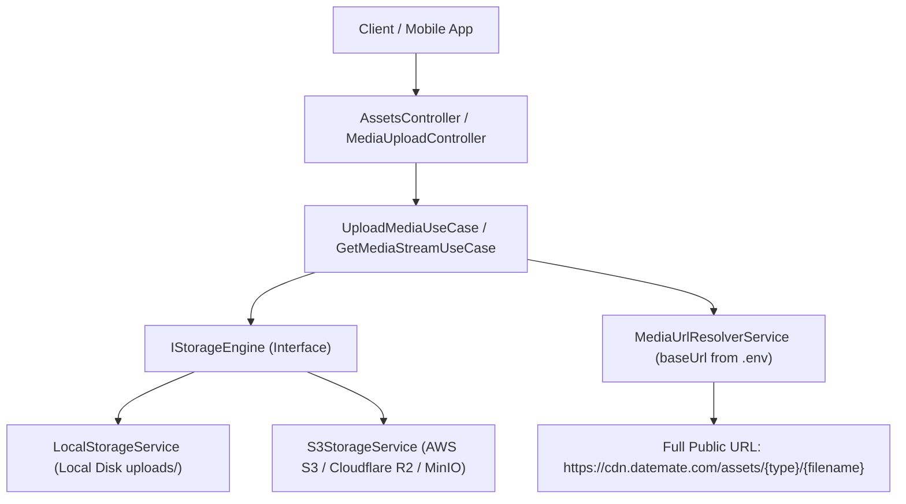

# DateMate Backend Architecture

## 1. Architectural Paradigm: Modular Monolith + Clean Architecture + DDD

DateMate is architected as a **Modular Monolith** applying **Domain-Driven Design (DDD)** and **Clean Architecture** principles. The system enforces strict boundaries between business logic and infrastructure to enable effortless maintenance, high test coverage, and a frictionless path to independent microservices when required.

### Layer Separation
1. **Domain Layer**: Pure business entities, enums, value objects, and repository/storage interfaces (`IStorageEngine`, `IUserRepository`). Zero external dependencies.
2. **Application Layer**: Use cases, DTOs, domain validators, and orchestrators (`UploadMediaUseCase`, `GetProfileUseCase`, `MediaUrlResolverService`).
3. **Infrastructure Layer**: Concrete persistence and driver implementations (`LocalStorageService`, `S3StorageService`, `PrismaUserRepository`, `RedisService`, `NodemailerService`).
4. **Presentation Layer**: NestJS controllers handling HTTP transport, OpenAPI/Swagger specifications, and input transformation (`AssetsController`, `MediaUploadController`, `UsersController`, `AuthController`).

### Canonical Contract Principles & No-Alias Policy
- **Don't add alias, client should have only one option to not confuse client**:
  - Maintain a single, canonical, unambiguous contract for every DTO, API request, and API response.
  - Do NOT accept parameters across multiple locations (e.g., do not accept the same parameter in headers, query parameters, and request body simultaneously).
  - Every field has one and only one authoritative location. For instance, in device termination (`DELETE /v1/users/devices`), client parameters (`excludeCurrent`, `refreshToken`) belong strictly in the request **body**.
  - **No Route Aliases**: Maintain one and only one canonical route path per endpoint (no multi-route bindings like `['devices', 'me/devices']`).
  - **No DTO Field Aliases**: Never introduce duplicate field names (e.g., `token` vs `refreshToken`). Clients must have exactly one clean, unambiguous way to interact with each endpoint to prevent confusion and bugs.

---

## 2. Media Upload & Scalable Asset System (`src/modules/media`)

### 2.1 Core Design Goals
- **Scalable Route Architecture**: Provides clean, dedicated routes for asset categories:
  - `/assets/icons/{filename}`
  - `/assets/images/{filename}`
  - `/assets/avatars/{filename}`
  - `/assets/selfies/{filename}`
  - `/assets/{type}/{filename}` (extensible to future types without code modification)
- **Decoupled Storage & Public URL Independence**:
  - The storage layer stores files organized by asset type (`uploads/<assetType>/<filename>` or `s3://<bucket>/<assetType>/<filename>`).
  - Stored database references hold relative keys (e.g. `icons/icon_123.svg`, `avatars/avatar_456.webp`).
  - The public URL is resolved dynamically using the configured `baseUrl`.
- **Zero-Migration Domain Changes**:
  - `baseUrl` is read from environment configuration (`ASSET_BASE_URL` -> `MEDIA_BASE_URL` -> `APP_BASE_URL` -> `http://localhost:<PORT>`).
  - Migrating to a CDN (e.g. `https://cdn.datemate.com`) requires only modifying `.env`; no database records require alteration.
- **Unique, Safe Filename Generation**:
  - Filenames follow the pattern: `<assetType>_<uuidHex>_<timestamp>.<safeExt>` (e.g. `icons_8f3e2b9c_1727599000000.svg`).
  - Strict protection against directory traversal (`..`, `/`, `\`, null bytes).
  - Cross-platform sanitized path handling.
- **Binary Inspection & Validation**:
  - Validates magic bytes for authentic JPEG, PNG, WebP, GIF, and PDF formats.
  - Cleans and sanitizes SVGs against embedded `<script>` or event handler XSS attacks.
  - Enforces size boundaries per asset type rule.

### 2.2 Storage Engine Abstraction (SOLID DIP & OCP)


### 2.3 Asset Type Registry
An extensible registry (`AssetTypeRegistry`) defines validation rules, MIME types, and size limits per asset type. Adding a new asset type (e.g., `banners`, `audio`, `documents`) only requires registering a configuration rule:
```typescript
registry.register({
  assetType: 'banners',
  allowedMimeTypes: ['image/jpeg', 'image/png', 'image/webp'],
  allowedExtensions: ['.jpg', '.jpeg', '.png', '.webp'],
  maxSizeBytes: 10 * 1024 * 1024,
  magicBytesValidation: true,
  description: 'Event and promotional banners',
});
```

---

## 3. Configuration Reference

| Environment Variable | Default | Purpose |
| :--- | :--- | :--- |
| `ASSET_BASE_URL` | `http://localhost:3000` | Authoritative public base domain for asset URLs |
| `MEDIA_BASE_URL` | *(optional fallback)* | Secondary asset base domain fallback |
| `APP_BASE_URL` | *(optional fallback)* | Application base URL fallback |
| `STORAGE_DRIVER` | `local` | Storage driver engine: `local` or `s3` |
| `UPLOADS_DIR` | `uploads` | Local disk storage root directory |
| `S3_BUCKET` | `datemate-media` | S3 bucket name when `STORAGE_DRIVER=s3` |
| `S3_REGION` | `us-east-1` | S3 bucket region |
| `S3_ENDPOINT` | *(optional)* | S3 endpoint override for MinIO / Cloudflare R2 |
| `RECOMMENDED_CACHE_TTL` | `86400` | Recommended candidate pool Redis cache duration in seconds (default: 86400 = 1 day) |
| `DOCS_IP_WHITELIST_ENABLED` | `false` | Enable/disable IP whitelist check for Swagger docs and /docs/rules (`true`/`false`) |
| `DOCS_ALLOWED_IPS` | `127.0.0.1,::1` | Comma-separated list of whitelisted IPs permitted to access docs and rules |
| `DOCS_AUTH_ENABLED` | `true` | Enable/disable HTTP Basic Auth login prompt for docs and rules (`true`/`false`) |
| `DOCS_USERNAME` | `admin` | HTTP Basic Auth username required to view docs and rules |
| `DOCS_PASSWORD` | `datemate_docs_password_2026` | HTTP Basic Auth password required to view docs and rules |
| `THROTTLE_TTL` | `60000` | Global rate limit rolling window duration in milliseconds (default: 60000 = 60s) |
| `THROTTLE_LIMIT` | `120` | Global maximum requests per IP permitted within THROTTLE_TTL window (default: 120) |
| `TRUST_PROXY` | `loopback` | Express trust proxy mode (`loopback`, `1`, `true`, CIDR). Prevents client IP spoofing |
| `PUSH_NOTIFICATION_BASE_URL` | *(required for push)* | External push notification gateway base URL |
| `PUSH_NOTIFICATION_API_KEY` | *(required for push)* | API key sent in `X-API-Key` header to push notification service |

---

## 4. API Specification

### Media Upload Endpoints
- `POST /v1/media/upload/:type` (and `/assets/upload/:type`): Multipart upload for any registered asset type.
- `POST /v1/media/upload/icons`: Dedicated icon upload.
- `POST /v1/media/upload/images`: Dedicated image upload.
- `POST /v1/media/upload/avatars`: Dedicated avatar upload.
- `GET /v1/media/types`: Returns supported asset types, allowed formats, and size constraints.

### Public Asset Endpoints
- `GET /assets/icons/:filename`: High-performance icon streaming with `ETag` and `304 Not Modified` support.
- `GET /assets/images/:filename`: High-performance image streaming.
- `GET /assets/avatars/:filename`: High-performance avatar streaming.
- `GET /assets/selfies/:filename`: High-performance selfie verification photo streaming.
- `GET /assets/:type/:filename`: Scalable endpoint dynamically serving any registered asset category.

---

## 5. Interests Module (`src/modules/interests`)

The Interests module provides category-based discovery of user hobbies and activities matching the mobile UI.

### 5.1 Architecture & Domain Invariants
- **Domain Entities**: `InterestCategoryEntity` and `InterestEntity` representing categories and their child interests.
- **Client Response Format**: Matches Android client schema:
  ```json
  [
    {
      "id": 1,
      "en": "Food",
      "fa": "غذا",
      "icon": {
        "type": "IMAGE",
        "url": "http://localhost:3000/assets/icons/Beach%20With%20Umbrella.svg",
        "alt": ""
      },
      "Interest": [
        {
          "id": 1,
          "en": "Gaming",
          "fa": "بازی"
        }
      ]
    }
  ]
  ```
- **Endpoints**:
  - `GET /interests` (and `GET /interest`): Retrieves list of categories with child interests. Supports optional `language` (en, fa) and `id` filter.
  - `GET /interests/:id`: Retrieves a single category with child interests.
  - `POST /interests` (and `POST /interest`): Admin-only category creation with child interests.
- **User Profile Integration**:
  - `GET /users/me`: Returns selected interests in `Profile.LikedActivities` as `{ [categoryId]: interestId | interestId[] }` (omitting duplicate `interest` / `interests`).
  - `PUT /users/me`: Updates selected user interests via `LikedActivities` key-value map, flat IDs, or category objects.
- **Seeding**:
  - Seed script: `npm run seed:interests` (`npx ts-node prisma/seed-interests.ts`).
  - Reads SVG icons from `seed-icons/intersets` or `seed-icons/interests` in project root and copies them to `uploads/icons/`.

---

## 6. Admin Panel Module (`src/modules/admin`)

The Admin Module provides administration, monitoring, user directory search, account moderation, and identity verification capabilities for platform operators.

### 6.1 Architecture & Domain Invariants
- **Bounded Context**: Dedicated `admin` domain isolated from consumer authentication and mobile profile endpoints.
- **Role-Based Security**: Secured with `AdminAuthGuard` requiring valid JWT with `role === 'ADMIN'`.
- **Session Termination on Ban**: Banning a user automatically purges all their active sessions (`user_sessions`) in real-time.
- **Identity Verification Notification**: Approving or rejecting a verification triggers `NotificationType.PROFILE_VERIFIED` to inform the user.

### 6.2 Administrative Endpoints
- `GET /v1/admin/dashboard/stats` (also `/v1/admin/dashboard/overview`): Returns KPI metrics (`totalUsers`, `onlineUsers`, `pendingSelfies`, `unansweredTickets`), weekly activity, gender stats, recent tickets, and `recentSelfies` (strictly returning the last 4 unvalidated users who have an existing `selfieUrl`).
- `GET /v1/admin/users/count`: Returns the total registered user count, supporting optional status filtering (`ALL`, `PENDING_VERIFICATION`, `BLOCKED`, `ONLINE`).
- `GET /v1/admin/users/pending-selfies/count`: Returns the count of unvalidated users who have a non-empty selfie URL and `profileValidated = false`.
- `GET /v1/admin/users`: Lightweight paginated user directory with multi-field search (`search`), status filters (`ALL`, `BLOCKED`, `PENDING_VERIFICATION`, `COMPLETED`), gender filters (`MALE`, `FEMALE`, `ALL`), age range filters (`minAge`, `maxAge`), and sorting (`createdAt`, `lastSeenAt`, `wallet`). Excludes heavy payloads (gallery, bio, transactions, chatRooms) for fast listing. Returns `id`, `email`, `fullName`, `avatarUrl`, `age`, `gender`, `isPremium`, `hasPendingSelfie`, `profileValidated`, `isOnline`, `bannedUntil`, and `createdAt`.
- `GET /v1/admin/users/:id`: Full user details endpoint providing complete inspection data for the admin details modal/tabs: demographics, full photo gallery, transactions, chatRooms, **devices** (list of user sessions: `id`, `deviceInfo`, `fcmToken`, `isActive`, `expiresAt`, `createdAt`), **likes** (list of right swipes received and sent: `id`, `userId`, `fullName`, `username`, `avatarUrl`, `city`, `type` ['RECEIVED' | 'SENT'], `createdAt`), and interests.
- `DELETE /v1/admin/users/:userId/devices/:deviceId`: Terminate device session endpoint allowing administrators to terminate / log out an active device session of a user by userId and deviceId (session ID). Returns `{ success: true, message: "Device session terminated successfully", data: { userId, deviceId, terminated: true } }`.
- `DELETE /v1/admin/users/:userId/devices`: Terminate all device sessions endpoint allowing administrators to terminate / log out all device sessions of a user by userId. Returns `{ success: true, message: "All user device sessions terminated successfully", data: { userId, terminated: true, count: number } }`.
- `DELETE /v1/admin/users/:id`: Permanently deletes a single user by ID and cascades through all associated records (sessions, profile, demographics, gallery, swipes, matches, messages). Strictly deletes only one user per request (multi-user delete is not supported).
- `DELETE /v1/admin/users/:userId/gallery/:galleryId`: Deletes a specific gallery photo for a user. If the deleted photo was the active profile picture, the backend automatically falls back to another gallery photo or clears `profilePictureUrl`. Returns `{ success: true, message: "Gallery image deleted successfully", data: { userId, galleryId, deleted: true } }`.
- `PATCH / PUT /v1/admin/users/:id`: Updates user moderation fields (bio, fullName, premium, wallet, and confirms selfie verification).
- `POST /v1/admin/users/:id/ban`: Bans/blocks user account with duration in hours or permanent ban (`null`).
- `POST /v1/admin/users/:id/unban`: Unbans user account and restores full access.
- `GET /v1/admin/verifications/count` (also `/v1/admin/verifications/pending/count`): Returns count of unvalidated users whose selfie is not validated, who have an existing selfie URL, and `profileValidated = false`.
- `GET /v1/admin/verifications`: Paginated queue of identity selfie reviews displaying user details (`id`, `userId`, `fullName`, `email`, `avatarUrl`, `selfieUrl`, `age`, `gender`, `requestedAt` ISO string, `status`). Strictly filters for users with an existing selfie photo (`selfieUrl` is not null/empty), and for `PENDING` status only returns unvalidated users (`profileValidated = false`). Supports `status` filter (`PENDING`, `APPROVED`, `REJECTED`, `ALL`), `page`, and `limit`.
- `POST /v1/admin/verifications/:id/approve`: Validates user profile (`profileValidated = true`) by verification request ID or userId, creates `PROFILE_VERIFIED` notification, and returns `{ success: true, message: "Verification approved successfully", ... }`.
- `POST /v1/admin/verifications/:id/reject`: Rejects verification by verification request ID or userId, clears `selfieUrl`, sets `profileValidated = false`, and fires notification explaining rejection reason. Accepts `{ reason?: string }` body and returns `{ success: true, message: "Verification rejected successfully", ... }`.

---

## 7. User Gallery & Swipe Profile Picture System (`src/modules/auth`)

The User Gallery system enables users to upload, manage, and curate their photo gallery for profile discovery and matching.

### 7.1 Architecture & Domain Invariants
- **Profile Picture vs. Avatar**:
  - `avatar`: Dedicated identity verification photo (stored in `Profile.avatarUrl`, served via `/assets/avatars/...`).
  - `profilePicture`: The primary public swipe picture used in the matching/discovery deck (stored in `Profile.profilePictureUrl`, served via `/assets/images/...`).
  - `Profile.profilePictureUrl` is persisted in nullable `profiles.profile_picture_url` (added by the `20261004130000_add_profile_picture_url_to_profiles` migration).
  - `Profile.profilePictureId`: Gallery ID of the currently active profile picture, returned in profile response.
  - `UserGallery.isProfilePicture`: Boolean flag designating which gallery item is currently active for swiping.
- **Multipart Upload Fields**:
  - Only three distinct file fields are accepted on profile update endpoints (`PUT /v1/users/profile` and `POST /v1/users/profile`):
    - `avatar?: Express.Multer.File[]` (max 1)
    - `selfie?: Express.Multer.File[]` (max 1)
    - `gallery?: Express.Multer.File[]` (max 1 - multiple gallery photo uploads in a single request are rejected)
- **Gallery Object & Profile Picture Updating**:
  - `gallery` in request body is a single object: `{ isProfilePicture?: boolean, image?: string, description?: string, id?: number }`.
  - `isProfilePicture` is optional: if omitted, the backend sets the user's first gallery image as `isProfilePicture: true` by default.
  - **In-place Gallery Update by ID**: When both a gallery image file and `gallery.id` are sent in the request, the backend replaces the existing gallery item's photo and description in-place without creating a duplicate record or counting towards the 10-image limit.
  - `profilePictureId`: integer gallery ID passed in request to select an existing or uploaded gallery photo as active profile picture.
  - **Single Canonical Contract**: `gallery` and `profilePictureId` are strictly sent outside the `Profile` object at the root level (no duplicated fields across root and nested objects). There is **no need** for `profilePicture` string URL in the request.

### 7.2 Validation Boundaries & Upload Rules
- **Resolution**: Resolution restriction removed for gallery uploads (no minimum 1200×800 or maximum dimension restriction; image dimensions are extracted for metadata and converted to WebP).
- **File Size Limits**: Minimum **50KB** and maximum **10MB** per photo.
- **Maximum Photos Per Upload**: 1 photo per request (multi-photo gallery requests are rejected with 400 Bad Request).
- **Maximum Total Upload Size**: 10MB per request.
- **Accepted Formats**: WebP (recommended) and JPG/JPEG/PNG. All images are normalized, EXIF-rotated, stripped of metadata, and converted to WebP via Sharp.
- **Gallery Total Capacity**: Maximum 10 photos stored per user (`projected = current - deleteCount + newUploads <= 10`).

### 7.3 Profile Response
`GET /v1/users/me`, `GET /v1/users/:id`, and `PUT /v1/users/profile` return the canonical client ProfileResponseDto:
```json
{
  "Profile": {
    "avatar": "http://localhost:3000/assets/avatars/avatar_1.webp",
    "profilePicture": "http://localhost:3000/assets/images/gallery_1_123.webp",
    "profilePictureId": 12
  },
  "gallery": [
    {
      "id": 12,
      "url": "http://localhost:3000/assets/images/gallery_1_123.webp",
      "description": "Weekend trip",
      "isProfilePicture": true,
      "createdAt": "2026-10-04T12:00:00.000Z"
    }
  ]
}
```

### 7.4 Gallery Image Deletion (`DELETE /v1/users/gallery/:galleryId`)
- **Self-Service Gallery Photo Delete**: Authenticated users can delete a specific photo from their gallery by `galleryId`.
- **Active Profile Picture Fallback**: If the deleted photo was the active profile picture, the backend automatically falls back to another existing gallery photo or sets `profilePictureUrl: null`.
- **Physical File Cleanup**: Attempts physical file deletion from disk (`uploads/` directory).
- **Response Contract**: Returns `{ status: "success", success: true, message: "Gallery image deleted successfully", data: { userId, galleryId, deleted: true } }`.
- **Bulk Deletion**: Bulk removals can also be executed in `PUT /v1/users/profile` via `deleteGalleryIds: [id1, id2]`.

### 7.5 User Account Deletion (`DELETE /v1/users/me` & `/v1/users/account`)
- **Self-Service Account Purge**: Authenticated users can permanently delete their own account.
- **Cascading Purge**: Removes user sessions, profiles, demographics, preferences, personalities, galleries, swipes, matches, and messages. Cleans up associated media files from local storage.
- **Response Contract**: Returns `{ status: "success", message: "Account deleted successfully", data: { userId, deleted: true } }`.

### 7.6 In-Process Geographic & Dataset Download Engine (`src/infrastructure/geo`)
- **Self-Contained In-Memory Engine**: Geographic datasets (`countries.json`, `states.json`, `cities.json`, `countries_states_cities.json`) are housed natively in `data/geo/` and indexed in memory on startup. Zero external HTTP/proxy dependencies on port 5454.
- **Unified Domain Routing**: All `/v1/geo/*` and `/v1/downloads/*` endpoints are served directly by the DateMate Backend on `api-datemate.testdevvvv.site` (with dl domain routed to backend as well).
- **Comprehensive Filter Support**:
  - `GET /v1/geo/countries`: Supports `?search=...`, `?envelope=true`, `?download=true` (sets `X-Total-Count`, `Content-Disposition`).
  - `GET /v1/geo/countries/:idOrName`: Resolves country by ID, name, or alias (`usa`, `us`, `america`, `uk`, etc.).
  - `GET /v1/geo/countries/:idOrName/states`: Resolves country's states (e.g. 60 states for America) with `?search=...`, `?envelope=true`.
  - `GET /v1/geo/states`: Retrieves states filtered by `?countryId=...`, `?country=...`, or `?search=...`.
  - `GET /v1/geo/states/:idOrName/cities`: Retrieves cities of a state (e.g. 311 cities for Alabama) with `?search=...`, `?limit=...`, `?offset=...`.
  - `GET /v1/geo/countries/:idOrName/cities`: Retrieves all cities in a country with pagination and search.
  - `GET /v1/geo/cities/:idOrName`: Resolves single city by ID or name (including Persian name transliteration map: e.g. `'تهران'` -> `'Tehran'`).
  - `GET /v1/geo/cities`: Resolves single city by `?id=...` or `?cityId=...`, or returns filtered list by state/country with pagination.
  - `GET /v1/geo/countries/:idOrName/hierarchy`: Returns complete nested hierarchy (`Country -> States -> Cities`).
- **Downloads & Catalog Engine**:
  - `GET /v1/downloads/catalog`: Discovers registered packages with file sizes, update dates, and filter capabilities.
  - `GET /v1/downloads/raw/:filename`: Directly streams static JSON files.
  - Convenience endpoints (`/v1/downloads/countries`, `/v1/downloads/states`, `/v1/downloads/cities`, `/v1/downloads/hierarchy`) force attachment download.
- **Single Canonical Contract (No Aliases)**:
  - In user profile responses (`GET /v1/users/profile`, `PUT /v1/users/profile`), city details reside exclusively at `Profile.Demographic.City` (`CityResponseDto` containing `id`, `name`, and nested `State: { id, name, Country }`).
  - Redundant field aliases (such as `City`, `city`, `cityName`, `citiName` at the `Profile` or root level, or `city` / `cityName` inside `Demographic`) are strictly forbidden.
  - In flat candidate DTOs (Feed, Recommended, Likes), the canonical city string is `city: string | null`.
- **Database Resilience**: During profile update transactions (`PUT /v1/users/profile` and `POST /v1/users/profile`), `demographics.city_id` stores the resolved geo ID (with FK constraint removed to prevent unseeded Postgres table errors) and optionally persists `city_name`.

### 7.6 Client User Profile Retrieval (`GET /v1/users/:id`)
- **Target Profile Inspection**: Allows authenticated clients to inspect any user's profile card by ID (e.g., when opening a profile from Feed or Matches).
- **Canonical Response Contract**: Returns the identical `ProfileResponseDto` schema as `GET /v1/users/me` (`id`, `email`, `language`, `lat`, `lon`, `profileValidated`, `isPremium`, `Profile: { fullName, username, phoneNumber, bio, languages, avatar, profilePicture, profilePictureId, profileCompleted, Demographic, RelationType, Answers, LikedActivities }`, and `gallery`).
- **Error Handling**: Missing or invalid token returns `401 Unauthorized`; non-existent user ID returns `404 Not Found`.

### 7.7 Bulk Users Retrieval (`POST /v1/users/bulk`)
- **Purpose**: High-performance batch endpoint to resolve multiple users' basic public profile information (e.g. for chat conversations, participant lists, and match previews) in a single request.
- **Request Body**: Accepts a list of user IDs directly as a JSON array (`[1, 2, 3]`), or optionally wrapped in an object (`{ "userIds": [1, 2, 3] }` / `{ "ids": [1, 2, 3] }`).
- **Response Contract**: Returns a list of user items, preserving the requested order of IDs, each containing:
  - `id`: User ID (`number`)
  - `avatar`: Publicly resolved avatar URL (`string | null`)
  - `username`: Username handle (`string | null`)
  - `fullName`: User's full name (`string | null`)
- **Authentication**: Optional Bearer token authentication (verified if provided; allows service-to-service calls).

### 7.8 Device Push Token & Device Info APIs (`PUT /v1/users/device-token`, `GET /v1/users/:userId/device-token`)
- **Single Canonical Contract (Strictly Zero Aliases)**:
  - Canonical field names are strictly `token` (`string`) and `deviceInfo` (`string | null`).
  - No aliases (`fcmToken`, `deviceToken`, `device_token`, `fcm_token`, `Token`, `DeviceInfo`, etc.) are permitted.
- **Update Device Token (`PUT /v1/users/device-token`)**:
  - Authenticated user endpoint (`Bearer <token>`).
  - Request body: `{ token: string, deviceInfo?: string }`.
  - Automatically updates the current active session (via JWT `sessionId`) or latest active session with the new device push token and optional device info string.
  - Returns: `{ status: "success", message: "Device token updated successfully", data: { userId, token, deviceInfo } }`.
- **Get Device Token & Device Info by User ID (`GET /v1/users/:userId/device-token`)**:
  - Path parameter: `userId` (number).
  - **Authentication**: Authenticated strictly via API key (`ApiKeyGuard`), NOT user JWT. The API key may be passed in header `x-api-key: <key>`, `Authorization: ApiKey <key>`, `Authorization: Bearer <key>`, or query param `?apiKey=<key>`.
  - Configurable via `DEVICE_TOKEN_API_KEY`, `INTERNAL_API_KEY`, or `API_KEY` environment variables (with default development key `datemate_device_token_api_key_2026`).
  - Retrieves the user's active device push token and device information.
  - Returns `401 Unauthorized` if API key is missing or invalid.
  - Returns `404 Not Found` if the user does not exist.
  - Returns: `{ status: "success", message: "Device token retrieved successfully", data: { userId, token, deviceInfo } }`.

### 7.9 User Avatar APIs (`GET /v1/users/:id/avatar`, `GET /v1/users/avatars/:ids`)
- **Single User Avatar (`GET /v1/users/:id/avatar`)**:
  - Path parameter: `id` (positive integer).
  - **Resolution**: Resolves `Profile.avatarUrl` directly via `MediaUrlResolverService` without querying or falling back to gallery photos. Returns `null` if no avatar is set.
  - **Response Contract (`UserAvatarDto`)**:
    - `id`: User ID (`number`)
    - `avatarUrl`: Publicly resolved avatar URL (`string | null`)
  - **Error Handling**: Missing/invalid token returns `401 Unauthorized`; non-existent user returns `404 Not Found`.
- **Multiple User Avatars (`GET /v1/users/avatars/:ids`)**:
  - Path parameter: `ids` (comma-separated list of user IDs, e.g. `/v1/users/avatars/1,2,3`).
  - **Authentication**: Authenticated user endpoint (`Bearer <token>`).
  - **Response Contract**: Returns an array of `UserAvatarDto` (`[{ id, avatarUrl }]`), preserving the requested order of valid IDs.
  - **Error Handling**: Missing/invalid token returns `401 Unauthorized`.

---


## 8. Authentication & Admin Sign-In (`src/modules/auth`)

The Authentication module supports consumer mobile applications and web administration portals with unified credentials.

### 8.1 Dual Identifier Sign-In (`POST /v1/auth/signin` & `/auth/signin`)
- **Flexible Identifier**: Accepts either `username` or `email` (or `usernameOrEmail` alias).
  - Searches `Profile.username` and `User.email` case-insensitively.
- **Web & Mobile Compatibility**:
  - Android client attestation fields (`integrityToken`, `packageName`, `device`, `userAgent`, `fcmToken`) are optional.
  - Web applications (such as Admin Panels) can authenticate by providing only:
    ```json
    {
      "username": "admin",
      "password": "Password123!"
    }
    ```
    or
    ```json
    {
      "email": "admin@datemate.com",
      "password": "Password123!"
    }
    ```
- **Device Information Default**: If client device metadata is omitted, `deviceInfo` defaults gracefully to `'Web Browser'`.
- **Role Propagation**:
  - JWT access tokens encode `role` in the payload (`role: 'ADMIN' | 'USER'`).
  - Auth response returns the authenticated user's role:
    ```json
    {
      "userId": 18,
      "access": "<jwt_access_token>",
      "refresh": "<refresh_token>",
      "role": "ADMIN"
    }
    ```
- **Admin Seeding**: Seeded admin user can be provisioned via `npm run seed:users` (`admin` / `admin@datemate.com`).

### 8.2 Client Logout API (`POST /v1/auth/logout` & `/auth/logout`)
- **Single-Device Logout (Current Session Only)**: `POST /v1/auth/logout` strictly logs out the current device session. To terminate all devices or other devices, users use the dedicated device management API (`DELETE /v1/users/devices`).
- **Bearer Header for Authentication**: The `Authorization: Bearer <accessToken>` header is used purely for request authentication and session verification.
- **RefreshToken Required in Body**: The client sends `{ "refreshToken": "..." }` in the request body to specify the session to terminate. No aliases (`token`) are accepted.
- **Standard Response Contract**: Returns `{ status: "success", message: "Logged out successfully", data: { loggedOut: true } }`.

### 8.3 Client Device Management & Termination (`GET /v1/users/devices`, `DELETE /v1/users/devices/:deviceId`, `DELETE /v1/users/devices`)
- **Get Active & Inactive Devices (`GET /v1/users/devices`)**:
  - Retrieves all device sessions for the authenticated user with explicit categorization (`devices`, `activeDevices`, `inactiveDevices`, `total`, `activeCount`, `inactiveCount`).
  - Automatically identifies whether each session is currently active (`isActive = true` when `expiresAt > now`).
  - Automatically tags the caller's current session (`isCurrent = true`) using the `sessionId` embedded inside the Bearer access token payload. No query parameter or custom header aliases are accepted.
  - Standard response envelope: `{ status: "success", message: "User devices retrieved successfully", data: { devices, activeDevices, inactiveDevices, total, activeCount, inactiveCount } }`.
- **Terminate a Specific Device Session (`DELETE /v1/users/devices/:deviceId`)**:
  - Authenticated user can terminate/log out any specific device session by deviceId.
  - Strictly verifies that the session belongs to the authenticated user (returns 404 if not found or belongs to another user).
  - Standard response envelope: `{ status: "success", success: true, message: "Device session terminated successfully", data: { deviceId, terminated: true } }`.
- **Terminate All Devices or All Except Current (`DELETE /v1/users/devices`)**:
  - Accepts parameters strictly in the request **body** (`TerminateClientDevicesDto: { excludeCurrent?: boolean, refreshToken?: string }`).
  - Zero aliases: redundant `x-refresh-token` header and query parameter aliases are removed.
  - When `excludeCurrent` is omitted or `false`, terminates all active and inactive device sessions for the authenticated user.
  - When `excludeCurrent=true`, terminates all device sessions EXCEPT the current caller's session (identified via session ID in the Bearer token or `refreshToken` provided in the request body).
  - Standard response envelope: `{ status: "success", success: true, message: "Device sessions terminated successfully", data: { terminatedCount, excludedCurrent } }`.

### 8.4 Immediate Device Session Termination & Access Token Revocation
- **Immediate Invalidation (Zero-Delay Revocation)**:
  - Access tokens embed the session ID (`sessionId`) in their JWT payload.
  - On every authenticated API request, `TokenService.verifyAccessToken()` validates the cryptographic signature and expiration, and performs an active session check against `user_sessions` in PostgreSQL (along with checking `User.bannedUntil`).
  - When a device is terminated—either by an administrator (`DELETE /v1/admin/users/:userId/devices/:deviceId` or `DELETE /v1/admin/users/:userId/devices`) or by the user themselves (`DELETE /v1/users/devices/:deviceId`, `DELETE /v1/users/devices`, or `POST /v1/auth/logout`)—the session record is deleted from the database.
  - The terminated device is immediately rejected on its very next API request with HTTP `401 Unauthorized` (`"Device session has been terminated or expired"`), guaranteeing real-time access revocation without waiting for the JWT's natural expiration.
  - Subsequent refresh token exchange attempts also fail because the refresh token hash no longer exists in `user_sessions`.

---

## 9. Matching & Swipes Module (`src/modules/matching`)

The Matching module provides candidate discovery (feed deck), high-throughput atomic swiping, and likes-received inspection designed for high scale and low latency.

### 9.1 Core Domain Philosophy & Business Rules
- **No Mutual Match Gate**: Unlike traditional dating apps that require a mutual right-swipe before revealing interest, DateMate allows users to directly inspect everyone who liked them (`GET /v1/likes`).
- **Sub-50ms Fast Swiping (`POST /v1/swipes`)**:
  - The client submits `{ targetUserId: number, direction: 'RIGHT' | 'LEFT' }`.
  - The backend executes an in-memory Redis update and persists to PostgreSQL.
  - Returns a minimal HTTP 200 OK (`{ status: "success", message: "Swipe recorded successfully" }`) **without hydrating matched user details**, ensuring maximum write throughput and sub-50ms response times.
- **Strict 6 Feed Selection Invariants (`GET /v1/feed`)**:
  The candidate feed deck (default 20 cards) is strictly filtered by:
  1. **Exclude Self**: `candidate.id != currentUserId`.
  2. **Exclude Already Swiped (with Loop Fallback)**: By default, excludes users previously swiped (Right or Left) via Redis in-memory set and PostgreSQL [`Swipe`](file:///home/parsa/Documents/projects/datemate/backend/prisma/schema.prisma#L399) records. If the unswiped candidate pool reaches 0 (deck exhausted), the feed automatically loops back through the candidate pool excluding only the user themselves so the user can continue viewing candidates.
  3. **Account Status**: `bannedUntil IS NULL` (user is not banned or suspended).
  4. **Has Photo**: Candidate must possess an active profile picture (prioritizing the `gallery` item with `isProfilePicture: true`, falling back to first gallery photo, `profile.profilePictureUrl`, or `profile.avatarUrl`). The feed candidate `profilePicture` field provides the resolved public URL of the gallery image marked with `isProfilePicture: true`.
  5. **Profile Validated**: Candidate has `profileValidated == true` (strictly checks `User.profileValidated == true`; does NOT require an existing `selfieUrl`).
  6. **Gender Matching**: Strictly serves the opposite gender (if user is `MALE`, sends `FEMALE`; if `FEMALE`, sends `MALE`).

### 9.2 API Endpoints
- `POST /v1/swipes` (and `/swipes`): Records swipe action (`RIGHT` or `LEFT`) on a target user. Returns fast 200 OK without extra payload.
- `GET /v1/feed` (and `/feed`): Retrieves candidate profiles for the swipe deck (supports query parameter `limit`, default: 20, max: 50).
- `GET /v1/likes` (and `/likes`): Retrieves all profiles that swiped right (liked) on the authenticated user. Returns `id`, `fullName`, `username`, `city`, `isOnline`, `avatarUrl`:
  ```json
  {
    "status": "success",
    "message": "Likes retrieved successfully",
    "data": [
      {
        "id": 205,
        "fullName": "Sara Connor",
        "username": "sarah_c",
        "city": "Tehran",
        "isOnline": true,
        "avatarUrl": "http://localhost:3000/assets/gallery/profile_pic.webp"
      }
    ]
  }
  ```
- `GET /v1/matches` (and `/matches`): Canonical compatibility endpoint returning the exact same likes list (`data: LikedUserDto[]`).

---

## 10. Recommended Module (`src/modules/recommended`)

The Recommended module computes personalized, high-compatibility profile recommendations (default: 20 candidates per request) using dynamic similarity scoring without hardcoded lifestyle or question rules.

### 10.1 Hygiene Invariants & Filters
Before scoring, candidates must satisfy the 6 discovery baseline hygiene rules:
1. **Exclude Self**: Candidate `id != currentUserId`.
2. **Exclude Already Swiped (with Backfill Fallback)**: Excludes candidates already swiped (`RIGHT` or `LEFT`) recorded in Redis (`swiped:{userId}`) and PostgreSQL [`Swipe`](file:///home/parsa/Documents/projects/datemate/backend/prisma/schema.prisma) table. If there are not enough unswiped candidates to satisfy the requested `limit`, swiped users are retrieved to backfill remaining slots (unswiped candidates are strictly prioritized first, followed by swiped candidates sorted from highest compatibility score to lowest).
3. **Account Status**: Active account (`bannedUntil IS NULL` or in the past).
4. **Has Active Photo**: Must have a valid, non-empty profile picture (`profilePictureUrl`, `avatarUrl`, or active gallery photo).
5. **Profile Validated**: Candidate has `profileValidated == true` (strictly checks `User.profileValidated == true`; does NOT require an existing `selfieUrl`).
6. **Gender**: Strictly opposite gender (`MALE` $\leftrightarrow$ `FEMALE`).

### 10.2 Modular Architecture & Separated Recommendation Algorithm
To ensure maintainability, readability, and ease of modification, the recommendation module decomposes responsibilities strictly following DDD and Clean Architecture:
- **`RecommendationAlgorithmService`** (`src/modules/recommended/domain/services/recommendation-algorithm.service.ts`):
  Pure, decoupled domain service containing the scoring formulas, weight definitions (`DEFAULT_RECOMMENDATION_WEIGHTS`), hygiene photo/validation checks, and multi-factor ranking. It is isolated from database and network infrastructure for easy inspection and algorithm adjustments.
- **`RecommendedCacheService`** (`src/modules/recommended/application/services/recommended-cache.service.ts`):
  Manages candidate list persistence in Redis (`recommended:ranked:{userId}`) with a 1-day TTL read directly from the environment (`RECOMMENDED_CACHE_TTL`, default: `86400` seconds). The cached candidate ranking persists consistently across consecutive client requests and automatically refreshes daily to account for changing user interests or newly joined users.
- **`GetRecommendedUseCase`** (`src/modules/recommended/application/use-cases/get-recommended.use-case.ts`):
  Retrieves lightweight cards (`id`, `avatarUrl`, `age`, `city`, `username`, `fullName`) with numeric pagination (`start`, `limit`, `end`, `offset`).
- **`GetRecommendedDetailUseCase`** (`src/modules/recommended/application/use-cases/get-recommended-detail.use-case.ts`):
  Retrieves full candidate profiles matching the Android `/me` canonical schema (`ProfileResponseDto`), preserving the exact recommendation order from the 1-day Redis cache.

### 10.3 Dynamic Compatibility Scoring Algorithm
Candidates are ranked in descending order of a multi-factor compatibility score ($0 \dots 100$):
1. **Dynamic Lifestyle & Personality Questions (Weight: up to 35 pts)**:
   - Evaluates shared question answers from [`UserQuestionAnswer`](file:///home/parsa/Documents/projects/datemate/backend/prisma/schema.prisma) across all dynamic question types (`LIFESTYLE`, `PERSONALITY`, `VALUES`, `PREFERENCES`).
   - Zero hardcoding of question texts or IDs; computed as the ratio of overlapping answers to total answered questions.
2. **Shared Interests (Weight: up to 25 pts)**:
   - Evaluates overlap across user interest tags ([`UserInterest`](file:///home/parsa/Documents/projects/datemate/backend/prisma/schema.prisma)).
3. **Same City Proximity (Weight: 20 pts)**:
   - $+20$ points when candidate's `cityId` matches current user's `cityId`.
4. **Relationship Goal Alignment (Weight: 10 pts)**:
   - $+10$ points when candidate's [`Preferences.relation`](file:///home/parsa/Documents/projects/datemate/backend/prisma/schema.prisma) matches user's relationship goal (`LONG`, `FUN`, `OPEN`).
5. **Age Proximity (Weight: up to 10 pts)**:
   - Evaluates age difference: $\le 3$ years: $+10$ pts; $\le 6$ years: $+6$ pts; $\le 10$ years: $+3$ pts.

Ranking order:
- Unswiped candidates appear first; swiped fallback candidates appear second.
- Within each tier, candidates sort in descending order of compatibility score (from highest match to lowest filter/match).
- Tie-breakers sort by user activity (`isOnline` descending), recent presence (`lastSeenAt` descending), and user ID.

### 10.4 API Endpoints

#### 1. Lightweight Discovery Cards: `GET /v1/recommended`
- **Query Params**:
  - `start` / `offset` (default: 0): Starting numeric index (0-based) OR candidate user ID cursor to start from/after.
  - `candidateId` (optional): Explicit candidate user ID cursor to start from/after.
  - `limit` (default: 20, min: 1, max: 50): Number of profile cards to retrieve.
  - `end` (optional): Ending numeric index.
  - `anchorUserId` (optional): Anchor candidate user ID around which to retrieve preceding and succeeding candidates.
  - `before` (optional, min: 0, max: 50): Number of candidates preceding the anchor.
  - `after` (optional, min: 0, max: 50): Number of candidates succeeding the anchor.
- **Caching**: 1-day Redis cache (`recommended:ranked:{userId}`). Does not regenerate automatically while cache is active; only generates and saves on first request or when cache expires.
- **Auth**: Requires Bearer JWT token (`UserAuthGuard`).
- **Response Payload**: Returns lightweight cards:
  ```json
  {
    "status": "success",
    "message": "Recommended profiles retrieved successfully",
    "data": [
      {
        "id": 102,
        "avatarUrl": "http://localhost:3000/assets/avatars/avatar_102.webp",
        "age": 25,
        "city": "Tehran",
        "username": "sarah_c",
        "fullName": "Sara Connor"
      }
    ]
  }
  ```

#### 2. Full Profile Details: `GET /v1/recommended/detail`
- **Query Params**:
  - `start` / `offset` (default: 0): Starting numeric index (0-based) OR candidate user ID cursor to start from/after.
  - `candidateId` (optional): Explicit candidate user ID cursor to start from/after.
  - `limit` (default: 20, min: 1, max: 50): Number of detailed profiles to retrieve.
  - `end` (optional): Ending numeric index.
  - `anchorUserId` (optional): Anchor candidate user ID around which to retrieve preceding and succeeding candidates (e.g. `anchorUserId=123&before=10&after=10`).
  - `before` (optional, min: 0, max: 50): Number of candidates preceding the anchor.
  - `after` (optional, min: 0, max: 50): Number of candidates succeeding the anchor.
- **Auth**: Requires Bearer JWT token (`UserAuthGuard`).
- **Response Payload**: Returns full `/me` detailed profile objects:
  ```json
  {
    "status": "success",
    "message": "Recommended detailed profiles retrieved successfully",
    "data": [
      {
        "id": 102,
        "email": "sarah@example.com",
        "language": "EN",
        "lat": 35.6892,
        "lon": 51.389,
        "profileValidated": true,
        "isPremium": false,
        "Profile": {
          "fullName": "Sara Connor",
          "username": "sarah_c",
          "phoneNumber": "+1234567890",
          "bio": "Designer in Tehran",
          "languages": ["en", "fa"],
          "avatar": "http://localhost:3000/assets/avatars/avatar_102.webp",
          "profilePicture": "http://localhost:3000/assets/avatars/avatar_102.webp",
          "profilePictureId": 5,
          "profileCompleted": true,
          "isPremium": false,
          "Demographic": {
            "birthDate": "1998-01-01",
            "gender": "FEMALE",
            "height": 168,
            "degree": "BACHELOR",
            "profession": "Designer",
            "relationStatus": "SINGLE",
            "City": {
              "id": 1,
              "name": "Tehran",
              "state": "Tehran",
              "country": "Iran"
            }
          },
          "RelationType": "LONG",
          "Answers": { "1": 0, "2": 1 },
          "LikedActivities": { "1": [1, 2] }
        },
        "gallery": [
          {
            "id": 5,
            "url": "http://localhost:3000/assets/images/gallery_5.webp",
            "description": "At the design studio",
            "isProfilePicture": true,
            "createdAt": "2026-10-04T12:00:00.000Z"
          }
        ]
      }
    ]
  }
  ```

---

## 11. Global Rate Limiting & Proxy Security

### 11.1 Architecture & Core Configuration
Rate limiting is globally enforced using the official `@nestjs/throttler` package integrated at the root module level (`src/app.module.ts`) via `APP_GUARD` and `ThrottlerGuard`.

- **Global Threshold**: **120 requests per IP per 60 seconds** (configurable via `THROTTLE_LIMIT` and `THROTTLE_TTL`).
- **Response On Limit Exceeded**: Returns HTTP `429 Too Many Requests` formatted cleanly through `AllExceptionsFilter`:
  ```json
  {
    "status": "error",
    "message": "Too Many Requests",
    "data": null,
    "error": {
      "type": "UNKNOWN_ERROR",
      "message": "Too Many Requests"
    }
  }
  ```
- **Standard Headers**: Rate-limiting response headers (`X-RateLimit-Limit`, `X-RateLimit-Remaining`, `X-RateLimit-Reset`, and `Retry-After`) are returned to enable client-side backoff calculation.
- **Monitoring / Health Exemption**: Health check endpoints (`GET /health` and `GET /`) are decorated with `@SkipThrottle()` to prevent container orchestrators (Docker, Kubernetes) and monitoring systems from being inadvertently throttled.

### 11.2 Reverse Proxy & Client IP Verification (Anti-Spoofing)
DateMate operates behind Nginx (configured in `docker-compose.yml` and `nginx/nginx.conf` terminating SSL and forwarding traffic to `127.0.0.1:2020`).

- **The Threat**: Attackers can send arbitrary `X-Forwarded-For` or `X-Real-IP` request headers from the client to attempt bypassing IP-based rate limiting or to cause denial-of-service against other users.
- **The Defense**:
  - Express is explicitly configured with `app.set('trust proxy', 'loopback')` in `src/main.ts`.
  - When `trust proxy` is set to `'loopback'` (or `1`), Express **only trusts the immediate reverse proxy hop** if the connection originates from a loopback address (`127.0.0.1` / `::1`).
  - Express evaluates `X-Forwarded-For` from right to left, peeling off the trusted loopback hop and selecting the first untrusted IP (the genuine client IP appended by Nginx's `$proxy_add_x_forwarded_for`). Any spoofed IP addresses prepended by malicious clients are discarded.
  - If a client connects directly to the backend bypassing Nginx, the incoming connection socket address is not loopback; Express automatically rejects all forwarded headers and uses the raw TCP socket address (`req.socket.remoteAddress`).

### 11.3 Endpoint-Specific Sensitive Route Limits
To defend against brute-force credential stuffing, OTP guessing, and email-bombing attacks, strict limits are declared using `@Throttle()` in `src/modules/auth/presentation/auth.controller.ts`:

| Endpoint | Method | Limit | TTL | Rationale |
| :--- | :--- | :--- | :--- | :--- |
| `/v1/auth/signin` | `POST` | 10 reqs | 60s | Mitigates credential stuffing and password brute-force attacks |
| `/v1/auth/signup` | `POST` | 10 reqs | 60s | Prevents automated registration spam and email inbox flooding |
| `/v1/auth/verify` | `POST` | 10 reqs | 60s | Stops brute-forcing 6-digit OTP verification codes (10m lifespan) |
| `/v1/auth/forgot-password` | `POST` | 5 reqs | 60s | Thwarts OTP spam and email exhaustion attacks against target accounts |
| `/v1/auth/reset-password` | `POST` | 10 reqs | 60s | Prevents rapid brute-force execution of password resets |

### 11.4 Scalability & Distributed Storage Considerations
- **Current Storage Model**: The default `@nestjs/throttler` storage uses high-performance in-memory storage (`ThrottlerStorageService`).
- **Single-Instance Suitability**: In single-instance deployments, in-memory rate limiting delivers minimal latency and zero extra infrastructure dependencies.
- **Multi-Instance / Clustered Limitations**:
  - In horizontal scale-out scenarios where multiple DateMate backend instances run behind a load balancer, each instance maintains an isolated in-memory counter table.
  - Consequently, client request capacity would multiply across $N$ instances ($N \times 120$ requests/min).
  - Additionally, instance restarts (e.g., rolling deployments or auto-scaling events) clear in-memory hit counts.
- **Recommendation for Distributed Deployments**:
  - When running multiple backend instances, configure shared distributed storage using DateMate's existing Redis cluster (`ioredis`).
  - `@nestjs/throttler` provides pluggable storage support via `@nestjs/throttler-storage-redis` or custom `ThrottlerStorage` implementing `increment()`, pointing to the existing `REDIS_HOST` and `REDIS_PORT` service defined in `src/infrastructure/redis/redis.module.ts`.

### 11.5 Nginx Edge Rate Limiting & Sensitive Path Protection
Nginx serves as the primary edge reverse proxy terminating TLS and protecting the backend from automated vulnerability scanning and DDoS floods before traffic ever reaches NestJS.

- **Dual-Layer Defense-in-Depth**:
  - **Layer 1 (Nginx)**: Absorbs high-volume L7 traffic spikes and rapid scanner bursts at the network edge with minimal CPU overhead.
  - **Layer 2 (NestJS @nestjs/throttler)**: Enforces business-aware rate limiting, rolling session quotas, and endpoint-specific thresholds (such as 5–10 attempts/min on auth routes).
- **Shared Memory Zone (`api_limit`)**:
  - Configured at the top-level `http` block: `limit_req_zone $binary_remote_addr zone=api_limit:10m rate=10r/s;`.
  - A 10 MB zone efficiently holds approximately 160,000 concurrent client IP states in binary format.
- **Enforcement & Burst Handling**:
  - Applied to the API proxy location: `limit_req zone=api_limit burst=30 nodelay;`.
  - Legitimate bursts of up to 30 requests are serviced immediately without artificial delays (`nodelay`).
  - Excess requests immediately trigger rejection status `limit_req_status 429;`.
- **Unified 429 Error Envelope**:
  - An internal Nginx handler (`error_page 429 = @rate_limited;`) outputs a unified JSON response matching the application's standard error format:
    ```json
    {"status":"error","message":"Too Many Requests","data":null,"error":{"type":"UNKNOWN_ERROR","message":"Too Many Requests"}}
    ```
- **Sensitive Path Probing Denial**:
  - Requests targeting common automated scanner patterns (`/ssh/`, `/keys/`, `/id_rsa`, `/id_ed25519`, `/private_key.pem`, and hidden credentials) are intercepted and dropped with HTTP 404 at the Nginx edge without forwarding to upstream services:
    ```nginx
    location ~* (/(?:\.?ssh|\.?keys)(?:/|$)|id_rsa|id_ed25519|private_key\.pem) {
        return 404;
    }
    ```
- **Anti-Spoofing Client Identifier**:
  - Rate limiting strictly indexes `$binary_remote_addr` (the actual IP from the TCP connection). Nginx does not trust client-supplied `X-Forwarded-For` or `X-Real-IP` headers, preventing attackers from bypassing edge rate limits via spoofed header injection.

---

## 12. Friends Module (`src/modules/friends`)

The Friends module provides social connections, friend request workflows, and friends directory capabilities.

### 12.1 Architecture & Domain Invariants
- **Bounded Context**: Dedicated `friends` domain organized around Clean Architecture, DDD, and SOLID principles.
- **Single Canonical Contract**:
  - Strict canonical field names: DTOs use `userId` for target user in add-friend payload.
  - Candidate/user profile information strictly uses `city: string | null` (no alias fields per Rule 6).
- **Auto-Accept Reciprocal Requests**:
  - If User B has already sent a `PENDING` friend request to User A, and User A calls `POST /v1/friends/add` with User B's `userId`, the system automatically accepts the existing request and establishes friendship immediately without duplicate entries.
- **Invariants & Validations**:
  - Cannot add self (`BadRequestException: Cannot add yourself as a friend`).
  - Target user must exist (`NotFoundException: Target user not found`).
  - Neither sender nor receiver can be banned (`ForbiddenException`).
  - Cannot duplicate pending requests (`BadRequestException: Friend request is already pending`).
  - Cannot re-request if already friends (`BadRequestException: Users are already friends`).
  - Only the intended recipient can accept or reject a friend request (`ForbiddenException`).
  - Automatically emits notification of type `NotificationType.FRIEND_REQUEST` for the recipient upon sending.

### 12.2 API Endpoints
- `POST /v1/friends/add`: Sends a friend request to a target user.
  - Body: `{ "userId": 205 }`
  - Response:
    ```json
    {
      "status": "success",
      "message": "Friend request sent successfully",
      "data": {
        "id": 1,
        "status": "PENDING",
        "createdAt": "2026-10-27T12:00:00.000Z",
        "updatedAt": "2026-10-27T12:00:00.000Z",
        "fullName": "Sara Connor",
        "username": "sarah_c",
        "avatarUrl": "http://localhost:3000/assets/avatars/avatar_205.webp"
      }
    }
    ```
- `GET /v1/friends/requests`: Retrieves paginated friend requests with flat items in root of each item.
  - Query: `page` (default: 1), `limit` (default: 10, max: 100), `type` (`'received'` | `'sent'`, default: `'received'`), `status` (`PENDING`, `ACCEPTED`, `REJECTED`, `CANCELLED`).
  - Response:
    ```json
    {
      "status": "success",
      "message": "Friend requests retrieved successfully",
      "data": {
        "items": [
          {
            "id": 1,
            "status": "PENDING",
            "createdAt": "2026-10-27T12:00:00.000Z",
            "updatedAt": "2026-10-27T12:00:00.000Z",
            "fullName": "Ali Reza",
            "username": "alireza",
            "avatarUrl": "http://localhost:3000/assets/avatars/avatar_10.webp"
          }
        ],
        "total": 1,
        "page": 1,
        "limit": 10,
        "totalPages": 1
      }
    }
    ```
- `POST /v1/friends/accept/:id`: Accepts a pending friend request by request ID (or sender user ID).
  - Param: `id` (integer)
  - Response: `{ "status": "success", "message": "Friend request accepted successfully", "data": { "id": 1, "status": "ACCEPTED", "createdAt": "...", "updatedAt": "...", "fullName": "...", "username": "...", "avatarUrl": "..." } }`
- `POST /v1/friends/reject/:id`: Rejects a pending friend request by request ID (or sender user ID).
  - Param: `id` (integer)
  - Response: `{ "status": "success", "message": "Friend request rejected successfully", "data": { "id": 1, "status": "REJECTED", "createdAt": "...", "updatedAt": "...", "fullName": "...", "username": "...", "avatarUrl": "..." } }`
- `POST /v1/friends/cancel/:id`: Cancels an outgoing pending friend request previously sent by the user by request ID (or target user ID).
  - Param: `id` (integer)
  - Response: `{ "status": "success", "message": "Friend request cancelled successfully", "data": { "id": 1, "status": "CANCELLED", "createdAt": "...", "updatedAt": "...", "fullName": "...", "username": "...", "avatarUrl": "..." } }`
- `GET /v1/friends`: Retrieves accepted friends with pagination and optional search query with flat items in root of each item.
  - Query: `page` (default: 1), `limit` (default: 10, max: 100), `search` (optional string filtering by `fullName` or `username`).
  - Response:
    ```json
    {
      "status": "success",
      "message": "Friends retrieved successfully",
      "data": {
        "items": [
          {
            "id": 1,
            "status": "ACCEPTED",
            "createdAt": "2026-10-27T12:00:00.000Z",
            "updatedAt": "2026-10-27T12:00:00.000Z",
            "fullName": "Sara Connor",
            "username": "sarah_c",
            "avatarUrl": "http://localhost:3000/assets/avatars/avatar_205.webp"
          }
        ],
        "total": 1,
        "page": 1,
        "limit": 10,
        "totalPages": 1
      }
    }
    ```
- `DELETE /v1/friends/:friendId`: Removes an existing friend by user ID (or friendship request ID).
  - Param: `friendId` (integer)
  - Response: `{ "status": "success", "message": "Friend removed successfully" }`

---

## 12. Push Notification Subsystem (`src/infrastructure/notification`)

### 12.1 Centralized Template Registry (`notification-templates.ts`)
All push notification templates, strongly typed payload interfaces, and priorities are centralized in a single file: `src/infrastructure/notification/notification-templates.ts`. This provides a single authoritative source for editing notification copy and ensures type safety.

#### Supported Notification Types & Priorities
Allowed priority values are `'high'` and `'normal'` (mapped to FCM Android priority `'high'`/`'normal'`, and APNs iOS header `'apns-priority': '10'`/`'5'`).

| Notification Type | `data.type` (lowercase) | Priority | Title Template | Body Template |
| :--- | :--- | :--- | :--- | :--- |
| `FRIEND_REQUEST` | `friend_request` | `normal` | `[Target/SenderFullName]` | `[FullName] sent you friend request` |
| `FRIEND_REQUEST_ACCEPTED` | `friend_request_accepted` | `normal` | `[Target/OtherFullName]` | `Now [fullName] is your friend` (sent to both users) |
| `LIKE_USER` | `like_user` | `normal` | `[LikerFullName]` | `user [fullName] like your profile` |
| `SELFIE_ACCEPTED` | `selfie_accepted` | `normal` | `Selfie Accepted` | `your selfie accepted, now your profile completed` |
| `SELFIE_REJECTED` | `selfie_rejected` | `normal` | `Selfie Rejected` | `[Rejection Reason]` |

### 12.2 External Push Gateway Contract
The service interacts with an external push gateway service configured via environment variables:
- `PUSH_NOTIFICATION_BASE_URL`: Base URL of the push notification service. Normalized dynamically to `${baseUrl}/v1/push`.
- `PUSH_NOTIFICATION_API_KEY`: Authentication secret sent in the `X-API-Key` HTTP header.

#### Request Format
```bash
POST /v1/push
Content-Type: application/json
X-API-Key: <PUSH_NOTIFICATION_API_KEY>

{
  "title": "Parsa Moloudie",
  "body": "Parsa Moloudie sent you friend request",
  "userId": "10",
  "data": {
    "userId": "10",
    "type": "friend_request"
  },
  "priority": "normal"
}
```

### 12.3 Trigger Integrations & Resilience
- **Add Friend** (`AddFriendUseCase`):
  - When friend request is created: fires `FRIEND_REQUEST` notification to target user.
  - When reciprocal request exists (auto-accepted): fires `FRIEND_REQUEST_ACCEPTED` notification to both users.
- **Accept Friend Request** (`AcceptFriendRequestUseCase`):
  - When request is accepted: fires `FRIEND_REQUEST_ACCEPTED` notification to both users with counterpart's full name.
- **Swipe / Like User** (`RecordSwipeUseCase`):
  - When a user swipes `RIGHT`: fires `LIKE_USER` notification to target user.
- **Selfie Verification** (`ApproveVerificationUseCase`, `RejectVerificationUseCase`):
  - On admin approval: fires `SELFIE_ACCEPTED` notification to user (`your selfie accepted, now your profile completed`).
  - On admin rejection: fires `SELFIE_REJECTED` notification with rejection reason to user.
- **Non-blocking Resilience**: All push notification dispatches are non-blocking; external gateway failures or network timeouts never interrupt or roll back primary database transactions.


