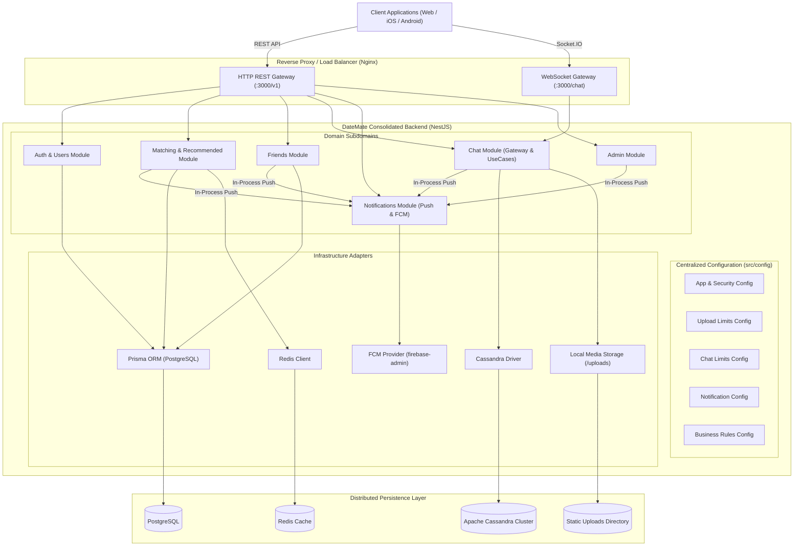
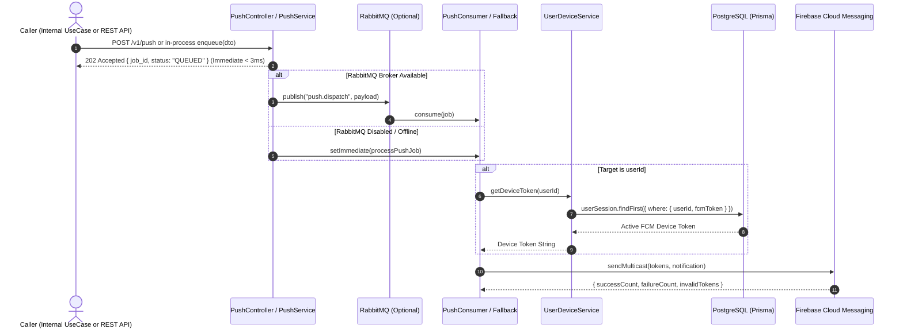

# DateMate Consolidated Backend Architecture & Business Rules Manual

> **Version**: 2.0.0 (Consolidated Edition)  
> **Target Environment**: Production / Staging / Local Development  
> **Consolidated Repositories**: Main Backend, Chat Service, Push Notification Service

---

## 1. Executive Summary & Overview

DateMate Backend is a high-performance, resilient, monolithic microservice built with **NestJS**, **PostgreSQL (Prisma)**, **Apache Cassandra**, **Redis**, **Socket.IO**, and **Firebase Cloud Messaging (FCM)**. 

To eliminate independent deployment overhead and network hop latency while preserving strict domain boundaries, all backend services—**Main Core**, **Real-Time Chat Service**, and **Push Notification Service**—are unified within this single codebase.

### Key Architectural Tenets
1. **Domain-Driven Subdomain Routing**: All public and internal APIs maintain their dedicated subdomains and path contracts under `/v1` (e.g. `/v1/auth`, `/v1/conversations`, `/v1/push`, `/v1/matching`).
2. **Hybrid Storage Strategy**:
   - **PostgreSQL (Prisma)**: Relational user profiles, demographics, matching, swipes, friends, questions, sessions, and system configuration.
   - **Apache Cassandra**: High-throughput distributed append-only chat timeline (`messages_timeline`), group profiles, conversation memberships, and presence.
   - **Redis**: Low-latency caching for recommendations, rate limiting, and OTP sessions.
3. **In-Process High Performance with Graceful Fallbacks**:
   - Internal notification dispatches (e.g., match alerts, chat message pushes, friend requests) occur directly in-memory without loopback HTTP calls.
   - External callers continue to use authenticated REST endpoints (`POST /v1/push`).
   - RabbitMQ queue worker executes asynchronously with transparent in-process fallback when RabbitMQ broker is offline.
4. **Centralized Configuration**: All operational limits, upload caps, rate throttles, and business thresholds live in a centralized, validated configuration module under `src/config/`.

---

## 2. High-Level Architecture



---

## 3. Subdomain Directory & Routing Architecture

Every domain retains isolated controllers, services, entities, and DTOs:

| Subdomain | Prefix / Route | Primary Protocol | Purpose |
| :--- | :--- | :--- | :--- |
| **Authentication** | `/v1/auth` | REST (JSON) | Phone OTP login, registration, token refresh, and logout |
| **User Profiles** | `/v1/users` | REST (JSON) | Profiles, demographics, avatars, galleries, device sessions |
| **User Presence** | `/v1/users/:id/activity`, `/v1/users/activity` | REST (JSON) | Real-time chat online/offline status and last seen querying |
| **Matching** | `/v1/matching` | REST (JSON) | Swipe feed, like/pass recording, mutual matches list |
| **Recommended** | `/v1/recommended` | REST (JSON) | Algorithmic candidate suggestions with Redis caching |
| **Friends** | `/v1/friends` | REST (JSON) | Friend requests, accept, reject, list, and removal |
| **Conversations** | `/v1/conversations` | REST (JSON) | Direct & group conversations, details, paginated messages |
| **Groups** | `/v1/groups` | REST (JSON) | Group creation, member invites, role updates, leave/remove |
| **Chat Upload** | `/v1/upload`, `/v1/chat/upload` | Multipart Form | Voice notes, media, video, and documents for messaging |
| **Real-Time Chat** | `/chat` namespace | WebSocket (Socket.IO) | Real-time messaging, typing indicators, delivery receipts |
| **Notifications** | `/v1/push`, `/v1/notifications/push` | REST (JSON) | High-speed push dispatch with FCM & optional RabbitMQ |
| **Questions** | `/v1/questions` | REST (JSON) | Personality questions, options, and categories |
| **Interests** | `/v1/interests` | REST (JSON) | Hobbies and lifestyle interest tags |
| **Media** | `/v1/media` | REST / Static | General profile media upload and thumbnail resolution |
| **Admin** | `/v1/admin` | REST (JSON) | User moderation, selfie verification triage, metrics |
| **System** | `/health`, `/time`, `/docs` | REST / HTML | Probes, server clock sync, Swagger & AsyncAPI documentation |

---

## 4. Centralized Configuration Management Reference

Adjustable operational values are centralized in `src/config/`, loaded on application startup with sensible fallback defaults:

### 4.1 Application & Security

| Parameter | Environment Variable | Default Value | Description |
| :--- | :--- | :--- | :--- |
| Server Port | `PORT` | `3000` | HTTP and WebSocket listener port |
| Node Environment | `NODE_ENV` | `development` | Runtime mode (`development`, `production`, `test`) |
| Base URL | `BASE_URL` | `http://localhost:3000` | Canonical host for asset URL resolution |
| Trust Proxy | `TRUST_PROXY` | `loopback` | Nginx reverse proxy IP resolution mode |
| Rate Limit TTL | `THROTTLE_TTL` | `60000` (60s) | Sliding window interval for request throttler |
| Rate Limit Max | `THROTTLE_LIMIT` | `120` | Max requests per IP within the TTL window |
| Auth Rate Limit | `THROTTLE_AUTH_LIMIT` | `15` | Max authentication attempts per minute |
| JWT Access Secret | `JWT_ACCESS_SECRET` | `access_secret` | Secret key signing access tokens |
| JWT Access Expiry | `JWT_ACCESS_EXPIRES_IN` | `15m` | Lifetime of user access tokens |
| JWT Refresh Secret | `JWT_REFRESH_SECRET` | `refresh_secret` | Secret key signing refresh tokens |
| JWT Refresh Expiry | `JWT_REFRESH_EXPIRES_IN` | `30d` | Lifetime of user refresh tokens |
| Docs Protection | `DOCS_PROTECTION_ENABLED`| `false` | Enables Basic Auth & IP Whitelist for docs |

### 4.2 File Upload & Media Restrictions

| Upload Category | Env Override | Max Size | Allowed MIME Types | Allowed Extensions |
| :--- | :--- | :--- | :--- | :--- |
| **Profile Avatar** | `UPLOAD_AVATAR_MAX_SIZE_BYTES` | 5 MB | `image/jpeg`, `image/png`, `image/webp` | `.jpg`, `.jpeg`, `.png`, `.webp` |
| **Gallery Photos** | `UPLOAD_GALLERY_MAX_SIZE_BYTES` | 10 MB | `image/jpeg`, `image/png`, `image/webp` | `.jpg`, `.jpeg`, `.png`, `.webp` |
| **Profile Video** | `UPLOAD_VIDEO_MAX_SIZE_BYTES` | 50 MB | `video/mp4`, `video/quicktime` | `.mp4`, `.mov` |
| **Chat Images** | `CHAT_IMAGE_MAX_SIZE_BYTES` | 15 MB | `image/jpeg`, `image/png`, `image/webp`, `image/gif` | Images |
| **Chat Voice/Audio** | `CHAT_AUDIO_MAX_SIZE_BYTES` | 25 MB | `audio/mpeg`, `audio/mp4`, `audio/ogg`, `audio/wav`, `audio/aac`, `audio/m4a` | Audio files |
| **Chat Video** | `CHAT_VIDEO_MAX_SIZE_BYTES` | 100 MB | `video/mp4`, `video/quicktime`, `video/webm` | Videos |
| **Chat Documents** | `CHAT_DOCUMENT_MAX_SIZE_BYTES` | 50 MB | `application/pdf`, `application/zip`, `text/plain` | Documents |

> [!CAUTION]
> **Executable Blacklist**: Files matching dangerous extensions (`.exe`, `.bat`, `.cmd`, `.sh`, `.php`, `.phtml`, `.pl`, `.cgi`, `.js`, `.mjs`, `.vbs`, `.msi`, `.dll`, `.so`, `.bin`, `.com`, `.scr`, `.vbe`, `.wsf`, `.wsh`, `.apk`, `.jar`) are strictly rejected with HTTP 400.

### 4.3 Chat & Group Limitations

| Parameter | Environment Variable | Default Value | Description |
| :--- | :--- | :--- | :--- |
| Max Message Length | `CHAT_MAX_MESSAGE_LENGTH` | `4000` chars | Maximum text characters per message |
| Max Attachments | `CHAT_MAX_ATTACHMENTS_PER_MESSAGE` | `10` | Maximum media attachments per message |
| Max Group Title | `CHAT_MAX_GROUP_TITLE_LENGTH` | `100` chars | Maximum characters in group name |
| Max Group Description| `CHAT_MAX_GROUP_DESCRIPTION_LENGTH` | `500` chars | Maximum characters in group bio |
| Min Group Members | `CHAT_MIN_GROUP_MEMBERS` | `2` | Minimum participants required for group |
| Max Group Members | `CHAT_MAX_GROUP_MEMBERS` | `100` | Hard cap on members per group |
| Max Groups Per User| `CHAT_MAX_GROUPS_PER_USER` | `50` | Maximum groups a single user can create |
| Presence Debounce | `CHAT_PRESENCE_DEBOUNCE_MS` | `3000` ms | Delay before marking disconnected user offline |
| WebSocket Ping | `CHAT_WS_PING_INTERVAL_MS` | `30000` ms | Socket.IO ping interval |
| WebSocket Timeout | `CHAT_WS_PING_TIMEOUT_MS` | `25000` ms | Socket.IO ping timeout |

### 4.4 Notifications & FCM Configuration

| Parameter | Environment Variable | Default Value | Description |
| :--- | :--- | :--- | :--- |
| FCM Mock Mode | `FCM_MOCK_MODE` | Auto-detected | `true` if credentials absent (simulates sends) |
| FCM Project ID | `FCM_PROJECT_ID` | `null` | Google Cloud Firebase project identifier |
| FCM Client Email | `FCM_CLIENT_EMAIL` | `null` | Service account email |
| FCM Private Key | `FCM_PRIVATE_KEY` | `null` | Service account private key string |
| FCM Service Account | `GOOGLE_APPLICATION_CREDENTIALS` | `null` | Path to JSON service account key file |
| RabbitMQ Enabled | `RABBITMQ_ENABLED` | `false` | Enables async AMQP message queue |
| RabbitMQ URL | `RABBITMQ_URL` | `amqp://localhost:5672` | AMQP broker connection string |
| Push Default Priority| `PUSH_DEFAULT_PRIORITY` | `normal` | Default priority (`normal` or `high`) |
| Push Timeout | `PUSH_NOTIFICATION_TIMEOUT_MS` | `5000` ms | Delivery abort timeout |
| Multicast Batch Size| `PUSH_MAX_BATCH_SIZE` | `500` | FCM multicast batch limit |
| Retry Attempts | `PUSH_RETRY_ATTEMPTS` | `3` | Max consumer retry attempts before DLQ |

### 4.5 Business Rules & Discovery Limits

| Parameter | Environment Variable | Default Value | Description |
| :--- | :--- | :--- | :--- |
| Pagination Default | `PAGINATION_DEFAULT_LIMIT` | `20` | Default items per page across all lists |
| Pagination Max | `PAGINATION_MAX_LIMIT` | `100` | Maximum items permitted per page request |
| Daily Swipe Limit | `MATCHING_DAILY_FREE_SWIPE_LIMIT`| `100` | Free user daily swipe quota (VIP = unlimited) |
| Min Allowed Age | `MATCHING_MIN_AGE` | `18` | Platform minimum legal age |
| Max Allowed Age | `MATCHING_MAX_AGE` | `100` | Platform maximum age |
| Default Match Radius| `MATCHING_DEFAULT_MAX_DISTANCE_KM`| `100` km | Default geographical discovery radius |
| Max Match Radius | `MATCHING_MAX_DISTANCE_KM` | `500` km | Hard limit on discovery distance filter |
| Selfie Verification | `REQUIRE_SELFIE_FOR_MATCHING` | `false` | Enforce selfie approval before swiping |

---

## 5. Authentication, Authorization & Roles

### 5.1 Token Types & Protocols
1. **User JWT Access Token**:
   - Header: `Authorization: Bearer <accessToken>`
   - Payload: `{ sub: <userId>, email: string, role: string, sessionId: number }`
   - Validated against active database sessions in `userSession`. If the session was terminated by the user or an admin, requests fail with `401 Unauthorized`.
2. **Internal Microservice API Key**:
   - Header: `x-api-key: <apiKey>`
   - Accepts keys configured via `INTERNAL_API_KEY`, `PUSH_NOTIFICATION_API_KEY`, or `DEVICE_TOKEN_API_KEY`.
   - Used for system-to-system dispatch (`POST /v1/push`).

### 5.2 Role-Based Access Control (RBAC)
- `USER`: Standard verified user; can participate in chat, swiping, friendships, and uploads.
- `VIP`: Premium subscriber; bypasses daily swipe limits (`MATCHING_DAILY_FREE_SWIPE_LIMIT`).
- `MODERATOR`: Staff member; can review pending selfie verifications and user reports.
- `ADMIN` / `SUPER_ADMIN`: Full administrative control; can terminate user device sessions, ban accounts, delete assets, and review system analytics.

---

## 6. Real-Time Chat & Cassandra Architecture

### 6.1 Deterministic Direct Conversations
Direct conversations between two users are mathematically deterministic. `CanonicalPairUtil` computes a canonical key (`min(userIdA, userIdB):max(userIdA, userIdB)`) and derives a RFC 4122 v5 UUID:
- Calling `POST /v1/conversations` between User 10 and User 20 always returns the exact same conversation UUID.
- Completely prevents duplicate 1-on-1 chat rooms under concurrent creation attempts.

### 6.2 Cassandra Time-Bucket Partitioning
Messages are partitioned by `(conversation_id, bucket)` where `bucket = YYYYMMDD` (UTC):
- Messages are sorted in descending order by `created_at` (TimeUUID).
- Opaque base64url cursors encode `{ bucket, pagingState, offset, t }`, enabling seamless pagination across days and months without partition hotspots.

### 6.3 WebSocket (`/chat`) Real-Time Events

#### Client-to-Server
- `join_conversation`: `{ conversationId: string }` — Subscribes socket to room.
- `leave_conversation`: `{ conversationId: string }` — Leaves socket room.
- `send_message`: `{ conversationId, content, clientMessageId, type?, attachments? }` — Sends message.
- `typing_start`: `{ conversationId }` — Emits typing indicator to room.
- `typing_stop`: `{ conversationId }` — Clears typing indicator.

#### Server-to-Client
- `new_message`: Dispatched to conversation room members with full `MessageItemDto`.
- `message_ack`: Direct acknowledgement to sender socket containing confirmed message ID and timestamp.
- `user_typing`: Broadcasts `{ userId, conversationId }` to other members.
- `user_presence`: Broadcasts `{ userId, isOnline, lastSeenAt }` on connection changes.
- `error`: Dispatched on validation or authorization errors via `WsExceptionsFilter`.

---

## 7. Push Notification System

### 7.1 Dispatch Pipeline


### 7.2 Notification Types & Templates
- `friend_request`: Triggered when User A sends a friend request to User B.
- `friend_request_accepted`: Triggered when a request is accepted.
- `like_user`: Triggered on mutual match or incoming like.
- `chat_message`: Triggered when an offline user receives a direct or group message.
- `selfie_accepted` / `selfie_rejected`: Dispatched after admin review.

---

## 8. Unified Response & Error Handling

All HTTP responses follow the standard `ResponseResult<T>` envelope:

### Success Envelope (HTTP 200 / 201 / 202)
```json
{
  "status": "success",
  "message": "Operation successful",
  "data": {
    "conversationId": "3fa85f64-5717-4562-b3fc-2c963f66afa6",
    "type": "DIRECT"
  },
  "error": null
}
```

### Error Envelope (HTTP 400 / 401 / 403 / 404 / 429 / 500)
```json
{
  "status": "error",
  "message": "Invalid opaque cursor",
  "data": null,
  "error": {
    "type": "INVALID_CURSOR",
    "message": "Invalid opaque cursor"
  }
}
```

---

## 9. Troubleshooting & Operational Runbook

### Cassandra Connection Issues
- **Symptom**: `Could not connect to Cassandra on startup: All host(s) tried for query failed`
- **Resolution**:
  1. Verify Cassandra container is healthy: `docker ps | grep cassandra`
  2. Check `CASSANDRA_CONTACT_POINTS` (default `127.0.0.1`) and `CASSANDRA_KEYSPACE` (default `datemate_chat`).
  3. Run standalone migrations: `npm run cql:migrate` or verify `CASSANDRA_AUTO_MIGRATE=true`.

### FCM Push Notification Failures
- **Symptom**: `Failed sending to device ... [Code: messaging/invalid-registration-token]`
- **Resolution**:
  - The token is invalid or expired. The service automatically flags it in `invalidTokens` for cleanup.
  - If FCM credentials are missing in development, check that `FCM Service running in MOCK MODE` appears in the logs. Deliveries will be simulated with full tracing.

### High Worker Memory / CPU Contention
- **Host Info**: 20 CPU Cores.
- **Rule**: Never run test runners without `--maxWorkers=4` (e.g. `npx jest --maxWorkers=4`).
- Throttler protections automatically reject excessive request bursts (`HTTP 429 Too Many Requests`).
