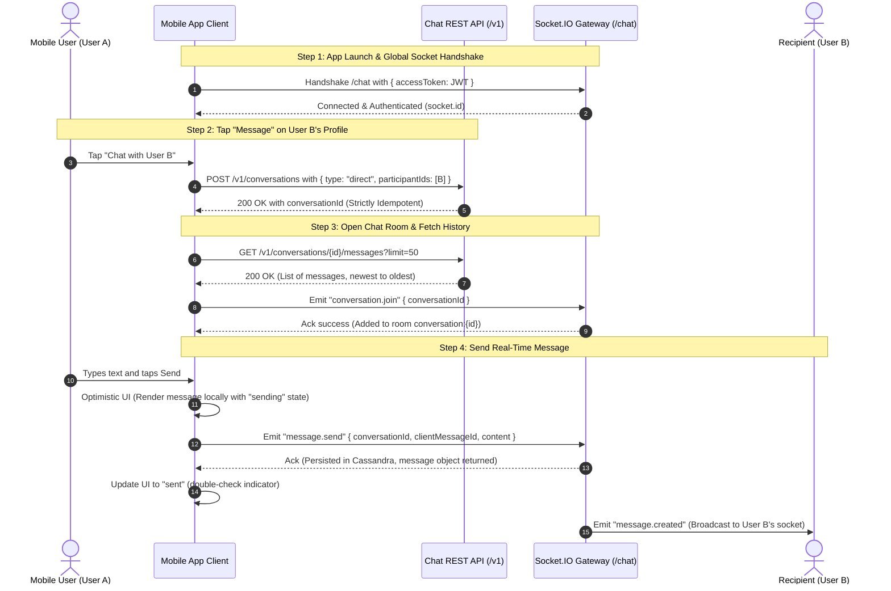

# Mobile Client Integration Guide & Real-Time Scenarios (DateMate Chat Service)

Step-by-step technical guide for mobile applications (Flutter / React Native / Swift / Kotlin) connecting to the DateMate Chat Microservice, managing conversations, and handling real-time messaging.

---

## 1. End-to-End Chat Lifecycle (Sequence Diagram)



---

## 2. Core Implementation Scenarios

### Scenario 1: App Launch & Global WebSocket Connection
When the application launches and the user has a valid access token:
1. Establish a persistent Socket.IO connection to `/chat`:
   ```javascript
   const socket = io("https://chat-datemate.testdevvvv.site/chat", {
     transports: ["websocket"],
     auth: {
       accessToken: userJwtToken
     }
   });
   ```
2. Keep this connection alive in the background while the app is active to receive live events.

---

### Scenario 2: Inbox & Conversations List Screen
When the user navigates to the messages tab, the client can query all, direct-only, or group-only conversations:
1. REST API endpoints:
   ```http
   # 1. All conversations (Direct + Group)
   GET /v1/conversations?limit=20
   Authorization: Bearer <JWT>

   # 2. Only Direct (1-on-1) conversations
   GET /v1/conversations/direct?limit=20
   Authorization: Bearer <JWT>

   # 3. Only Group conversations
   GET /v1/conversations/group?limit=20
   Authorization: Bearer <JWT>
   ```
2. The response contains conversation previews (`lastMessage`, `recentMessages`, unread status, and `peerActivity`).
3. Supports cursor-based pagination for smooth infinite scrolling.

---

### Scenario 3: Initiating a Conversation from Profile / Match Screen
**Key Question: Must the mobile client always call `POST /v1/conversations`?**

> **YES, ALWAYS.**  
> Real-time rooms and Cassandra tables enforce strict membership records. Until a conversation record exists in the database, calling `conversation.join` or `message.send` will be rejected with `FORBIDDEN` or `CONVERSATION_NOT_FOUND`.

#### Idempotency Behavior:
- When User A taps "Chat" on User B's profile (e.g. user ID `42`):
  ```http
  POST /v1/conversations
  Authorization: Bearer <JWT>
  Content-Type: application/json

  {
    "type": "direct",
    "participantIds": [42]
  }
  ```
- **Strict Idempotency**:
  - The server checks canonical pair key `min(A, B) : max(A, B)` with lightweight transaction (`IF NOT EXISTS`).
  - **If conversation already exists:** Returns existing conversation with `conversationId` and `created: false`.
  - **If first time:** Creates canonical conversation and returns new `conversationId` with `created: true`.
- **Client Advantage:** Mobile developers never need to manually check if a conversation exists first; simply call `POST /v1/conversations` and navigate to the chat room using the returned `conversationId`.

---

### Scenario 4: Active Chat Screen
When opening a conversation screen:

#### 1. Retrieve Historical Messages (via REST):
```http
GET /v1/conversations/:conversationId/messages?limit=50
Authorization: Bearer <JWT>
```
Messages are returned in reverse chronological order (newest first). When scrolling up, pass `cursor` to retrieve older messages.

#### 2. Join the Real-Time Room (WebSocket):
```javascript
socket.emit("conversation.join", {
  conversationId: activeConversationId
}, (ack) => {
  if (ack.success) {
    console.log("Joined real-time room successfully");
  }
});
```

#### 3. Send a Message (with Idempotency & Optimistic UI):
Generate a local UUID v4 as `clientMessageId`:
```javascript
const clientMessageId = generateUuid();

// 1. Optimistic UI update: Display immediately with "sending" state
appendLocalMessage({ content: "Hello!", status: "sending", clientMessageId });

// 2. Emit over WebSocket
socket.emit("message.send", {
  conversationId: activeConversationId,
  clientMessageId: clientMessageId,
  content: "Hello!"
}, (ack) => {
  if (ack.success) {
    markMessageAsSent(clientMessageId, ack.data.message);
  } else {
    console.error("Failed to send message:", ack.error?.message);
    markMessageAsFailed(clientMessageId);
  }
});
```

#### 4. Receive Live Incoming Messages (Broadcast):
```javascript
socket.on("message.created", (message) => {
  if (message.conversationId === activeConversationId) {
    appendIncomingMessage(message);
  }
});
```

#### 5. Exit Chat Screen:
When navigating back:
```javascript
socket.emit("conversation.leave", {
  conversationId: activeConversationId
});
```

---

### Scenario 5: User Activity, Online Status & Last Seen
High-performance presence tracking in memory ($O(1)$) with durable Cassandra persistence on state transitions:
- **Direct Conversations (`GET /v1/conversations/direct`):** Returns `peerActivity` with `isOnline` and `lastSeenAt`.
- **Conversation Details (`GET /v1/conversations/:id`):** Returns `membersActivity` for all members.
- **Group Participants (`GET /v1/groups/:id/participants`):** Every participant includes `isOnline` and `lastSeenAt`.
- **Real-Time WebSocket Events (`user.activity`):**
  ```javascript
  socket.on("user.activity", (data) => {
    // data: { userId: 42, conversationId: "...", isOnline: false, lastSeenAt: "2026-10-27T11:45:00.000Z" }
    updateOnlineStatusInUI(data.userId, data.isOnline, data.lastSeenAt);
  });
  ```
- **On-Demand Socket Query (`user.activity.get`):**
  ```javascript
  socket.emit("user.activity.get", { userIds: [1, 2, 42] }, (ack) => {
    console.log("Member activities:", ack.data.activities);
  });
  ```
- **Dedicated REST Endpoints:**
  - `GET /v1/users/:userId/activity`
  - `POST /v1/users/activity` with `{ "userIds": [1, 2, 42] }`

---

## 3. Critical Guidelines for Mobile Teams

1. **Reconnection Handling:**
   - On socket reconnect, re-emit `conversation.join` for the currently active chat screen.
2. **Idempotency with `clientMessageId`:**
   - Always generate a unique `clientMessageId` for each outgoing message. If a packet is retransmitted due to network lag, Cassandra guarantees zero duplicate writes.
3. **Push Notification Service:**
   - Upon successful message persistence, the chat service dispatches push notifications (`POST /v1/push` defined in `PUSH_NOTIFICATION_BASE_URL`) to all conversation members except the sender.
   - Example payload:
     ```json
     {
       "userId": 12,
       "title": "Parsa Moloudie",
       "body": "Hello John, how are you?",
       "data": {
         "conversationId": "550e8400-e29b-41d4-a716-446655440000"
       },
       "priority": "high"
     }
     ```
   - Tapping the notification opens the chat screen directly using the `conversationId`.
