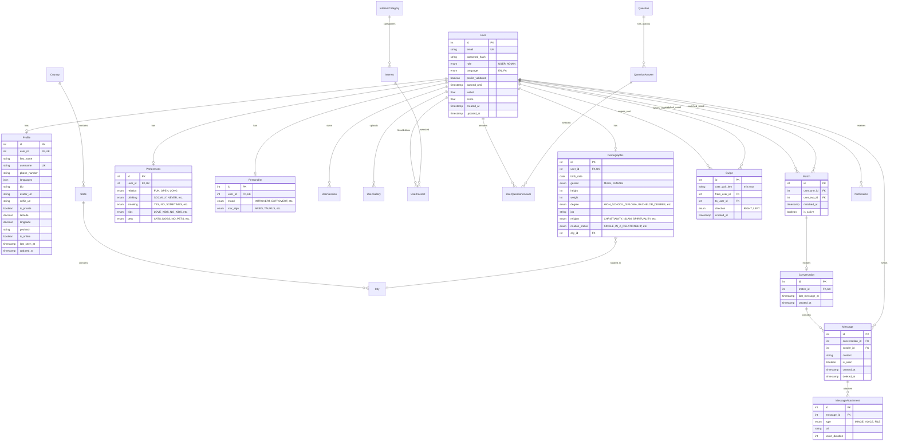

# DateMate MVP Data Model Specification
*(Aligned with Figma Redesign & Client Implementation)*

## 1. Overview & Scope

This data model is designed following **Clean Architecture**, **Domain-Driven Design (DDD)**, and **Modular Monolith** principles, strictly matching the screens in **Figma Redesign** (`date-mate-redesign-copy`) and the Kotlin Android client (`datemate`):

1. **Authentication & Identity**: Email/password, role (`USER`, `ADMIN`), device sessions, and push tokens.
2. **Profile & Onboarding (Figma Flow)**:
   - **Basic Info**: Avatar, first name, username, birth date, gender.
   - **Verification**: Selfie picture & verified badge status.
   - **Demographics & Lifestyle**: Height, weight, degree, job, religion, relationship status, city/state/country.
   - **Preferences**: Relationship type (fun, open, long), drinking, smoking, kids, pets.
   - **Personality**: Mood (introvert/extrovert), star sign.
   - **Interests & Lifestyle Questions**: Liked/disliked interest tags and answered multiple-choice questions.
   - **User Gallery**: Additional photo uploads with descriptions and likes.
3. **Location & Geospatial Search**: Latitude, longitude, geohash, and online presence.
4. **Matching & Swiping (Feed)**: Right (like) and Left (pass) swipes, atomic mutual matches, and liked-by list.
5. **Direct Messaging (1-on-1)**: Conversations, messages with text, image, and voice notes.
6. **Notifications**: Push & in-app alerts (`NEW_MATCH`, `NEW_MESSAGE`, `PROFILE_VERIFIED`, etc.).

---

## 2. Bounded Contexts & Entity-Relationship Model (ERD)



---

## 3. Data Dictionary & Enums

### 3.0 Profile Onboarding Rules & Constraints

> 📘 **Authoritative Client Validation Rules Document**:  
> For the complete, shareable reference document and live online endpoint, see [**docs/RULES.md**](file:///home/parsa/Documents/projects/datemate/backend/docs/RULES.md) or visit **[`http://localhost:3000/docs/rules`](http://localhost:3000/docs/rules)**.


#### 1. Username Rules
- **Length & Format**:
  - Min length: 3 characters; Max length: 30 characters.
  - Cannot contain only numbers (e.g. `123456` ❌; must include at least one letter).
  - Cannot contain spaces.
  - Cannot start or end with special characters (first and last characters must be alphanumeric).
  - Cannot contain consecutive special characters (e.g., `john__`, `anna..`, `a--b`, `a._b`).
  - Cannot contain only special characters (e.g., `!!!`).
- **Character Restrictions**:
  - Supported: English letters (`a-z`, `A-Z`), digits (`0-9`), single dot (`.`), underscore (`_`), hyphen (`-`).
  - Prohibited: Emojis, zero-width/invisible characters (`\u200B-\u200D`, `\uFEFF`).
  - Prohibited: HTML, SQL, and script characters: `<`, `>`, `'`, `"`, `;`, `{`, `}`, `--`.
- **Identity & Impersonation Protection**:
  - Prohibited reserved names: `admin`, `administrator`, `root`, `system`, `support`, `help`, `moderator`, `staff`, `official`, `verified`, `security`, `api`, `null`, `undefined`, `official_team`, `datemate`, `date_mate`.
  - Prohibited status prefixes/suffixes: `_verified`, `_official`, `_admin`, `_support`, `_staff`, `verified_`, `official_`, `admin_`, `support_`.
  - Blocked impersonation targets: `taylor_swift`, `elon_musk`, `mark_zuckerberg`, `cristiano_ronaldo`.
- **Uniqueness**:
  - Must be unique across all profiles (case-insensitive search).

#### 2. Name Rules
- **Length & Format**:
  - Cannot be empty.
  - Min length: 2 characters; Max length: 50 characters.
  - Cannot contain only numbers.

#### 3. Date of Birth (DOB) & Age Restrictions
- **Format**: `YYYY-MM-DD` (e.g. `1998-11-25`).
- **Validation**: Strict calendar validity (rejects impossible dates like `2026-02-30`, `2026-13-01`).
- **Age Bounds**:
  - Minimum age: **18 years old** (users under 18 strictly prohibited).
  - Maximum age: **80 years old**.
  - Future dates strictly prohibited.
- **Privacy & Storage Policy**:
  - Exact DOB is stored privately in `demographics.birth_date`.
  - Public profile APIs only display dynamically computed `age` (`today - dob`).
  - Anti-fraud rule: Once set, DOB cannot be altered without administrative support verification.

#### 4. Gender Selection Rules
- Must be strictly binary: `Male` or `Female` (mapped to `Gender.MALE`, `Gender.FEMALE`).
- Explicitly rejected: `null`, `""`, `"Other"`, `"Unknown"`, numbers.

#### 5. Profile Picture (Avatar) Pipeline
- **File Size**:
  - Minimum: 50 KB (prevents low-quality artifacts).
  - Maximum: 5 MB.
- **Image Dimensions**:
  - Minimum: 300 x 300 pixels.
  - Maximum: 4096 x 4096 pixels.
- **Security & File Signature (Magic Bytes)**:
  - Validates actual file content:
    - JPEG: `FF D8 FF`
    - PNG: `89 50 4E 47 0D 0A 1A 0A`
    - WebP: `RIFF` ... `WEBP`
  - Strict rejection of SVG, GIF, EXE, ZIP, etc.
- **EXIF Metadata Stripping**:
  - Automatic removal of GPS location, device model, camera info, timestamps, and comments.
- **Optimization**:
  - Auto-oriented, cropped/resized to 1080x1080 square, converted to WebP (`~150–300 KB`), and stored in `/uploads/avatars/`.

---

### 3.1 Demographic & Lifestyle Enums (Matching Client & Figma)
- **`Gender`**: `MALE`, `FEMALE`
- **`RelationType`**: `FUN`, `OPEN`, `LONG`
- **`RelationshipStatus`**: `SINGLE`, `IN_A_RELATIONSHIP`, `MARRIED`, `COMPLICATED`, `OPEN_RELATIONSHIP`, `DIVORCED`, `WIDOWED`, `RATHER_NOT_SAY`
- **`DrinkStatus`**: `SOCIALLY`, `NEVER`, `OCCASIONALLY`, `REGULARLY`, `RATHER_NOT_SAY`
- **`SmokeStatus`**: `YES`, `NO`, `SOMETIMES`, `RATHER_NOT_SAY`
- **`KidsStatus`**: `LOVE_KIDS`, `MAYBE_SOME_DAY_WANT_KIDS`, `UNDECIDED_ABOUT_KIDS`, `DO_NOT_WANT_KIDS`, `ALREADY_HAVE_KIDS`, `RATHER_NOT_SAY`
- **`EducationStatus`**: `HIGH_SCHOOL_DIPLOMA`, `SOME_COLLEGE`, `ASSOCIATE_DEGREE`, `BACHELOR_DEGREE`, `MASTER_DEGREE`, `DOCTORATE`, `RATHER_NOT_SAY`
- **`MoodStatus`**: `INTROVERT`, `EXTROVERT`, `SOMEWHERE_IN_BETWEEN`, `RATHER_NOT_SAY`
- **`StarSignStatus`**: `ARIES`, `TAURUS`, `GEMINI`, `CANCER`, `LEO`, `VIRGO`, `LIBRA`, `SCORPIO`, `SAGITTARIUS`, `CAPRICORN`, `AQUARIUS`, `PISCES`, `RATHER_NOT_SAY`
- **`PetsStatus`**: `CATS`, `DOGS`, `CATS_AND_DOGS`, `OTHER_ANIMALS`, `NO_PETS`, `RATHER_NOT_SAY`
- **`ReligionStatus`**: `CHRISTIANITY`, `ISLAM`, `HINDUISM`, `BUDDHISM`, `JUDAISM`, `SPIRITUALITY`, `AGNOSTIC`, `ATHEISM`, `OTHER`, `RATHER_NOT_SAY`

---

## 4. Prisma Schema Specification

```prisma
datasource db {
  provider = "postgresql"
  url      = env("DATABASE_URL")
}

generator client {
  provider = "prisma-client-js"
}

// ----------------------------------------------------
// ENUMS
// ----------------------------------------------------

enum Role {
  USER
  ADMIN
}

enum Language {
  EN
  FA
}

enum Gender {
  MALE
  FEMALE
}

enum RelationType {
  FUN
  OPEN
  LONG
}

enum RelationshipStatus {
  SINGLE
  IN_A_RELATIONSHIP
  MARRIED
  COMPLICATED
  OPEN_RELATIONSHIP
  DIVORCED
  WIDOWED
  RATHER_NOT_SAY
}

enum DrinkStatus {
  SOCIALLY
  NEVER
  OCCASIONALLY
  REGULARLY
  RATHER_NOT_SAY
}

enum SmokeStatus {
  YES
  NO
  SOMETIMES
  RATHER_NOT_SAY
}

enum KidsStatus {
  LOVE_KIDS
  MAYBE_SOME_DAY_WANT_KIDS
  UNDECIDED_ABOUT_KIDS
  DO_NOT_WANT_KIDS
  ALREADY_HAVE_KIDS
  RATHER_NOT_SAY
}

enum EducationStatus {
  HIGH_SCHOOL_DIPLOMA
  SOME_COLLEGE
  ASSOCIATE_DEGREE
  BACHELOR_DEGREE
  MASTER_DEGREE
  DOCTORATE
  RATHER_NOT_SAY
}

enum MoodStatus {
  INTROVERT
  EXTROVERT
  SOMEWHERE_IN_BETWEEN
  RATHER_NOT_SAY
}

enum StarSignStatus {
  ARIES
  TAURUS
  GEMINI
  CANCER
  LEO
  VIRGO
  LIBRA
  SCORPIO
  SAGITTARIUS
  CAPRICORN
  AQUARIUS
  PISCES
  RATHER_NOT_SAY
}

enum PetsStatus {
  CATS
  DOGS
  CATS_AND_DOGS
  OTHER_ANIMALS
  NO_PETS
  RATHER_NOT_SAY
}

enum ReligionStatus {
  CHRISTIANITY
  ISLAM
  HINDUISM
  BUDDHISM
  JUDAISM
  SPIRITUALITY
  AGNOSTIC
  ATHEISM
  OTHER
  RATHER_NOT_SAY
}

enum SwipeDirection {
  RIGHT
  LEFT
}

enum AttachmentType {
  IMAGE
  VOICE
  FILE
}

enum NotificationType {
  NEW_MATCH
  NEW_MESSAGE
  PROFILE_VERIFIED
  FRIEND_REQUEST
  LIKE_USER
}

// ----------------------------------------------------
// MODELS
// ----------------------------------------------------

model User {
  id               Int            @id @default(autoincrement())
  email            String         @unique @db.VarChar(255)
  passwordHash     String         @map("password_hash") @db.VarChar(255)
  role             Role           @default(USER)
  language         Language       @default(EN)
  profileValidated Boolean        @default(false) @map("profile_validated")
  isPremium        Boolean        @default(false) @map("is_premium")
  bannedUntil      DateTime?      @map("banned_until")
  wallet           Float          @default(0.0)
  score            Float          @default(1.0)
  notificationsOn  Boolean        @default(true) @map("notifications_on")
  createdAt        DateTime       @default(now()) @map("created_at")
  updatedAt        DateTime       @updatedAt @map("updated_at")

  profile          Profile?
  demographic      Demographic?
  preferences      Preferences?
  personality      Personality?
  sessions         UserSession[]
  gallery          UserGallery[]
  interests        UserInterest[]
  questionAnswers  UserQuestionAnswer[]

  swipesSent       Swipe[]        @relation("SwipesSent")
  swipesReceived   Swipe[]        @relation("SwipesReceived")
  matchesAsOne     Match[]        @relation("MatchesAsOne")
  matchesAsTwo     Match[]        @relation("MatchesAsTwo")

  messagesSent     Message[]
  notifications    Notification[]

  @@map("users")
}

model UserSession {
  id               Int      @id @default(autoincrement())
  userId           Int      @map("user_id")
  refreshTokenHash String   @unique @map("refresh_token_hash") @db.VarChar(255)
  deviceInfo       String?  @map("device_info") @db.VarChar(255)
  fcmToken         String?  @map("fcm_token") @db.VarChar(512)
  expiresAt        DateTime @map("expires_at")
  createdAt        DateTime @default(now()) @map("created_at")

  user             User     @relation(fields: [userId], references: [id], onDelete: Cascade)

  @@map("user_sessions")
}

model Profile {
  id          Int       @id @default(autoincrement())
  userId      Int       @unique @map("user_id")
  fullName    String    @map("first_name") @db.VarChar(100)
  username    String?   @unique @db.VarChar(50)
  phoneNumber String?   @map("phone_number") @db.VarChar(50)
  languages   Json?     @db.JsonB // ["EN", "FA"]
  bio         String?   @db.Text
  avatarUrl   String    @map("avatar_url") @db.VarChar(512)
  selfieUrl   String?   @map("selfie_url") @db.VarChar(512)
  isPrivate   Boolean   @default(false) @map("is_private")
  latitude    Decimal   @db.Decimal(10, 8)
  longitude   Decimal   @db.Decimal(11, 8)
  geohash     String?   @db.VarChar(12)
  isOnline    Boolean   @default(false) @map("is_online")
  lastSeenAt  DateTime  @default(now()) @map("last_seen_at")
  updatedAt   DateTime  @updatedAt @map("updated_at")

  user        User      @relation(fields: [userId], references: [id], onDelete: Cascade)

  @@index([geohash])
  @@index([latitude, longitude])
  @@map("profiles")
}

model Demographic {
  id             Int                 @id @default(autoincrement())
  userId         Int                 @unique @map("user_id")
  birthDate      DateTime            @map("birth_date") @db.Date
  gender         Gender
  height         Int?                @db.SmallInt
  weight         Int?                @db.SmallInt
  degree         EducationStatus?
  job            String?             @map("profession") @db.VarChar(100)
  religion       ReligionStatus?
  relationStatus RelationshipStatus? @map("relation_status")
  cityId         Int?                @map("city_id")

  user           User                @relation(fields: [userId], references: [id], onDelete: Cascade)
  city           City?               @relation(fields: [cityId], references: [id], onDelete: SetNull)

  @@map("demographics")
}

model Preferences {
  id        Int          @id @default(autoincrement())
  userId    Int          @unique @map("user_id")
  relation  RelationType?
  drinking  DrinkStatus?
  smoking   SmokeStatus?
  kids      KidsStatus?
  pets      PetsStatus?

  user      User         @relation(fields: [userId], references: [id], onDelete: Cascade)

  @@map("preferences")
}

model Personality {
  id          Int             @id @default(autoincrement())
  userId      Int             @unique @map("user_id")
  mood        MoodStatus?
  starSign    StarSignStatus? @map("star_sign")

  user        User            @relation(fields: [userId], references: [id], onDelete: Cascade)

  @@map("personalities")
}

// ----------------------------------------------------
// CATALOGS & ASSETS
// ----------------------------------------------------

model Country {
  id     Int     @id @default(autoincrement())
  name   String  @unique @db.VarChar(100)
  code   String  @unique @db.VarChar(10)
  states State[]

  @@map("countries")
}

model State {
  id        Int     @id @default(autoincrement())
  countryId Int     @map("country_id")
  name      String  @db.VarChar(100)
  cities    City[]

  country   Country @relation(fields: [countryId], references: [id], onDelete: Cascade)

  @@map("states")
}

model City {
  id           Int           @id @default(autoincrement())
  stateId      Int           @map("state_id")
  name         String        @db.VarChar(100)

  state        State         @relation(fields: [stateId], references: [id], onDelete: Cascade)
  demographics Demographic[]

  @@map("cities")
}

model InterestCategory {
  id        Int        @id @default(autoincrement())
  nameEn    String     @map("name_en") @db.VarChar(100)
  nameFa    String     @map("name_fa") @db.VarChar(100)
  media     String?    @db.VarChar(512)
  interests Interest[]

  @@map("interest_categories")
}

model Interest {
  id            Int              @id @default(autoincrement())
  categoryId    Int              @map("category_id")
  nameEn        String           @map("name_en") @db.VarChar(100)
  nameFa        String           @map("name_fa") @db.VarChar(100)
  media         String?          @db.VarChar(512)

  category      InterestCategory @relation(fields: [categoryId], references: [id], onDelete: Cascade)
  userInterests UserInterest[]

  @@map("interests")
}

model UserInterest {
  id         Int      @id @default(autoincrement())
  userId     Int      @map("user_id")
  interestId Int      @map("interest_id")
  isLiked    Boolean  @default(true) @map("is_liked")

  user       User     @relation(fields: [userId], references: [id], onDelete: Cascade)
  interest   Interest @relation(fields: [interestId], references: [id], onDelete: Cascade)

  @@unique([userId, interestId])
  @@map("user_interests")
}

model Question {
  id      Int              @id @default(autoincrement())
  nameEn  String           @map("name_en") @db.VarChar(255)
  nameFa  String           @map("name_fa") @db.VarChar(255)
  answers QuestionAnswer[]

  @@map("questions")
}

model QuestionAnswer {
  id                  Int                  @id @default(autoincrement())
  questionId          Int                  @map("question_id")
  answerEn            String               @map("answer_en") @db.VarChar(255)
  answerFa            String               @map("answer_fa") @db.VarChar(255)

  question            Question             @relation(fields: [questionId], references: [id], onDelete: Cascade)
  userQuestionAnswers UserQuestionAnswer[]

  @@map("question_answers")
}

model UserQuestionAnswer {
  id               Int            @id @default(autoincrement())
  userId           Int            @map("user_id")
  questionAnswerId Int            @map("question_answer_id")

  user             User           @relation(fields: [userId], references: [id], onDelete: Cascade)
  questionAnswer   QuestionAnswer @relation(fields: [questionAnswerId], references: [id], onDelete: Cascade)

  @@unique([userId, questionAnswerId])
  @@map("user_question_answers")
}

model UserGallery {
  id          Int      @id @default(autoincrement())
  userId      Int      @map("user_id")
  imageUrl    String   @map("image_url") @db.VarChar(512)
  description String?  @db.Text
  likesCount  Int      @default(0) @map("likes_count")
  createdAt   DateTime @default(now()) @map("created_at")

  user        User     @relation(fields: [userId], references: [id], onDelete: Cascade)

  @@map("user_galleries")
}

// ----------------------------------------------------
// SWIPES & MATCHES
// ----------------------------------------------------

model Swipe {
  id          Int            @id @default(autoincrement())
  userPairKey String         @map("user_pair_key") @db.VarChar(50) // min_id:max_id
  fromUserId  Int            @map("from_user_id")
  toUserId    Int            @map("to_user_id")
  direction   SwipeDirection
  createdAt   DateTime       @default(now()) @map("created_at")

  fromUser    User           @relation("SwipesSent", fields: [fromUserId], references: [id], onDelete: Cascade)
  toUser      User           @relation("SwipesReceived", fields: [toUserId], references: [id], onDelete: Cascade)

  @@unique([fromUserId, toUserId])
  @@index([userPairKey])
  @@map("swipes")
}

model Match {
  id           Int           @id @default(autoincrement())
  userOneId    Int           @map("user_one_id")
  userTwoId    Int           @map("user_two_id")
  matchedAt    DateTime      @default(now()) @map("matched_at")
  isActive     Boolean       @default(true) @map("is_active")

  userOne      User          @relation("MatchesAsOne", fields: [userOneId], references: [id], onDelete: Cascade)
  userTwo      User          @relation("MatchesAsTwo", fields: [userTwoId], references: [id], onDelete: Cascade)
  conversation Conversation?

  @@unique([userOneId, userTwoId])
  @@map("matches")
}

// ----------------------------------------------------
// DIRECT MESSAGING
// ----------------------------------------------------

model Conversation {
  id            Int       @id @default(autoincrement())
  matchId       Int       @unique @map("match_id")
  lastMessageAt DateTime? @map("last_message_at")
  createdAt     DateTime  @default(now()) @map("created_at")

  match         Match     @relation(fields: [matchId], references: [id], onDelete: Cascade)
  messages      Message[]

  @@map("conversations")
}

model Message {
  id             Int                 @id @default(autoincrement())
  conversationId Int                 @map("conversation_id")
  senderId       Int                 @map("sender_id")
  content        String?             @db.Text
  isSeen         Boolean             @default(false) @map("is_seen")
  createdAt      DateTime            @default(now()) @map("created_at")
  deletedAt      DateTime?           @map("deleted_at")

  conversation   Conversation        @relation(fields: [conversationId], references: [id], onDelete: Cascade)
  sender         User                @relation(fields: [senderId], references: [id], onDelete: Cascade)
  attachments    MessageAttachment[]

  @@index([conversationId, createdAt])
  @@map("messages")
}

model MessageAttachment {
  id            Int            @id @default(autoincrement())
  messageId     Int            @map("message_id")
  type          AttachmentType
  uri           String         @db.VarChar(512)
  voiceDuration Int?           @map("voice_duration")

  message       Message        @relation(fields: [messageId], references: [id], onDelete: Cascade)

  @@map("message_attachments")
}

// ----------------------------------------------------
// NOTIFICATIONS
// ----------------------------------------------------

model Notification {
  id        Int              @id @default(autoincrement())
  userId    Int              @map("user_id")
  type      NotificationType
  metadata  Json             @db.JsonB
  isRead    Boolean          @default(false) @map("is_read")
  createdAt DateTime         @default(now()) @map("created_at")

  user      User             @relation(fields: [userId], references: [id], onDelete: Cascade)

  @@index([userId, isRead])
  @@map("notifications")
}
```
