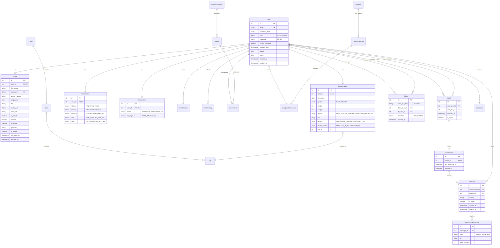

# DateMate MVP Data Model Specification
*(Aligned with Figma Redesign & Client Implementation)*

## 1. Overview & Scope

This data model is designed following **Clean Architecture**, **Domain-Driven Design (DDD)**, and **Modular Monolith** principles, strictly matching the screens in **Figma Redesign** (`date-mate-redesign-copy`) and the Kotlin Android client (`datemate`):

1. **Authentication & Identity**: Email/password, role (`USER`, `ADMIN`), device sessions, and push tokens.
2. **Profile & Onboarding (Figma Flow)**:
   - **Basic Info**: Avatar, first name, username, birth date, gender.
   - **Verification**: Selfie picture & verified badge status.
   - **Demographics & Lifestyle**: Height, weight, degree, job, religion, relationship status, city/state/country.
   - **Preferences**: Relationship type (fun, open, long), drinking, smoking, kids, pets.
   - **Personality**: Mood (introvert/extrovert), star sign.
   - **Interests & Lifestyle Questions**: Liked/disliked interest tags and answered multiple-choice questions.
   - **User Gallery**: Additional photo uploads with descriptions and likes.
3. **Location & Geospatial Search**: Latitude, longitude, geohash, and online presence.
4. **Matching & Swiping (Feed)**: Right (like) and Left (pass) swipes, atomic mutual matches, and liked-by list.
5. **Direct Messaging (1-on-1)**: Conversations, messages with text, image, and voice notes.
6. **Notifications**: Push & in-app alerts (`NEW_MATCH`, `NEW_MESSAGE`, `PROFILE_VERIFIED`, etc.).

---

## 2. Bounded Contexts & Entity-Relationship Model (ERD)



---

## 3. Data Dictionary & Enums

### 3.0 Profile Onboarding Rules & Constraints

> 📘 **Authoritative Client Validation Rules Document**:  
> For the complete, shareable reference document and live online endpoint, see [**docs/RULES.md**](../RULES.md) or visit **[`http://localhost:3000/docs/rules`](http://localhost:3000/docs/rules)**.


#### 1. Username Rules
- **Length & Format**:
  - Min length: 3 characters; Max length: 30 characters.
  - Cannot contain only numbers (e.g. `123456` ❌; must include at least one letter).
  - Cannot contain spaces.
  - Cannot start or end with special characters (first and last characters must be alphanumeric).
  - Cannot contain consecutive special characters (e.g., `john__`, `anna..`, `a--b`, `a._b`).
  - Cannot contain only special characters (e.g., `!!!`).
- **Character Restrictions**:
  - Supported: English letters (`a-z`, `A-Z`), digits (`0-9`), single dot (`.`), underscore (`_`), hyphen (`-`).
  - Prohibited: Emojis, zero-width/invisible characters (`\u200B-\u200D`, `\uFEFF`).
  - Prohibited: HTML, SQL, and script characters: `<`, `>`, `'`, `"`, `;`, `{`, `}`, `--`.
- **Identity & Impersonation Protection**:
  - Prohibited reserved names: `admin`, `administrator`, `root`, `system`, `support`, `help`, `moderator`, `staff`, `official`, `verified`, `security`, `api`, `null`, `undefined`, `official_team`, `datemate`, `date_mate`.
  - Prohibited status prefixes/suffixes: `_verified`, `_official`, `_admin`, `_support`, `_staff`, `verified_`, `official_`, `admin_`, `support_`.
  - Blocked impersonation targets: `taylor_swift`, `elon_musk`, `mark_zuckerberg`, `cristiano_ronaldo`.
- **Uniqueness**:
  - Must be unique across all profiles (case-insensitive search).

#### 2. Name Rules
- **Length & Format**:
  - Cannot be empty.
  - Min length: 2 characters; Max length: 50 characters.
  - Cannot contain only numbers.

#### 3. Date of Birth (DOB) & Age Restrictions
- **Format**: `YYYY-MM-DD` (e.g. `1998-11-25`).
- **Validation**: Strict calendar validity (rejects impossible dates like `2026-02-30`, `2026-13-01`).
- **Age Bounds**:
  - Minimum age: **18 years old** (users under 18 strictly prohibited).
  - Maximum age: **80 years old**.
  - Future dates strictly prohibited.
- **Privacy & Storage Policy**:
  - Exact DOB is stored privately in `demographics.birth_date`.
  - Public profile APIs only display dynamically computed `age` (`today - dob`).
  - Anti-fraud rule: Once set, DOB cannot be altered without administrative support verification.

#### 4. Gender Selection Rules
- Must be strictly binary: `Male` or `Female` (mapped to `Gender.MALE`, `Gender.FEMALE`).
- Explicitly rejected: `null`, `""`, `"Other"`, `"Unknown"`, numbers.

#### 5. Profile Picture (Avatar) Pipeline
- **File Size**:
  - Minimum: 50 KB (prevents low-quality artifacts).
  - Maximum: 5 MB.
- **Image Dimensions**:
  - Minimum: 300 x 300 pixels.
  - Maximum: 4096 x 4096 pixels.
- **Security & File Signature (Magic Bytes)**:
  - Validates actual file content:
    - JPEG: `FF D8 FF`
    - PNG: `89 50 4E 47 0D 0A 1A 0A`
    - WebP: `RIFF` ... `WEBP`
  - Strict rejection of SVG, GIF, EXE, ZIP, etc.
- **EXIF Metadata Stripping**:
  - Automatic removal of GPS location, device model, camera info, timestamps, and comments.
- **Optimization**:
  - Auto-oriented, cropped/resized to 1080x1080 square, converted to WebP (`~150–300 KB`), and stored in `/uploads/avatars/`.

---

### 3.1 Demographic & Lifestyle Enums (Matching Client & Figma)
- **`Gender`**: `MALE`, `FEMALE`
- **`RelationType`**: `FUN`, `OPEN`, `LONG`
- **`RelationshipStatus`**: `SINGLE`, `IN_A_RELATIONSHIP`, `MARRIED`, `COMPLICATED`, `OPEN_RELATIONSHIP`, `DIVORCED`, `WIDOWED`, `RATHER_NOT_SAY`
- **`DrinkStatus`**: `SOCIALLY`, `NEVER`, `OCCASIONALLY`, `REGULARLY`, `RATHER_NOT_SAY`
- **`SmokeStatus`**: `YES`, `NO`, `SOMETIMES`, `RATHER_NOT_SAY`
- **`KidsStatus`**: `LOVE_KIDS`, `MAYBE_SOME_DAY_WANT_KIDS`, `UNDECIDED_ABOUT_KIDS`, `DO_NOT_WANT_KIDS`, `ALREADY_HAVE_KIDS`, `RATHER_NOT_SAY`
- **`EducationStatus`**: `HIGH_SCHOOL_DIPLOMA`, `SOME_COLLEGE`, `ASSOCIATE_DEGREE`, `BACHELOR_DEGREE`, `MASTER_DEGREE`, `DOCTORATE`, `RATHER_NOT_SAY`
- **`MoodStatus`**: `INTROVERT`, `EXTROVERT`, `SOMEWHERE_IN_BETWEEN`, `RATHER_NOT_SAY`
- **`StarSignStatus`**: `ARIES`, `TAURUS`, `GEMINI`, `CANCER`, `LEO`, `VIRGO`, `LIBRA`, `SCORPIO`, `SAGITTARIUS`, `CAPRICORN`, `AQUARIUS`, `PISCES`, `RATHER_NOT_SAY`
- **`PetsStatus`**: `CATS`, `DOGS`, `CATS_AND_DOGS`, `OTHER_ANIMALS`, `NO_PETS`, `RATHER_NOT_SAY`
- **`ReligionStatus`**: `CHRISTIANITY`, `ISLAM`, `HINDUISM`, `BUDDHISM`, `JUDAISM`, `SPIRITUALITY`, `AGNOSTIC`, `ATHEISM`, `OTHER`, `RATHER_NOT_SAY`

---

## 4. PostgreSQL Schema Specification (SQL DDL & sqlc)

The authoritative database schema for DateMate is maintained in PostgreSQL SQL DDL format ( and ). Type-safe Go models, query interfaces, and scanning logic are automatically generated using **sqlc**.

The consolidated schema below covers all domains, including authentication, users, profiles, demographics, questions, interests, swipes, friend requests, notifications, and consolidated chat tables (Migration 0014):

```sql
-- CreateEnum
CREATE TYPE "Role" AS ENUM ('USER', 'ADMIN');

-- CreateEnum
CREATE TYPE "Language" AS ENUM ('EN', 'FA');

-- CreateEnum
CREATE TYPE "Gender" AS ENUM ('MALE', 'FEMALE');

-- CreateEnum
CREATE TYPE "RelationType" AS ENUM ('FUN', 'OPEN', 'LONG');

-- CreateEnum
CREATE TYPE "RelationshipStatus" AS ENUM ('SINGLE', 'IN_A_RELATIONSHIP', 'MARRIED', 'COMPLICATED', 'OPEN_RELATIONSHIP', 'DIVORCED', 'WIDOWED', 'RATHER_NOT_SAY');

-- CreateEnum
CREATE TYPE "DrinkStatus" AS ENUM ('SOCIALLY', 'NEVER', 'OCCASIONALLY', 'REGULARLY', 'RATHER_NOT_SAY');

-- CreateEnum
CREATE TYPE "SmokeStatus" AS ENUM ('YES', 'NO', 'SOMETIMES', 'RATHER_NOT_SAY');

-- CreateEnum
CREATE TYPE "KidsStatus" AS ENUM ('LOVE_KIDS', 'MAYBE_SOME_DAY_WANT_KIDS', 'UNDECIDED_ABOUT_KIDS', 'DO_NOT_WANT_KIDS', 'ALREADY_HAVE_KIDS', 'RATHER_NOT_SAY');

-- CreateEnum
CREATE TYPE "EducationStatus" AS ENUM ('HIGH_SCHOOL_DIPLOMA', 'SOME_COLLEGE', 'ASSOCIATE_DEGREE', 'BACHELOR_DEGREE', 'MASTER_DEGREE', 'DOCTORATE', 'RATHER_NOT_SAY');

-- CreateEnum
CREATE TYPE "MoodStatus" AS ENUM ('INTROVERT', 'EXTROVERT', 'SOMEWHERE_IN_BETWEEN', 'RATHER_NOT_SAY');

-- CreateEnum
CREATE TYPE "StarSignStatus" AS ENUM ('ARIES', 'TAURUS', 'GEMINI', 'CANCER', 'LEO', 'VIRGO', 'LIBRA', 'SCORPIO', 'SAGITTARIUS', 'CAPRICORN', 'AQUARIUS', 'PISCES', 'RATHER_NOT_SAY');

-- CreateEnum
CREATE TYPE "PetsStatus" AS ENUM ('CATS', 'DOGS', 'CATS_AND_DOGS', 'OTHER_ANIMALS', 'NO_PETS', 'RATHER_NOT_SAY');

-- CreateEnum
CREATE TYPE "ReligionStatus" AS ENUM ('CHRISTIANITY', 'ISLAM', 'HINDUISM', 'BUDDHISM', 'JUDAISM', 'SPIRITUALITY', 'AGNOSTIC', 'ATHEISM', 'OTHER', 'RATHER_NOT_SAY');

-- CreateEnum
CREATE TYPE "SwipeDirection" AS ENUM ('RIGHT', 'LEFT');

-- CreateEnum
CREATE TYPE "AttachmentType" AS ENUM ('IMAGE', 'VOICE', 'FILE');

-- CreateEnum
CREATE TYPE "NotificationType" AS ENUM ('NEW_MATCH', 'NEW_MESSAGE', 'PROFILE_VERIFIED', 'FRIEND_REQUEST', 'LIKE_USER');

-- CreateTable
CREATE TABLE "users" (
    "id" SERIAL NOT NULL,
    "email" VARCHAR(255) NOT NULL,
    "password_hash" VARCHAR(255) NOT NULL,
    "role" "Role" NOT NULL DEFAULT 'USER',
    "language" "Language" NOT NULL DEFAULT 'EN',
    "profile_validated" BOOLEAN NOT NULL DEFAULT false,
    "banned_until" TIMESTAMP(3),
    "wallet" DOUBLE PRECISION NOT NULL DEFAULT 0.0,
    "score" DOUBLE PRECISION NOT NULL DEFAULT 1.0,
    "notifications_on" BOOLEAN NOT NULL DEFAULT true,
    "created_at" TIMESTAMP(3) NOT NULL DEFAULT CURRENT_TIMESTAMP,
    "updated_at" TIMESTAMP(3) NOT NULL,

    CONSTRAINT "users_pkey" PRIMARY KEY ("id")
);

-- CreateTable
CREATE TABLE "user_sessions" (
    "id" SERIAL NOT NULL,
    "user_id" INTEGER NOT NULL,
    "refresh_token_hash" VARCHAR(255) NOT NULL,
    "device_info" VARCHAR(255),
    "fcm_token" VARCHAR(512),
    "expires_at" TIMESTAMP(3) NOT NULL,
    "created_at" TIMESTAMP(3) NOT NULL DEFAULT CURRENT_TIMESTAMP,

    CONSTRAINT "user_sessions_pkey" PRIMARY KEY ("id")
);

-- CreateTable
CREATE TABLE "profiles" (
    "id" SERIAL NOT NULL,
    "user_id" INTEGER NOT NULL,
    "first_name" VARCHAR(100) NOT NULL,
    "username" VARCHAR(50),
    "phone_number" VARCHAR(50),
    "languages" JSONB,
    "bio" TEXT,
    "avatar_url" VARCHAR(512) NOT NULL,
    "selfie_url" VARCHAR(512),
    "is_private" BOOLEAN NOT NULL DEFAULT false,
    "latitude" DECIMAL(10,8) NOT NULL,
    "longitude" DECIMAL(11,8) NOT NULL,
    "geohash" VARCHAR(12),
    "is_online" BOOLEAN NOT NULL DEFAULT false,
    "last_seen_at" TIMESTAMP(3) NOT NULL DEFAULT CURRENT_TIMESTAMP,
    "updated_at" TIMESTAMP(3) NOT NULL,

    CONSTRAINT "profiles_pkey" PRIMARY KEY ("id")
);

-- CreateTable
CREATE TABLE "demographics" (
    "id" SERIAL NOT NULL,
    "user_id" INTEGER NOT NULL,
    "birth_date" DATE NOT NULL,
    "gender" "Gender" NOT NULL,
    "height" SMALLINT,
    "weight" SMALLINT,
    "degree" "EducationStatus",
    "profession" VARCHAR(100),
    "religion" "ReligionStatus",
    "relation_status" "RelationshipStatus",
    "city_id" INTEGER,

    CONSTRAINT "demographics_pkey" PRIMARY KEY ("id")
);

-- CreateTable
CREATE TABLE "preferences" (
    "id" SERIAL NOT NULL,
    "user_id" INTEGER NOT NULL,
    "relation" "RelationType",
    "drinking" "DrinkStatus",
    "smoking" "SmokeStatus",
    "kids" "KidsStatus",
    "pets" "PetsStatus",

    CONSTRAINT "preferences_pkey" PRIMARY KEY ("id")
);

-- CreateTable
CREATE TABLE "personalities" (
    "id" SERIAL NOT NULL,
    "user_id" INTEGER NOT NULL,
    "mood" "MoodStatus",
    "star_sign" "StarSignStatus",

    CONSTRAINT "personalities_pkey" PRIMARY KEY ("id")
);

-- CreateTable
CREATE TABLE "countries" (
    "id" SERIAL NOT NULL,
    "name" VARCHAR(100) NOT NULL,
    "code" VARCHAR(10) NOT NULL,

    CONSTRAINT "countries_pkey" PRIMARY KEY ("id")
);

-- CreateTable
CREATE TABLE "states" (
    "id" SERIAL NOT NULL,
    "country_id" INTEGER NOT NULL,
    "name" VARCHAR(100) NOT NULL,

    CONSTRAINT "states_pkey" PRIMARY KEY ("id")
);

-- CreateTable
CREATE TABLE "cities" (
    "id" SERIAL NOT NULL,
    "state_id" INTEGER NOT NULL,
    "name" VARCHAR(100) NOT NULL,

    CONSTRAINT "cities_pkey" PRIMARY KEY ("id")
);

-- CreateTable
CREATE TABLE "interest_categories" (
    "id" SERIAL NOT NULL,
    "name_en" VARCHAR(100) NOT NULL,
    "name_fa" VARCHAR(100) NOT NULL,
    "media" VARCHAR(512),

    CONSTRAINT "interest_categories_pkey" PRIMARY KEY ("id")
);

-- CreateTable
CREATE TABLE "interests" (
    "id" SERIAL NOT NULL,
    "category_id" INTEGER NOT NULL,
    "name_en" VARCHAR(100) NOT NULL,
    "name_fa" VARCHAR(100) NOT NULL,
    "media" VARCHAR(512),

    CONSTRAINT "interests_pkey" PRIMARY KEY ("id")
);

-- CreateTable
CREATE TABLE "user_interests" (
    "id" SERIAL NOT NULL,
    "user_id" INTEGER NOT NULL,
    "interest_id" INTEGER NOT NULL,
    "is_liked" BOOLEAN NOT NULL DEFAULT true,

    CONSTRAINT "user_interests_pkey" PRIMARY KEY ("id")
);

-- CreateTable
CREATE TABLE "questions" (
    "id" SERIAL NOT NULL,
    "name_en" VARCHAR(255) NOT NULL,
    "name_fa" VARCHAR(255) NOT NULL,

    CONSTRAINT "questions_pkey" PRIMARY KEY ("id")
);

-- CreateTable
CREATE TABLE "question_answers" (
    "id" SERIAL NOT NULL,
    "question_id" INTEGER NOT NULL,
    "answer_en" VARCHAR(255) NOT NULL,
    "answer_fa" VARCHAR(255) NOT NULL,

    CONSTRAINT "question_answers_pkey" PRIMARY KEY ("id")
);

-- CreateTable
CREATE TABLE "user_question_answers" (
    "id" SERIAL NOT NULL,
    "user_id" INTEGER NOT NULL,
    "question_answer_id" INTEGER NOT NULL,

    CONSTRAINT "user_question_answers_pkey" PRIMARY KEY ("id")
);

-- CreateTable
CREATE TABLE "user_galleries" (
    "id" SERIAL NOT NULL,
    "user_id" INTEGER NOT NULL,
    "image_url" VARCHAR(512) NOT NULL,
    "description" TEXT,
    "likes_count" INTEGER NOT NULL DEFAULT 0,
    "created_at" TIMESTAMP(3) NOT NULL DEFAULT CURRENT_TIMESTAMP,

    CONSTRAINT "user_galleries_pkey" PRIMARY KEY ("id")
);

-- CreateTable
CREATE TABLE "swipes" (
    "id" SERIAL NOT NULL,
    "user_pair_key" VARCHAR(50) NOT NULL,
    "from_user_id" INTEGER NOT NULL,
    "to_user_id" INTEGER NOT NULL,
    "direction" "SwipeDirection" NOT NULL,
    "created_at" TIMESTAMP(3) NOT NULL DEFAULT CURRENT_TIMESTAMP,

    CONSTRAINT "swipes_pkey" PRIMARY KEY ("id")
);

-- CreateTable
CREATE TABLE "matches" (
    "id" SERIAL NOT NULL,
    "user_one_id" INTEGER NOT NULL,
    "user_two_id" INTEGER NOT NULL,
    "matched_at" TIMESTAMP(3) NOT NULL DEFAULT CURRENT_TIMESTAMP,
    "is_active" BOOLEAN NOT NULL DEFAULT true,

    CONSTRAINT "matches_pkey" PRIMARY KEY ("id")
);

-- CreateTable
CREATE TABLE "conversations" (
    "id" SERIAL NOT NULL,
    "match_id" INTEGER NOT NULL,
    "last_message_at" TIMESTAMP(3),
    "created_at" TIMESTAMP(3) NOT NULL DEFAULT CURRENT_TIMESTAMP,

    CONSTRAINT "conversations_pkey" PRIMARY KEY ("id")
);

-- CreateTable
CREATE TABLE "messages" (
    "id" SERIAL NOT NULL,
    "conversation_id" INTEGER NOT NULL,
    "sender_id" INTEGER NOT NULL,
    "content" TEXT,
    "is_seen" BOOLEAN NOT NULL DEFAULT false,
    "created_at" TIMESTAMP(3) NOT NULL DEFAULT CURRENT_TIMESTAMP,
    "deleted_at" TIMESTAMP(3),

    CONSTRAINT "messages_pkey" PRIMARY KEY ("id")
);

-- CreateTable
CREATE TABLE "message_attachments" (
    "id" SERIAL NOT NULL,
    "message_id" INTEGER NOT NULL,
    "type" "AttachmentType" NOT NULL,
    "uri" VARCHAR(512) NOT NULL,
    "voice_duration" INTEGER,

    CONSTRAINT "message_attachments_pkey" PRIMARY KEY ("id")
);

-- CreateTable
CREATE TABLE "notifications" (
    "id" SERIAL NOT NULL,
    "user_id" INTEGER NOT NULL,
    "type" "NotificationType" NOT NULL,
    "metadata" JSONB NOT NULL,
    "is_read" BOOLEAN NOT NULL DEFAULT false,
    "created_at" TIMESTAMP(3) NOT NULL DEFAULT CURRENT_TIMESTAMP,

    CONSTRAINT "notifications_pkey" PRIMARY KEY ("id")
);

-- CreateIndex
CREATE UNIQUE INDEX "users_email_key" ON "users"("email");

-- CreateIndex
CREATE UNIQUE INDEX "user_sessions_refresh_token_hash_key" ON "user_sessions"("refresh_token_hash");

-- CreateIndex
CREATE UNIQUE INDEX "profiles_user_id_key" ON "profiles"("user_id");

-- CreateIndex
CREATE UNIQUE INDEX "profiles_username_key" ON "profiles"("username");

-- CreateIndex
CREATE INDEX "profiles_geohash_idx" ON "profiles"("geohash");

-- CreateIndex
CREATE INDEX "profiles_latitude_longitude_idx" ON "profiles"("latitude", "longitude");

-- CreateIndex
CREATE UNIQUE INDEX "demographics_user_id_key" ON "demographics"("user_id");

-- CreateIndex
CREATE UNIQUE INDEX "preferences_user_id_key" ON "preferences"("user_id");

-- CreateIndex
CREATE UNIQUE INDEX "personalities_user_id_key" ON "personalities"("user_id");

-- CreateIndex
CREATE UNIQUE INDEX "countries_name_key" ON "countries"("name");

-- CreateIndex
CREATE UNIQUE INDEX "countries_code_key" ON "countries"("code");

-- CreateIndex
CREATE UNIQUE INDEX "user_interests_user_id_interest_id_key" ON "user_interests"("user_id", "interest_id");

-- CreateIndex
CREATE UNIQUE INDEX "user_question_answers_user_id_question_answer_id_key" ON "user_question_answers"("user_id", "question_answer_id");

-- CreateIndex
CREATE INDEX "swipes_user_pair_key_idx" ON "swipes"("user_pair_key");

-- CreateIndex
CREATE UNIQUE INDEX "swipes_from_user_id_to_user_id_key" ON "swipes"("from_user_id", "to_user_id");

-- CreateIndex
CREATE UNIQUE INDEX "matches_user_one_id_user_two_id_key" ON "matches"("user_one_id", "user_two_id");

-- CreateIndex
CREATE UNIQUE INDEX "conversations_match_id_key" ON "conversations"("match_id");

-- CreateIndex
CREATE INDEX "messages_conversation_id_created_at_idx" ON "messages"("conversation_id", "created_at");

-- CreateIndex
CREATE INDEX "notifications_user_id_is_read_idx" ON "notifications"("user_id", "is_read");

-- AddForeignKey
ALTER TABLE "user_sessions" ADD CONSTRAINT "user_sessions_user_id_fkey" FOREIGN KEY ("user_id") REFERENCES "users"("id") ON DELETE CASCADE ON UPDATE CASCADE;

-- AddForeignKey
ALTER TABLE "profiles" ADD CONSTRAINT "profiles_user_id_fkey" FOREIGN KEY ("user_id") REFERENCES "users"("id") ON DELETE CASCADE ON UPDATE CASCADE;

-- AddForeignKey
ALTER TABLE "demographics" ADD CONSTRAINT "demographics_user_id_fkey" FOREIGN KEY ("user_id") REFERENCES "users"("id") ON DELETE CASCADE ON UPDATE CASCADE;

-- AddForeignKey
ALTER TABLE "demographics" ADD CONSTRAINT "demographics_city_id_fkey" FOREIGN KEY ("city_id") REFERENCES "cities"("id") ON DELETE SET NULL ON UPDATE CASCADE;

-- AddForeignKey
ALTER TABLE "preferences" ADD CONSTRAINT "preferences_user_id_fkey" FOREIGN KEY ("user_id") REFERENCES "users"("id") ON DELETE CASCADE ON UPDATE CASCADE;

-- AddForeignKey
ALTER TABLE "personalities" ADD CONSTRAINT "personalities_user_id_fkey" FOREIGN KEY ("user_id") REFERENCES "users"("id") ON DELETE CASCADE ON UPDATE CASCADE;

-- AddForeignKey
ALTER TABLE "states" ADD CONSTRAINT "states_country_id_fkey" FOREIGN KEY ("country_id") REFERENCES "countries"("id") ON DELETE CASCADE ON UPDATE CASCADE;

-- AddForeignKey
ALTER TABLE "cities" ADD CONSTRAINT "cities_state_id_fkey" FOREIGN KEY ("state_id") REFERENCES "states"("id") ON DELETE CASCADE ON UPDATE CASCADE;

-- AddForeignKey
ALTER TABLE "interests" ADD CONSTRAINT "interests_category_id_fkey" FOREIGN KEY ("category_id") REFERENCES "interest_categories"("id") ON DELETE CASCADE ON UPDATE CASCADE;

-- AddForeignKey
ALTER TABLE "user_interests" ADD CONSTRAINT "user_interests_user_id_fkey" FOREIGN KEY ("user_id") REFERENCES "users"("id") ON DELETE CASCADE ON UPDATE CASCADE;

-- AddForeignKey
ALTER TABLE "user_interests" ADD CONSTRAINT "user_interests_interest_id_fkey" FOREIGN KEY ("interest_id") REFERENCES "interests"("id") ON DELETE CASCADE ON UPDATE CASCADE;

-- AddForeignKey
ALTER TABLE "question_answers" ADD CONSTRAINT "question_answers_question_id_fkey" FOREIGN KEY ("question_id") REFERENCES "questions"("id") ON DELETE CASCADE ON UPDATE CASCADE;

-- AddForeignKey
ALTER TABLE "user_question_answers" ADD CONSTRAINT "user_question_answers_user_id_fkey" FOREIGN KEY ("user_id") REFERENCES "users"("id") ON DELETE CASCADE ON UPDATE CASCADE;

-- AddForeignKey
ALTER TABLE "user_question_answers" ADD CONSTRAINT "user_question_answers_question_answer_id_fkey" FOREIGN KEY ("question_answer_id") REFERENCES "question_answers"("id") ON DELETE CASCADE ON UPDATE CASCADE;

-- AddForeignKey
ALTER TABLE "user_galleries" ADD CONSTRAINT "user_galleries_user_id_fkey" FOREIGN KEY ("user_id") REFERENCES "users"("id") ON DELETE CASCADE ON UPDATE CASCADE;

-- AddForeignKey
ALTER TABLE "swipes" ADD CONSTRAINT "swipes_from_user_id_fkey" FOREIGN KEY ("from_user_id") REFERENCES "users"("id") ON DELETE CASCADE ON UPDATE CASCADE;

-- AddForeignKey
ALTER TABLE "swipes" ADD CONSTRAINT "swipes_to_user_id_fkey" FOREIGN KEY ("to_user_id") REFERENCES "users"("id") ON DELETE CASCADE ON UPDATE CASCADE;

-- AddForeignKey
ALTER TABLE "matches" ADD CONSTRAINT "matches_user_one_id_fkey" FOREIGN KEY ("user_one_id") REFERENCES "users"("id") ON DELETE CASCADE ON UPDATE CASCADE;

-- AddForeignKey
ALTER TABLE "matches" ADD CONSTRAINT "matches_user_two_id_fkey" FOREIGN KEY ("user_two_id") REFERENCES "users"("id") ON DELETE CASCADE ON UPDATE CASCADE;

-- AddForeignKey
ALTER TABLE "conversations" ADD CONSTRAINT "conversations_match_id_fkey" FOREIGN KEY ("match_id") REFERENCES "matches"("id") ON DELETE CASCADE ON UPDATE CASCADE;

-- AddForeignKey
ALTER TABLE "messages" ADD CONSTRAINT "messages_conversation_id_fkey" FOREIGN KEY ("conversation_id") REFERENCES "conversations"("id") ON DELETE CASCADE ON UPDATE CASCADE;

-- AddForeignKey
ALTER TABLE "messages" ADD CONSTRAINT "messages_sender_id_fkey" FOREIGN KEY ("sender_id") REFERENCES "users"("id") ON DELETE CASCADE ON UPDATE CASCADE;

-- AddForeignKey
ALTER TABLE "message_attachments" ADD CONSTRAINT "message_attachments_message_id_fkey" FOREIGN KEY ("message_id") REFERENCES "messages"("id") ON DELETE CASCADE ON UPDATE CASCADE;

-- AddForeignKey
ALTER TABLE "notifications" ADD CONSTRAINT "notifications_user_id_fkey" FOREIGN KEY ("user_id") REFERENCES "users"("id") ON DELETE CASCADE ON UPDATE CASCADE;
-- CreateEnum
CREATE TYPE "QuestionType" AS ENUM ('PERSONALITY', 'INTERESTS', 'LIFESTYLE', 'VALUES');

-- AlterTable
ALTER TABLE "questions" ADD COLUMN     "type" "QuestionType" NOT NULL DEFAULT 'PERSONALITY';
-- CreateEnum
CREATE TYPE "AnswerType" AS ENUM ('SINGLE', 'MULTI');

-- AlterTable
ALTER TABLE "questions" ADD COLUMN     "answer_type" "AnswerType" NOT NULL DEFAULT 'SINGLE';
-- AlterEnum
ALTER TYPE "QuestionType" ADD VALUE 'PREFERENCES';
-- AlterTable
ALTER TABLE "questions" ADD COLUMN     "icon" VARCHAR(512);
-- AlterTable
ALTER TABLE "profiles" ADD COLUMN     "relation_type" "RelationType";
-- AlterTable
ALTER TABLE "questions" ADD COLUMN     "icon_alt" VARCHAR(255);
-- Add the profile-picture flag for the UserGallery model.
ALTER TABLE "user_galleries"
ADD COLUMN "is_profile_picture" BOOLEAN NOT NULL DEFAULT false;-- Persist the public swipe-profile picture separately from the verification avatar.
ALTER TABLE "profiles"
ADD COLUMN "profile_picture_url" VARCHAR(512);-- AlterTable
ALTER TABLE "users" ADD COLUMN "is_premium" BOOLEAN NOT NULL DEFAULT false;
-- Drop the foreign key constraint on city_id if it exists
ALTER TABLE "demographics" DROP CONSTRAINT IF EXISTS "demographics_city_id_fkey";

-- Add city_name column to demographics table if it does not exist
ALTER TABLE "demographics" ADD COLUMN IF NOT EXISTS "city_name" VARCHAR(100);
-- CreateEnum
CREATE TYPE "FriendRequestStatus" AS ENUM ('PENDING', 'ACCEPTED', 'REJECTED', 'CANCELLED');

-- CreateTable
CREATE TABLE "friend_requests" (
    "id" SERIAL NOT NULL,
    "sender_id" INTEGER NOT NULL,
    "receiver_id" INTEGER NOT NULL,
    "status" "FriendRequestStatus" NOT NULL DEFAULT 'PENDING',
    "created_at" TIMESTAMP(3) NOT NULL DEFAULT CURRENT_TIMESTAMP,
    "updated_at" TIMESTAMP(3) NOT NULL,

    CONSTRAINT "friend_requests_pkey" PRIMARY KEY ("id")
);

-- CreateIndex
CREATE UNIQUE INDEX "friend_requests_sender_id_receiver_id_key" ON "friend_requests"("sender_id", "receiver_id");

-- CreateIndex
CREATE INDEX "friend_requests_receiver_id_status_idx" ON "friend_requests"("receiver_id", "status");

-- CreateIndex
CREATE INDEX "friend_requests_sender_id_status_idx" ON "friend_requests"("sender_id", "status");

-- AddForeignKey
ALTER TABLE "friend_requests" ADD CONSTRAINT "friend_requests_sender_id_fkey" FOREIGN KEY ("sender_id") REFERENCES "users"("id") ON DELETE CASCADE ON UPDATE CASCADE;

-- AddForeignKey
ALTER TABLE "friend_requests" ADD CONSTRAINT "friend_requests_receiver_id_fkey" FOREIGN KEY ("receiver_id") REFERENCES "users"("id") ON DELETE CASCADE ON UPDATE CASCADE;
-- AlterTable: convert question.type from QuestionType enum to VARCHAR(100)
ALTER TABLE "questions" ALTER COLUMN "type" DROP DEFAULT;
ALTER TABLE "questions" ALTER COLUMN "type" TYPE VARCHAR(100) USING "type"::text;
ALTER TABLE "questions" ALTER COLUMN "type" SET DEFAULT 'PERSONALITY';
-- Migration 0014: Consolidated Chat Tables (Migrating Cassandra to PostgreSQL)
DROP TABLE IF EXISTS "message_attachments" CASCADE;
DROP TABLE IF EXISTS "messages" CASCADE;
DROP TABLE IF EXISTS "conversations" CASCADE;

CREATE TABLE IF NOT EXISTS "conversations" (
    "conversation_id" UUID PRIMARY KEY,
    "conversation_type" TEXT NOT NULL,
    "created_by" BIGINT NOT NULL,
    "created_at" TIMESTAMPTZ NOT NULL DEFAULT CURRENT_TIMESTAMP,
    "title" TEXT,
    "last_message_at" TIMESTAMPTZ,
    "last_message_id" UUID,
    "last_message_sender_id" BIGINT,
    "last_message_preview" TEXT,
    "updated_at" TIMESTAMPTZ NOT NULL DEFAULT CURRENT_TIMESTAMP
);

CREATE TABLE IF NOT EXISTS "conversation_members" (
    "conversation_id" UUID NOT NULL REFERENCES "conversations"("conversation_id") ON DELETE CASCADE,
    "user_id" BIGINT NOT NULL,
    "joined_at" TIMESTAMPTZ NOT NULL DEFAULT CURRENT_TIMESTAMP,
    "role" TEXT NOT NULL DEFAULT 'MEMBER',
    PRIMARY KEY ("conversation_id", "user_id")
);

CREATE TABLE IF NOT EXISTS "messages_by_conversation" (
    "conversation_id" UUID NOT NULL,
    "bucket" VARCHAR(8) NOT NULL,
    "created_at" TIMESTAMPTZ NOT NULL DEFAULT CURRENT_TIMESTAMP,
    "message_id" UUID NOT NULL,
    "sender_id" BIGINT NOT NULL,
    "content" TEXT,
    "client_message_id" TEXT,
    "message_type" TEXT NOT NULL DEFAULT 'text',
    "media_url" TEXT,
    "duration" DOUBLE PRECISION,
    "attachment_name" TEXT,
    "attachment_size" BIGINT,
    "mime_type" TEXT,
    PRIMARY KEY ("conversation_id", "bucket", "created_at", "message_id")
);

CREATE TABLE IF NOT EXISTS "conversations_by_user" (
    "user_id" BIGINT NOT NULL,
    "last_message_at" TIMESTAMPTZ NOT NULL DEFAULT CURRENT_TIMESTAMP,
    "conversation_id" UUID NOT NULL,
    "conversation_type" TEXT NOT NULL,
    "last_message_preview" TEXT,
    "last_message_sender_id" BIGINT,
    "title" TEXT,
    PRIMARY KEY ("user_id", "conversation_id")
);
CREATE INDEX IF NOT EXISTS "idx_conv_by_user_last_msg" ON "conversations_by_user" ("user_id", "last_message_at" DESC);

CREATE TABLE IF NOT EXISTS "direct_conversations_by_pair" (
    "canonical_pair_key" TEXT PRIMARY KEY,
    "conversation_id" UUID NOT NULL,
    "created_at" TIMESTAMPTZ NOT NULL DEFAULT CURRENT_TIMESTAMP
);

CREATE TABLE IF NOT EXISTS "message_idempotency" (
    "conversation_id" UUID NOT NULL,
    "sender_id" BIGINT NOT NULL,
    "client_message_id" TEXT NOT NULL,
    "message_id" UUID NOT NULL,
    "created_at" TIMESTAMPTZ NOT NULL DEFAULT CURRENT_TIMESTAMP,
    PRIMARY KEY ("conversation_id", "sender_id", "client_message_id")
);

CREATE TABLE IF NOT EXISTS "group_profiles_by_id" (
    "conversation_id" UUID PRIMARY KEY,
    "owner_id" BIGINT NOT NULL,
    "active" BOOLEAN NOT NULL DEFAULT true,
    "is_private" BOOLEAN NOT NULL DEFAULT false,
    "title" TEXT,
    "bio" TEXT,
    "gender" TEXT,
    "minimum_age" INT,
    "maximum_age" INT,
    "subject_id" BIGINT,
    "city_id" BIGINT,
    "avatar" TEXT,
    "created_at" TIMESTAMPTZ NOT NULL DEFAULT CURRENT_TIMESTAMP,
    "updated_at" TIMESTAMPTZ NOT NULL DEFAULT CURRENT_TIMESTAMP
);

CREATE TABLE IF NOT EXISTS "group_relationships_by_user" (
    "conversation_id" UUID NOT NULL,
    "user_id" BIGINT NOT NULL,
    "status" TEXT NOT NULL DEFAULT 'JOINED',
    "role" TEXT NOT NULL DEFAULT 'MEMBER',
    "created_at" TIMESTAMPTZ NOT NULL DEFAULT CURRENT_TIMESTAMP,
    "updated_at" TIMESTAMPTZ NOT NULL DEFAULT CURRENT_TIMESTAMP,
    "requested_at" TIMESTAMPTZ,
    "invited_at" TIMESTAMPTZ,
    "joined_at" TIMESTAMPTZ,
    "banned_at" TIMESTAMPTZ,
    "banned_by_user_id" BIGINT,
    "ban_reason" TEXT,
    PRIMARY KEY ("conversation_id", "user_id")
);

CREATE TABLE IF NOT EXISTS "group_relationships_by_group" (
    "conversation_id" UUID NOT NULL,
    "shard" SMALLINT NOT NULL DEFAULT 0,
    "user_id" BIGINT NOT NULL,
    "status" TEXT NOT NULL DEFAULT 'JOINED',
    "created_at" TIMESTAMPTZ NOT NULL DEFAULT CURRENT_TIMESTAMP,
    "updated_at" TIMESTAMPTZ NOT NULL DEFAULT CURRENT_TIMESTAMP,
    PRIMARY KEY ("conversation_id", "shard", "user_id")
);

CREATE TABLE IF NOT EXISTS "group_relationships_by_group_and_status" (
    "conversation_id" UUID NOT NULL,
    "shard" SMALLINT NOT NULL DEFAULT 0,
    "status" TEXT NOT NULL DEFAULT 'JOINED',
    "user_id" BIGINT NOT NULL,
    "role" TEXT NOT NULL DEFAULT 'MEMBER',
    "created_at" TIMESTAMPTZ NOT NULL DEFAULT CURRENT_TIMESTAMP,
    "updated_at" TIMESTAMPTZ NOT NULL DEFAULT CURRENT_TIMESTAMP,
    "requested_at" TIMESTAMPTZ,
    "invited_at" TIMESTAMPTZ,
    "joined_at" TIMESTAMPTZ,
    "banned_at" TIMESTAMPTZ,
    "banned_by_user_id" BIGINT,
    "ban_reason" TEXT,
    PRIMARY KEY ("conversation_id", "shard", "status", "user_id")
);

CREATE TABLE IF NOT EXISTS "user_presence" (
    "user_id" BIGINT PRIMARY KEY,
    "is_online" BOOLEAN NOT NULL DEFAULT false,
    "last_seen_at" TIMESTAMPTZ NOT NULL DEFAULT CURRENT_TIMESTAMP
);

CREATE INDEX IF NOT EXISTS "idx_messages_timeline" ON "messages_by_conversation" ("conversation_id", "bucket", "created_at" DESC);
CREATE INDEX IF NOT EXISTS "idx_user_conv_timeline" ON "conversations_by_user" ("user_id", "last_message_at" DESC);
CREATE INDEX IF NOT EXISTS "idx_conv_members_user" ON "conversation_members" ("user_id");
CREATE INDEX IF NOT EXISTS "idx_group_rel_group_status" ON "group_relationships_by_group_and_status" ("conversation_id", "status");

```
