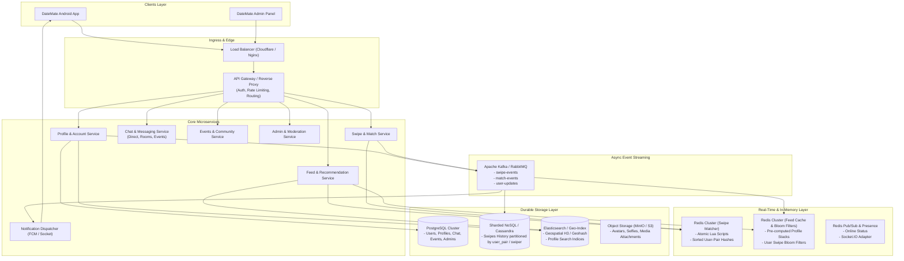
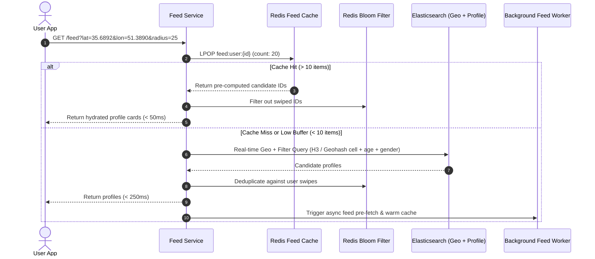

# DateMate High-Scale System Design & Business Logic Architecture
*(Modeled after HelloInterview Tinder System Design Breakdown)*

## 1. Executive Summary & Design Goals

The current DateMate architecture relies heavily on relational database queries (`SELECT * FROM users WHERE lat BETWEEN ... AND long BETWEEN ...`) and unified Socket.IO handlers on a single database. At scale (millions of users, billions of swipes, high concurrency), this creates severe bottlenecks:
1. **Feed Generation Bottleneck**: Inefficient bounding box SQL queries on relational databases cause high latency and database saturation.
2. **Race Conditions in Matching**: Concurrent mutual swipes can result in missed matches without strict atomicity.
3. **Write Saturation**: Swipes generate massive write throughput (20M DAU × 100 swipes/day = 2B writes/day) which degrades primary transactional databases.
4. **Feed Staleness & Deduplication**: Repeatedly showing already-swiped profiles or running expensive `NOT IN (SELECT swiped_id FROM ...)` queries.

This document redesigns DateMate's system architecture, API specifications, and business logic based on industry-proven patterns from **HelloInterview Tinder System Design**, while preserving DateMate's unique features (Events, Chatrooms, Admin Panel, WebRTC, Subscriptions).

---

## 2. Core Requirements & Non-Functional SLOs

### 2.1 Functional Requirements
1. **Profile & Preferences**: Users configure age range, interests, relationship goals, and search radius ($R_{max}$).
2. **Recommendation Feed**: Users receive a personalized, low-latency stack of candidate profiles based on location and preference filters.
3. **Atomic Swiping (Yes / No)**: Users swipe right (like) or left (pass). Immediate mutual match detection.
4. **Instant Match Notification**: Immediate in-app banner for the active swiper; low-latency push notification (FCM) for the passive swiper.
5. **No Duplicate Profiles**: Profiles a user already swiped on must not reappear in their feed.
6. **DateMate Platform Ecosystem**: Group chat rooms, community events, WebRTC 1-on-1 calls, Zarinpal payments, and Admin/Support moderation.

### 2.2 Non-Functional Requirements & Scale Estimation
- **Scale**:
  - Daily Active Users (DAU): **20 Million**
  - Average Swipes/User/Day: **100 swipes**
  - Total Daily Swipes: **2 Billion swipes/day** (~23,000 writes/sec average, ~70,000 writes/sec peak).
  - Feed Requests: ~20M DAU × 5 requests/day = 100M feed queries/day.
- **Latency**:
  - Feed / Stack Fetch: **< 300 ms (p99)**.
  - Swipe Processing & Match Evaluation: **< 50 ms (p99)**.
- **Consistency**:
  - **Strong Consistency** for swipe matching: If User A likes B and User B likes A at the same moment, the system must detect the match atomically without race conditions.
  - **Eventual Consistency** for profile updates, feed pre-computation, and historical analytics.
- **Availability**: High availability (99.99%) for reading feeds and recording swipes.

---

## 3. High-Level System Architecture



---

## 4. Deep Dive 1: Atomic Swipe & Match Engine

### 4.1 The Race Condition Problem
If User A and User B swipe right on each other simultaneously, traditional asynchronous or non-atomic systems check for an existing swipe in the database, find nothing, insert both swipes, and neither user receives a match notification.

### 4.2 Solution: Consistent Hashing with Sorted User-Pair Keys in Redis
To ensure both swipes ($A \to B$ and $B \to A$) hit the exact same Redis shard and partition, keys are constructed deterministically by sorting the user IDs:

$$\text{Key} = \text{"swipe:"} + \min(A, B) + \text{":"} + \max(A, B)$$

#### Redis Hash Structure:
- **Key**: `swipe:104:205` (where 104 < 205)
- **Field `104`**: `{"dir": "RIGHT", "ts": 1726830000}`
- **Field `205`**: `{"dir": "RIGHT", "ts": 1726830005}`
- **TTL**: 30 days (active window).

#### Atomic Lua Script Execution:
```lua
-- KEYS[1]: swipe:<min_id>:<max_id>
-- ARGV[1]: current_user_id
-- ARGV[2]: target_user_id
-- ARGV[3]: direction ('RIGHT' or 'LEFT')
-- ARGV[4]: timestamp

local current_user = ARGV[1]
local target_user = ARGV[2]
local direction = ARGV[3]
local timestamp = ARGV[4]

-- 1. Record current user swipe
redis.call('HSET', KEYS[1], current_user, cjson.encode({ dir = direction, ts = timestamp }))
redis.call('EXPIRE', KEYS[1], 2592000) -- 30 days TTL

-- 2. If current user passed (LEFT), no match possible
if direction ~= 'RIGHT' then
    return 'NO_MATCH'
end

-- 3. Check target user swipe
local target_data = redis.call('HGET', KEYS[1], target_user)
if target_data then
    local parsed = cjson.decode(target_data)
    if parsed.dir == 'RIGHT' then
        return 'MATCH'
    end
end

return 'NO_MATCH'
```

### 4.3 Asynchronous Persistence to Cassandra
Once the Lua script returns:
1. If `MATCH`:
   - Return `{ isMatch: true }` immediately in the HTTP / Socket response to the active swiper.
   - Publish `MatchEvent(userA, userB)` to Kafka topic `match-events`.
   - Notification Service dispatches FCM push to the passive user.
2. Publish `SwipeEvent` to Kafka topic `swipe-events`.
3. Background workers consume `swipe-events` and write asynchronously into Cassandra for long-term durable audit history:

```sql
CREATE TABLE datemate.swipes (
    user_pair text,           -- partition key: min(userA, userB):max(userA, userB)
    from_user_id bigint,      -- clustering key
    to_user_id bigint,        -- clustering key
    direction text,           -- 'RIGHT', 'LEFT'
    created_at timestamp,
    PRIMARY KEY ((user_pair), from_user_id, to_user_id)
) WITH CLUSTERING ORDER BY (from_user_id ASC);
```

---

## 5. Deep Dive 2: Sub-300ms Feed & Recommendation Generation

### 5.1 The Latency Challenge
Directly querying relational databases with `WHERE lat BETWEEN ... AND long BETWEEN ... AND age BETWEEN ...` results in full table scans or inefficient multi-column B-Tree index merges at 20M users.

### 5.2 Hybrid Solution: Pre-Computation + Geospatial Indexing (H3 / Geohash)



### 5.3 Feed Pre-Computation Strategy
1. **Active Users Window**: Background workers pre-compute feeds only for users active within the last 48 hours.
2. **Redis List Buffer**: Each active user has a Redis list `feed:user:{id}` containing 50–100 pre-scored user IDs.
3. **Threshold Re-fill**: When the client has swiped down to 15 remaining cards, the client sends an async background pre-fetch request to replenish the buffer.
4. **Handling Stale Feeds**:
   - TTL of cached feeds: **60 minutes**.
   - If user moves > 5 km or changes preference filters, invalidate `feed:user:{id}` and rebuild immediately.

---

## 6. Deep Dive 3: Preventing Duplicate Profiles (Bloom Filters)

### 6.1 The Scale of Deduplication
For a user who has swiped 10,000 times, sending a 10,000-element `NOT IN (...)` array to the database or doing set intersection on every feed request is prohibitive.

### 6.2 Solution: Client Cache + Server-Side Bloom Filters
1. **Client-Side Cache (Recent $K=200$ Swipes)**:
   - The mobile app maintains an in-memory set of the last 200 swiped IDs to eliminate any race condition where a swipe is in transit while a new feed chunk arrives.
2. **Server-Side Scalable Bloom Filter (RedisBF)**:
   - For each user, maintain a Bloom filter: `bf:swipes:{userId}`.
   - On every swipe: `BF.ADD bf:swipes:{userId} {targetUserId}`.
   - When generating/hydrating feed:
     - `BF.MEXISTS bf:swipes:{userId} candidateId1 candidateId2 ...`
     - O(1) time complexity, minimal memory (~1.2 bytes per item at 1% error rate).
   - **Zero False Negatives**: A Bloom filter never says "user hasn't swiped" if they actually did. It will never re-show an already-swiped user.

---

## 7. Business Logic & Domain Architecture

### 7.1 Domain Modules

| Module | Responsibilities | Data Store |
|---|---|---|
| **Identity & Auth** | Registration, Email OTP, Google & Apple OAuth, Play Integrity verification, JWT lifecycle. | PostgreSQL, Redis |
| **Profile & Preferences** | User demographics, lifestyle questions, interests catalog, photo uploads. | PostgreSQL, Elasticsearch, S3 |
| **Feed & Matching** | Geospatial recommendations, pre-computed stacks, atomic swipe matching. | Redis, Cassandra, Elasticsearch |
| **Messaging & Chat** | 1-on-1 direct messages, group chatrooms, community event discussions. | PostgreSQL, Redis (Pub/Sub) |
| **Signaling (WebRTC)** | SDP offer/answer exchange, ICE candidates, call state management. | Redis (ephemeral) |
| **Community Events** | Event creation, participant RSVPs, location-based event discovery. | PostgreSQL, Elasticsearch |
| **Monetization & Plans**| Zarinpal payment requests, subscription verification, premium quota enforcement. | PostgreSQL, Zarinpal PG |
| **Admin & Moderation** | Selfie verification, user bans, content moderation, restriction rule toggles. | PostgreSQL |

### 7.2 Business Restriction Rules
- **Selfie Verification Requirement**: If `chatroom_rule_selfie` or `event_rule_selfie` is enabled in `RestrictionSettings`, users with `profile_validated == false` cannot create rooms or events.
- **Onboarding Questions Requirement**: Users must complete onboarding questions if `chatroom_rule_questions` is enabled.
- **Daily Quotas for Non-Premium**:
  - Non-friends message quota: `message_count_not_friends` (tracked in Redis key `quota:msg:{userId}:{date}`).
  - Daily swipe quota: Configurable max swipes per 24 hours for free users.

---

## 8. REST & Real-Time API Specification

### 8.1 Feed & Swipe REST APIs

#### 1. `GET /api/v1/feed`
- **Headers**: `Authorization: Bearer <JWT>`
- **Query Parameters**:
  - `lat`: `35.6892` (float)
  - `lon`: `51.3890` (float)
  - `distance`: `25` (int, km, optional)
- **Response**:
```json
{
  "status": "success",
  "data": {
    "profiles": [
      {
        "userId": 205,
        "firstName": "Sara",
        "age": 24,
        "bio": "Love photography and coffee.",
        "avatarUrl": "https://media.appdatemate.com/avatars/205.jpg",
        "distanceKm": 4.2,
        "interests": ["Photography", "Hiking"],
        "isVerified": true
      }
    ],
    "hasMore": true
  }
}
```

#### 2. `POST /api/v1/swipes`
- **Headers**: `Authorization: Bearer <JWT>`, `Idempotency-Key: <UUID>`
- **Body**:
```json
{
  "targetUserId": 205,
  "direction": "RIGHT" // "RIGHT" (Like) or "LEFT" (Pass)
}
```
- **Response**:
```json
{
  "status": "success",
  "data": {
    "isMatch": true,
    "match": {
      "matchedAt": "2026-09-20T10:30:00Z",
      "targetUser": {
        "userId": 205,
        "firstName": "Sara",
        "avatarUrl": "https://media.appdatemate.com/avatars/205.jpg"
      }
    }
  }
}
```

---

## 9. Technology Stack Recommendation

| Component | Technology | Rationale |
|---|---|---|
| **API Framework** | **NestJS (Node.js LTS)** / Go | High throughput, TypeScript type safety with clients, modular architecture. |
| **Relational Database** | **PostgreSQL 16** | Robust transactional store for user profiles, transactions, and admin records. |
| **High-Throughput NoSQL**| **Cassandra** / ScyllaDB | Linearly scalable, write-optimized store for 2B+ daily swipes. |
| **In-Memory Store** | **Redis 7 (Cluster)** | Atomic Lua scripts for matching, RedisBF for Bloom filters, feed list caching. |
| **Geospatial & Search Engine** | **Elasticsearch / OpenSearch** | Fast geospatial bounding queries (H3 / Geohash) and multi-facet filtering. |
| **Event Streaming** | **Apache Kafka** | Decouples swipe ingestion, match notification dispatch, and persistence pipelines. |
| **Push Notifications** | **Firebase Admin SDK (FCM)** | Background device wake-up and real-time match alerts. |
| **Signaling & Chat** | **Socket.IO 4.x** with Redis Adapter | Dual-namespace support (`/` for users, `/admin` for panel operators). |

---

## 10. Summary & Transition Plan

1. **Phase 1: Swipe & Match Decoupling**: Introduce the Redis-based Lua atomic swipe engine and Kafka event bus to offload write traffic from PostgreSQL.
2. **Phase 2: Feed Architecture Upgrade**: Deploy Elasticsearch with geospatial indices and implement the pre-computed Redis feed cache with Bloom filters.
3. **Phase 3: Client Compatibility**: Ensure existing Android clients (`com.dmate.datemate` and `com.rzcode.datematepanel`) seamlessly interact with the new endpoints while maintaining backward compatibility with existing Socket.IO events.
